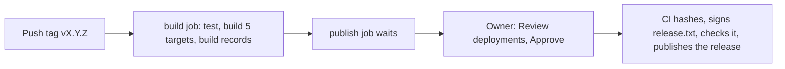

# Contributing

Thanks for helping. Phygital Key is free and open source under the [Apache-2.0](LICENSE) licence. Bug reports, fixes, test vectors and clearer docs are all welcome. Small, focused pull requests are the easiest to review.

## Reporting a problem

Click **New issue** on GitHub and pick a form:

| Form | Use it when |
|---|---|
| **Something doesn't work** | You hit a bug or an error |
| **Question** | You want to know how to do something |
| **Idea or feature** | You want something new or different |
| **Report a security problem, privately** | Someone could make a service act without a real yes. Only the maintainer sees it. See [SECURITY.md](SECURITY.md). |

Issues are public. Never paste your MCP access token, an enrollment link or a private key.

## Ground rules

1. **Test vectors are law.** A change to what a verifier accepts or refuses starts with new or changed vectors in `crates/phygital-key-testgen`, then code.
2. **Both verifiers, every time.** The Rust verifier and the JavaScript checker share no code, only [the spec](docs/spec.md) and `test-vectors/`. A change to what is accepted or refused lands in both, in the same pull request.
3. **Fail closed.** If something is unclear, the answer is no.
4. **No home-made crypto.** Use the existing RustCrypto crates in Rust and WebCrypto in JavaScript. `unsafe` code is forbidden in the workspace.
5. **No new dependencies without discussion.** Open an issue first. The licence must be on the `deny.toml` allowlist (Apache-2.0, MIT, BSD-2-Clause, BSD-3-Clause, ISC, Unicode-3.0, Zlib, CDLA-Permissive-2.0), and the crate must be maintained. The JavaScript checker has no dependencies and stays that way.
6. **No LLM** in the gate or the approval page, ever.
7. **Never weaken a defence** listed in the [threat model](docs/threat-model.md) without a test, a vector where it applies, and a clear note in the pull request.

Read [AGENTS.md](AGENTS.md) for how the code is laid out.

## Setup

You need Rust (stable, at least 1.89; the workspace uses edition 2024) and Node 20 or newer for the JavaScript checker and the end-to-end tests. Fuzzing needs nightly Rust.

```bash
git clone https://github.com/Phygital-Key/phygital-key-mcp
cd phygital-key-mcp
cargo build --workspace
```

## Run every check

These are the same checks CI runs on every push and pull request (see [testing](docs/testing.md)). Run them before you open a pull request.

Formatting, lints and tests:

```bash
cargo fmt --all --check
cargo clippy --workspace --all-targets -- -D warnings
cargo test --workspace
```

`cargo test` includes `installer_pins_at_least_one_release_key`, which fails until a release key is pinned in the installers (see [releasing](#releasing)). Every other test must pass.

Test vectors are up to date and deterministic:

```bash
cargo run -p phygital-key-testgen -- test-vectors && git diff --exit-code test-vectors
```

Licences, advisories, bans and sources:

```bash
cargo deny check
```

Fuzzing (needs nightly Rust and `cargo install cargo-fuzz`). CI runs each of the four targets for 60 seconds:

```bash
cd fuzz && cargo +nightly fuzz run verify -- -max_total_time=60
```

Replace `verify` with `strict_json`, `keyring_history` or `standing` for the others.

JavaScript checker (must pass the same vectors):

```bash
cd verifier-js && npm test
```

End-to-end and red team, with a real Chromium, a virtual passkey and the official MCP SDK (uses ports 17468 to 17488):

```bash
cargo build --release -p phygital-key
cd tests/e2e && npm ci && npx playwright install chromium
PKA_BIN=../../target/release/phygital-key node run.mjs
```

The secure install, including its automatic updates, is tested for real in CI on macOS and Linux (`tests/secure-install.sh`, 30 checks). It needs password-less sudo, so it runs only on CI machines. Do not set up password-less sudo on your own computer to run it.

CI also checks the examples:

```bash
node --check examples/node-service/server.mjs
cargo build --manifest-path examples/rust-service/Cargo.toml
```

## Changing the spec

1. Write the new rule in [docs/spec.md](docs/spec.md), with MUST or MUST NOT.
2. Add vectors for it in `crates/phygital-key-testgen`: at least one case that passes and one that is refused, at the exact edge.
3. Regenerate `test-vectors/` and commit the result.
4. Change the Rust verifier (`crates/phygital-key-verify`) until every vector passes.
5. Change the JavaScript checker (`verifier-js`) until every vector passes.
6. If the gate or the approval page is affected, add an end-to-end check in `tests/e2e/run.mjs`.
7. Write the reason in [docs/decisions.md](docs/decisions.md) when the change is a design choice.

## Releasing

Only the repository owner can make a release that installs, because only a release run the owner approved can use the release key. Installers and the secure install's daily update job accept a release only if its file list (`release.txt`) is signed by a key pinned in `crates/phygital-key/assets/install-service.sh` and `install.sh` (decision 36 in [decisions](docs/decisions.md)). The private key is the secret `RELEASE_SIGNING_KEY` of the GitHub environment `release`, and nowhere else.



Once, before the first signed release, the owner:

- [ ] Runs `scripts/release-key.sh` in a terminal (it refuses to run without one), with the GitHub CLI `gh` signed in as the owner and `openssl` installed. It makes one P-256 key in a temporary folder, creates the GitHub environment `release` (the owner as required reviewer, deployments only from tags `v*`), stores the private key as the environment secret `RELEASE_SIGNING_KEY`, deletes the local copy, and pins the public key in the two installers. It refuses if a key is already pinned.
- [ ] Commits the two changed installers.
- [ ] Protects the GitHub account with two-factor sign-in, ideally a passkey: whoever controls it can approve a release.

For each release:

1. Update the version (`Cargo.toml`, `verifier-js/package.json`, `CITATION.cff`, the default `VERSION` in `crates/phygital-key/assets/install-service.sh`) and add a `CHANGELOG.md` entry. CI must be green on `main`.
2. Push the tag `vX.Y.Z`. In `.github/workflows/release.yml`, the build job runs `cargo test` on each runner, builds the five targets, writes a `.sha256` for each archive and publishes a build provenance attestation (build record) for each archive with `actions/attest-build-provenance`.
3. Open the run in GitHub Actions. The `publish` job waits for the environment `release`. Press "Review deployments", then Approve.
4. The approved job computes the SHA-256 of every archive, writes and signs `release.txt`, checks the signature against the keys pinned in that commit's `install-service.sh` (it stops if none matches), and publishes the release with all files, `release.txt` and `release.txt.sig`. Nothing is published before the approval.
5. Write the package manifests with `scripts/package-manifests.sh vX.Y.Z` (Homebrew formula, Scoop manifest, winget manifests).

To replace the key, pin the new public key next to the old one in a release signed with the old key, then remove the old key in a later release.

> [!CAUTION]
> Never put the release key in the repository, a workflow file or anywhere else: it lives only in the environment secret. Approve a run only for a tag you pushed yourself. AI agents never run `scripts/release-key.sh` and never approve a release run.

## Docs style

Docs are read by people who approve actions, by developers and by AI agents.

- Plain, calm, exact. Short sentences, everyday words, "you". Explain a technical word the first time, or link the [glossary](docs/glossary.md).
- Every claim must be true today and traceable to the code or a command you ran. Show the check, the number or the command instead of praise words.
- Say what it does not do, near where it matters (signed, not encrypted; pre-audit).
- No em dashes. Use a period, comma, colon or parentheses.
- One term for one thing: approval, request, gate, verifier, key, keyring, standing approval, use token, revocation, receipt.
- Write the name exactly "Phygital Key". The program is `phygital-key`.
- Relative links between docs, and every link must resolve.

## Commits and pull requests

- One topic per commit. Start the summary with the area and a colon, then what changed, for example `Install: refuse a foreign listener before starting`.
- Say why in the body when it is not obvious.
- In the pull request, fill in the checklist and say which vectors or checks you added.

## Credit and licence

By contributing, you agree that your work is shared under the [Apache-2.0](LICENSE) licence, the same as the rest of the project. The [NOTICE](NOTICE) file and its line "Created by Phygital-Key" must stay in every copy and every modified version (Apache-2.0, section 4(d)); please do not remove or change it. [CITATION.cff](CITATION.cff) says how to cite the project.

## Security problems

Please report privately. See [SECURITY.md](SECURITY.md).
