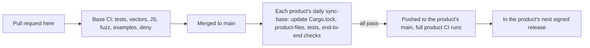

# Contributing

Thanks for helping. Phygital Key is free and open source under the [Apache-2.0](LICENSE) licence. Bug reports, fixes, test vectors and clearer docs are all welcome. Small, focused pull requests are the easiest to review.

This repository is the shared base: the verifiers, the gate engine, the spec, the test vectors and the shared docs. Changes to how one product talks to agents (for example the MCP tools) go to that product's repository: [phygital-key-mcp](https://github.com/Phygital-Key/phygital-key-mcp) or [phygital-key-a2a](https://github.com/Phygital-Key/phygital-key-a2a). Everything the products share is changed here, never in a product.

## Reporting a problem

Click **New issue** on GitHub and pick a form:

| Form | Use it when |
|---|---|
| **Something doesn't work** | You hit a bug or an error |
| **Question** | You want to know how to do something |
| **Idea or feature** | You want something new or different |
| **Report a security problem, privately** | Someone could make a service act without a real yes. Only the maintainer sees it. See [SECURITY.md](SECURITY.md). |

If you are not sure whether a problem is in the base or in a product, open it here. Issues are public. Never paste an access token, an enrollment link or a private key.

## Ground rules

1. **Shared behaviour lives here.** The approval page, keys, standing approvals, receipts, the audit log, the secure install, updates, the shared commands and the installer templates are changed only in this repository.
2. **Test vectors are law.** A change to what a verifier accepts or refuses starts with new or changed vectors in `crates/phygital-key-testgen`, then code.
3. **Both verifiers, every time.** The Rust verifier and the JavaScript checker share no code, only [the spec](docs/spec.md) and `test-vectors/`. A change to what is accepted or refused lands in both, in the same pull request.
4. **Fail closed.** If something is unclear, the answer is no.
5. **No home-made crypto.** Use the existing RustCrypto crates in Rust and WebCrypto in JavaScript. `unsafe` code is forbidden in the workspace.
6. **No new dependencies without discussion.** Open an issue first. The licence must be on the `deny.toml` allowlist (Apache-2.0, MIT, BSD-2-Clause, BSD-3-Clause, ISC, Unicode-3.0, Zlib, CDLA-Permissive-2.0), and the crate must be maintained. The JavaScript checker has no dependencies and stays that way.
7. **No LLM** in the gate or the approval page, ever.
8. **Never weaken a defence** listed in the [threat model](docs/threat-model.md) without a test, a vector where it applies, and a clear note in the pull request.

Read [AGENTS.md](AGENTS.md) for how the code is laid out.

## Setup

You need Rust (stable, at least 1.89; the workspace uses edition 2024) and Node 20 or newer for the JavaScript checker. Fuzzing needs nightly Rust.

```bash
git clone https://github.com/Phygital-Key/phygital-key
cd phygital-key
cargo build --workspace
```

## Run every check

These are the checks the base CI runs on every push and pull request (see [testing](docs/testing.md)). Run them before you open a pull request.

Formatting, lints and tests:

```bash
cargo fmt --all --check
cargo clippy --workspace --all-targets -- -D warnings
cargo test --workspace
```

Test vectors are up to date and deterministic:

```bash
cargo run -p phygital-key-testgen -- test-vectors && git diff --exit-code test-vectors
```

Licences, advisories, bans and sources:

```bash
cargo deny check
```

Fuzzing (needs nightly Rust and `cargo install cargo-fuzz`). CI runs each of the four targets for 60 seconds:

```bash
cd fuzz && cargo +nightly fuzz run verify -- -max_total_time=60
```

Replace `verify` with `strict_json`, `keyring_history` or `standing` for the others.

JavaScript checker (must pass the same vectors, and Wycheproof):

```bash
cd verifier-js && npm test
```

Cross-check with SimpleWebAuthn, an independent WebAuthn library:

```bash
cd crosscheck && npm ci && npm test
```

The installer scripts (ShellCheck, then the secure installer's release-list check, which needs `openssl`):

```bash
shellcheck -S warning crates/phygital-key-gate/assets/*.sh crates/phygital-key-gate/tests/*.sh
crates/phygital-key-gate/tests/release-lists.sh
```

Mutation testing of the verifier, by hand (about an hour):

```bash
cargo mutants --package phygital-key-verify
```

CI also checks the examples:

```bash
node --check examples/node-service/server.mjs
cargo build --manifest-path examples/rust-service/Cargo.toml
```

## Checks that run in the products

The base has no program, so some checks live in each product's repository and run there on every push and after every base update:

| Check | Phygital Key MCP |
|---|---|
| End-to-end and red team (real Chromium, a virtual passkey, the official MCP SDK; 124 checks) | `tests/e2e/run.mjs` |
| The approval page in Firefox and WebKit (16 checks) | `tests/e2e/browsers.mjs` |
| Abuse: floods, huge and slow requests, idle connections (16 checks) | `tests/e2e/abuse.mjs` |
| Secure install, for real on macOS and Linux, with its automatic updates (36 checks on Linux, 32 on macOS) | `tests/secure-install.sh` |
| Container image builds and starts | `packaging/container/Dockerfile` |
| Files made from the base templates are up to date | `phygital-key-mcp product-files --out .` then `git diff --exit-code` |

If you change the gate engine, the page or a template, run the product's end-to-end checks against your change before you open the pull request: build the product with its `phygital-key-gate` dependency pointing at your checkout, and follow that product's `CONTRIBUTING.md`. The secure-install test needs password-less sudo, so it runs only on CI machines. Do not set up password-less sudo on your own computer to run it.

## How a base change reaches the products



If a product's checks fail on a new base commit, `sync-base` keeps nothing and the product stays on the last good commit until the base is fixed. Fix it here.

## Changing the spec

1. Write the new rule in [docs/spec.md](docs/spec.md), with MUST or MUST NOT.
2. Add vectors for it in `crates/phygital-key-testgen`: at least one case that passes and one that is refused, at the exact edge.
3. Regenerate `test-vectors/` and commit the result.
4. Change the Rust verifier (`crates/phygital-key-verify`) until every vector passes.
5. Change the JavaScript checker (`verifier-js`) until every vector passes.
6. If the gate or the approval page is affected, add an end-to-end check in each product's `tests/e2e/run.mjs`.
7. Write the reason in [docs/decisions.md](docs/decisions.md) when the change is a design choice.

## Releases

The base makes no releases. Each product tags and signs its own releases in its own repository, with its own key in its own GitHub environment `release`. How that works, and what it protects: [updates](docs/updates.md) and the release section of each product's `CONTRIBUTING.md`. For a base change, add a `CHANGELOG.md` entry here.

## Docs style

Docs are read by people who approve actions, by developers and by AI agents.

- Plain, calm, exact. Short sentences, everyday words, "you". Explain a technical word the first time, or link the [glossary](docs/glossary.md).
- Every claim must be true today and traceable to the code or a command you ran. Show the check, the number or the command instead of praise words.
- Say what it does not do, near where it matters (signed, not encrypted; pre-audit).
- No em dashes. Use a period, comma, colon or parentheses.
- One term for one thing: approval, request, gate, verifier, key, keyring, standing approval, use token, revocation, receipt.
- Write the name exactly "Phygital Key", and the products "Phygital Key MCP" and "Phygital Key A2A". In shared docs, show commands with `phygital-key-mcp` and say that `phygital-key-a2a` takes the same ones; where names differ per product, use a small table with both.
- Shared guides live only here. Product repositories hold only product-specific guides and link here for the rest.
- Relative links between docs, and every link must resolve.

## Commits and pull requests

- One topic per commit. Start the summary with the area and a colon, then what changed, for example `Install: refuse a foreign listener before starting`.
- Say why in the body when it is not obvious.
- In the pull request, fill in the checklist and say which vectors or checks you added.

## Credit and licence

By contributing, you agree that your work is shared under the [Apache-2.0](LICENSE) licence, the same as the rest of the project. The [NOTICE](NOTICE) file and its line "Created by Phygital-Key" must stay in every copy and every modified version (Apache-2.0, section 4(d)); please do not remove or change it. [CITATION.cff](CITATION.cff) says how to cite the project.

## Security problems

Please report privately. See [SECURITY.md](SECURITY.md).
