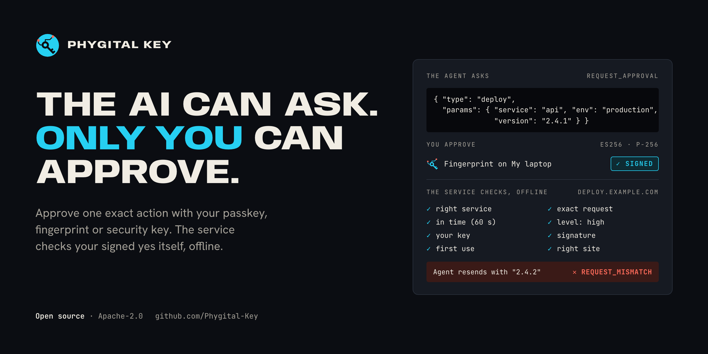
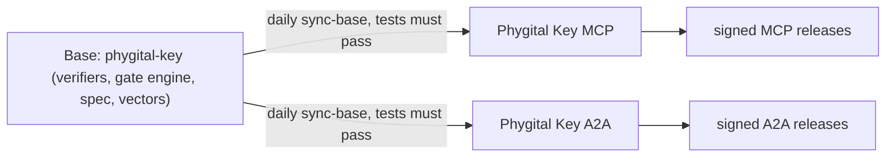
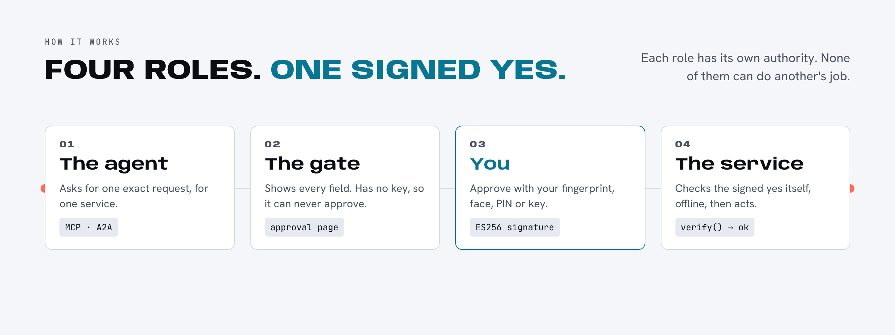
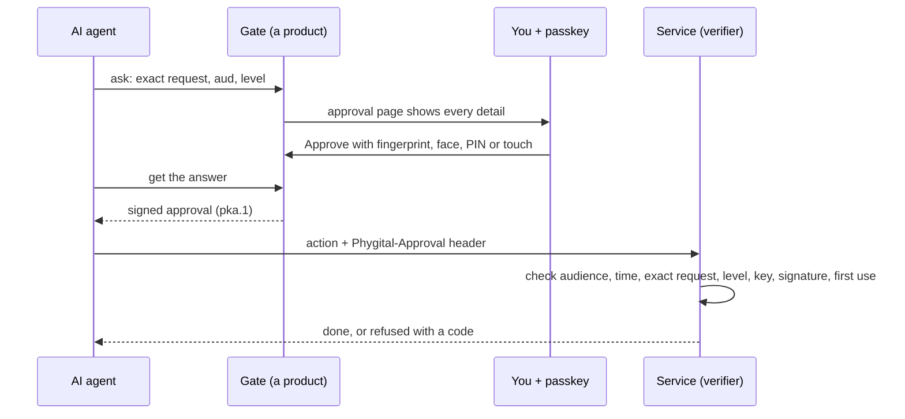
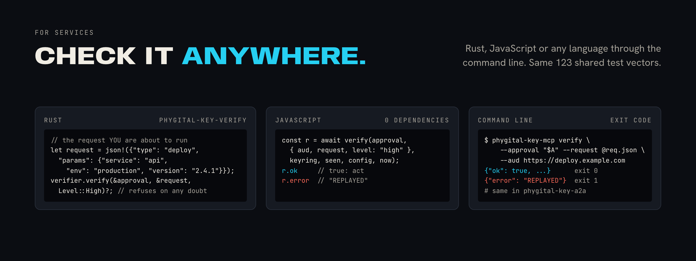
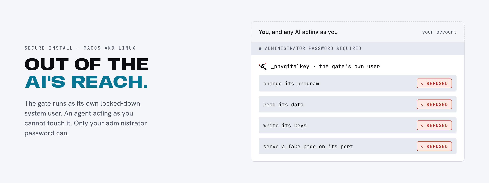
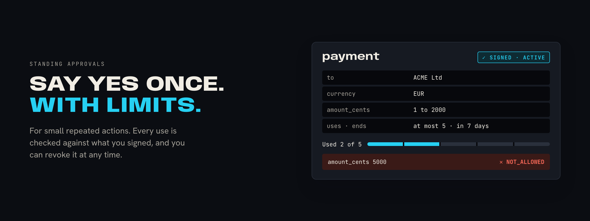
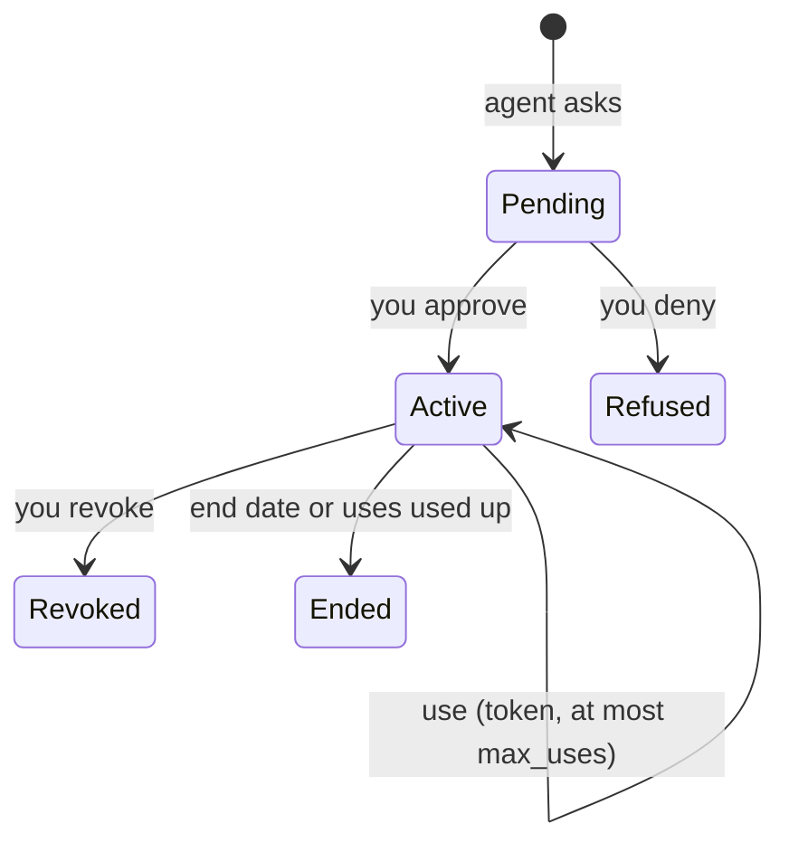

<p align="center"></p>

<h1 align="center">Phygital Key</h1>

<p align="center"><b>A person's signed yes, for one exact request, that anyone can check.</b><br>Before an AI agent deploys, pays, deletes or sends, you approve that exact action with a passkey, fingerprint or hardware key. The service checks your signature itself, offline.</p>

<h3 align="center">Pick your product</h3>

<p align="center">
<a href="https://github.com/Phygital-Key/phygital-key-mcp"></a>
<br>
<a href="https://github.com/Phygital-Key/phygital-key-a2a"></a>
</p>

<p align="center"><a href="https://github.com/Phygital-Key/phygital-key-mcp"><b>Phygital Key MCP</b></a>: AI apps ask through MCP. &nbsp;·&nbsp; <a href="https://github.com/Phygital-Key/phygital-key-a2a"><b>Phygital Key A2A</b></a>: other agents ask through A2A.<br>This repository is the shared base both are built on.</p>

<p align="center">
<a href="#open-source-and-credit"></a>
<a href="LICENSE"></a>
<a href="https://github.com/Phygital-Key/phygital-key/actions/workflows/ci.yml"></a>
<a href="Cargo.toml"></a>
<a href="https://github.com/Phygital-Key/phygital-key/stargazers"></a>
<a href="https://github.com/Phygital-Key/phygital-key/commits/main"></a>
<a href="https://scorecard.dev/viewer/?uri=github.com/Phygital-Key/phygital-key"></a>
</p>

<p align="center">
<a href="docs/webauthn.md"></a>
<a href="docs/testing.md"></a>
<a href="docs/secure-install.md"></a>
<a href="docs/threat-model.md"></a>
<a href="#signed-automatic-updates"></a>
<a href="Cargo.toml"></a>
<a href="docs/privacy.md"></a>
<a href="docs/ap2.md"></a>
</p>

<p align="center"><b>Free and open source under the Apache-2.0 license.</b> Use it, change it, sell it, build on it. Keep the <code>NOTICE</code> file. See <a href="#open-source-and-credit">Open source and credit</a>.</p>

<p align="center">
<a href="#products">Products</a> ·
<a href="#try-it-in-2-minutes">Quick start</a> ·
<a href="#check-approvals-in-your-service">Check approvals</a> ·
<a href="#safety-verification-and-authority">Safety</a> ·
<a href="docs/use-cases.md">Use cases</a> ·
<a href="#all-the-guides">All guides</a>
</p>

> [!WARNING]
> **Pre-audit.** No outside security firm has reviewed it yet. It has had eight independent AI security reviews with every finding fixed or documented as a limit, and it is tested on every change. Read the [threat model](docs/threat-model.md) before you rely on it.

<p align="center">

</p>

## Why it exists

An AI agent with tools can deploy code, move money and send messages. Most apps ask "Allow?" with a button inside the app. That click is not signed, so the service on the other end has no way to check that a person said yes, or to what.

Phygital Key gives the service proof it can check:

| Property | How it holds |
|---|---|
| **Can't be faked** | Only your key can sign (ES256 on P-256). The private key stays in your phone, laptop chip or security key. The AI never holds a key, and the gate has no signing key for approvals. |
| **Can't be changed** | Your signature covers the exact request in canonical form (RFC 8785). The service rebuilds the request it is about to run and compares it to the last character. One changed character gives `REQUEST_MISMATCH`. |
| **Can't be reused** | Each approval names one service (`aud`), lives 60 seconds by default and works once. A second use gives `REPLAYED`. |
| **Can't be phished** | Passkeys sign only for the real address of your approval page. A copy on another address gets nothing usable. |
| **Out of the AI's reach** | With the [secure install](docs/secure-install.md), the gate runs as its own locked-down system user. The AI, even acting as you, can't change its program, read its data or write its keys. Only your administrator password can. |
| **Checked offline** | The service needs your public keys and a few lines of code. No call home, no account, no cloud. |

## Products

You install a product. Each product is the same gate (approval page, keys, standing approvals, receipts, audit log, secure install, signed updates) with one agent protocol added.

| Product | For | Repository |
|---|---|---|
| **Phygital Key MCP** | AI apps that speak MCP (Claude Code, Claude Desktop and other MCP clients), over stdio or HTTP at `/mcp`. Program `phygital-key-mcp`, version 0.4.0. | [Phygital-Key/phygital-key-mcp](https://github.com/Phygital-Key/phygital-key-mcp) |
| **Phygital Key A2A** | Agents that speak A2A 1.0 (JSON-RPC at `/a2a`, agent card at `/.well-known/agent-card.json`). Program `phygital-key-a2a`. New and still being built. | [Phygital-Key/phygital-key-a2a](https://github.com/Phygital-Key/phygital-key-a2a) |

This repository is the base both products are built on. It publishes no programs and no releases: each product signs and publishes its own.

## What this repository holds

| Part | Path | What |
|---|---|---|
| Rust verifier | [`crates/phygital-key-verify`](crates/phygital-key-verify) | The library a service uses to check approvals: pure, offline, fail closed |
| JavaScript verifier | [`verifier-js/`](verifier-js) | An independent checker with no dependencies (Node 20+ and browsers) that passes the same vectors |
| Gate engine | [`crates/phygital-key-gate`](crates/phygital-key-gate) | Everything the products share: approval page, keys, standing approvals, receipts, audit log, secure install, signed updates and the shared commands |
| Open spec | [`docs/spec.md`](docs/spec.md) | The `pka.1` format and every check, so anyone can write another verifier |
| Test vectors | [`test-vectors/`](test-vectors) | 123 cases every verifier must pass, made by [`crates/phygital-key-testgen`](crates/phygital-key-testgen) |
| Fuzzing | [`fuzz/`](fuzz) | 4 fuzz targets |
| Examples | [`examples/`](examples) | Runnable services in Node and Rust, and a CI approval step |
| Docs | [`docs/`](docs) | Every shared guide |

## How products build on the base

A product is a small program: it names itself (a `Product`: name, program, port, repository, pinned release keys) and adds its agent protocol as an `Adapter`. Everything else comes from `phygital-key-gate`. The installers, the secure-install test and the release scripts are templates in the base; each product writes its own copies with `product-files`, and its CI fails if they differ.

Every day, each product's `sync-base` workflow moves to the latest commit of this repository's `main` branch. It keeps the update only if the product's tests and end-to-end checks pass, then pushes it and starts the product's full CI. A fix made here reaches every product the next day, through that product's own tests. Details: [architecture](docs/architecture.md#the-base-and-the-products).



## How it works

<p align="center"></p>



Four roles, each with its own authority:

| Role | Decides | Can never |
|---|---|---|
| **You** (the approver) | Yes or no, on the exact request shown | Be skipped: no key, no approval |
| **The agent** (requester) | What to ask for | Approve, sign, or change a request after you sign |
| **The gate** | Shows the request and collects your signature | Sign an approval on its own |
| **The service** (verifier) | Its own audience, the request it runs, the level each action needs, which keys it trusts | Accept a request you did not sign |

More: [how it works](docs/how-it-works.md), [architecture](docs/architecture.md), [the open spec](docs/spec.md).

## Try it in 2 minutes

With Phygital Key MCP (every way to install it: [getting started](docs/getting-started.md)):

```bash
brew install phygital-key/tap/phygital-key-mcp
phygital-key-mcp demo
```

The demo starts the gate on `http://localhost:7468` and a fake service on `http://localhost:7469` that acts only with a valid approval. It prints a one-time link (valid 10 minutes) to add your passkey (Touch ID, Windows Hello, your phone or a security key) and the line to connect Claude Code with the access token:

```bash
claude mcp add --transport http phygital-key-mcp http://localhost:7468/mcp --header "Authorization: Bearer <token>"
```

Then ask your AI app: *"Deploy api 2.4.1 to production through the demo service at http://localhost:7469."* An approval page opens. Approve, and the demo service deploys (nothing real happens). Deny, and it refuses.

Connecting other AI apps: [connect your AI app](https://github.com/Phygital-Key/phygital-key-mcp/blob/main/docs/connect-your-ai.md).

## What you see

<p align="center">


</p>

The approval page is built by the gate from the canonical request, never from text the agent wrote. It shows every field, warns about look-alike, invisible or extra-space characters, and shows the SHA-256 fingerprint of the exact text you sign. Before it asks your key to sign, it checks that what it shows is what will be signed. The page is part of the base, so every product shows the same one. Reading the page: [approving](docs/approving.md). How the page protects you: [approval page](docs/approval-page.md).

## Check approvals in your service

<p align="center"></p>

The service is the verifier. It checks the approval against the request **it** is about to run, built from its own data. The check is the same whichever product made the approval.

**Rust:**

```rust
use phygital_key_verify::{Config, Keyring, Level, Verifier};

let verifier = Verifier::new(
    "https://deploy.example.com",                                     // your audience
    Keyring::from_json(&std::fs::read_to_string("keyring.json")?)?,   // trusted keys: `phygital-key-mcp keys`
    Config { origins: vec!["https://approve.example.com".into()], rp_ids: vec!["approve.example.com".into()] },
);
let request = serde_json::json!({"type": "deploy", "params": {"service": "api", "env": "production", "version": "2.4.1"}});
verifier.verify(&approval, &request, Level::High)?; // refuses on any doubt
// ...now deploy.
```

**JavaScript** (Node 20+ or a browser, no dependencies): the independent checker in [`verifier-js/`](verifier-js) passes the same 123 test vectors.

**Any language:** call the command line of an installed product and check the exit code (`phygital-key-a2a verify` takes the same options).

```bash
phygital-key-mcp verify --approval "$APPROVAL" \
  --request '{"type":"deploy","params":{"service":"api","env":"production","version":"2.4.1"}}' \
  --aud https://deploy.example.com --level high
```

Exit 0 with `{"ok": true, ...}` means go. Exit 1 with `{"ok": false, "error": "REQUEST_MISMATCH"}` means no. Used approvals are remembered in a local file, so each works once.

Full guide: [integrate](docs/integrate.md). Per language: [Rust](docs/verifier-rust.md), [JavaScript](docs/verifier-js.md), [command line](docs/cli.md). Runnable code: [examples](examples/README.md).

## Safety, verification and authority

### What the service checks, in order

The verifier fails closed. The first failed check refuses the approval with a code.

| Step | Check | Refused with |
|:-:|---|---|
| 1 | Present, strict JSON, known fields, sizes and depth | `APPROVAL_REQUIRED`, `MALFORMED` |
| 2 | Approved for this service (`aud`) | `WRONG_AUDIENCE` |
| 3 | In time: not before `iat` (30 s skew), not after `exp`, life at most 300 s | `EXPIRED` |
| 4 | The exact request, byte for byte in canonical form | `REQUEST_MISMATCH` |
| 5 | The level this action needs (`medium` touch, `high` fingerprint, face or PIN) | `ASSURANCE_TOO_LOW` |
| 6 | Signed by a key in your keyring, for the right site | `UNTRUSTED_KEY` |
| 7 | The WebAuthn assertion: type, challenge, origin, site hash, ES256 signature | `BAD_SIGNATURE` |
| 8 | Presence and verification flags match the level | `ASSURANCE_TOO_LOW` |
| 9 | First use (seen store) | `REPLAYED` |

Every code, with causes and what to do: [error codes](docs/error-codes.md).

### The cryptography

Your key signs a challenge that commits to every claim:

$$\text{challenge} = \mathrm{SHA256}\big(\texttt{"phygital-key/approval/v1"} \,\|\, \texttt{0x00} \,\|\, \mathrm{JCS}(\text{claims})\big)$$

The claims hold the request, its hash, the audience, the level and the times. JCS is the canonical JSON form from RFC 8785, so every checker computes the same bytes. Text that is not already in Unicode NFC is refused, never rewritten, so two different strings can never share one approval.

| Part | Algorithm |
|---|---|
| Signature | ES256 (ECDSA on P-256 with SHA-256), WebAuthn assertion |
| Hashes | SHA-256 |
| Canonical form | RFC 8785 (JCS), strict JSON, safe integers only, no floats |
| Receipts and use tokens | ES256 JWS |
| Audit log | SHA-256 hash chain |
| Release lists | ECDSA P-256 (SHA-256) over `release.txt` |

> [!NOTE]
> Approvals are **signed, not encrypted**. The gate, the service and anyone holding an approval can read the request. Keep passwords and card numbers out of requests. Use HTTPS for any gate that is not on `localhost`. Why: [decision 33](docs/decisions.md).

Deep dives: [canonical form](docs/canonical-form.md), [WebAuthn checks](docs/webauthn.md), [key history](docs/key-history.md), [audit log](docs/audit-log.md).

### Who decides which keys count

Every key you add or remove is itself an approval, signed by a key you already trust. Your first key signs itself. Share that first key's fingerprint once, and anyone can check your whole key history. A service keeps the copy it accepted, so an old copy or a branch signed by a removed key is refused:

```bash
phygital-key-mcp keys --check <fingerprint> --file new.json --signed-on https://approve.example.com --previous accepted.json
```

### Out of the AI's reach

<p align="center"></p>

An AI agent on your computer runs as you, so it could edit files you own. The secure install moves the gate out of that reach (macOS and Linux). Each product publishes its own installer; for Phygital Key MCP, from a fresh terminal:

```bash
curl -q -fsSL https://raw.githubusercontent.com/Phygital-Key/phygital-key-mcp/v0.4.0/install-service.sh | sudo bash
```

It downloads the official release itself, checks it against the signed release list, installs it into root-owned folders, starts it as its own system user (`_phygitalkeymcp` on macOS, `phygitalkey-mcp` on Linux), and refuses to run if any other program listens on the gate's port. Then:

```bash
phygital-key-mcp-admin enroll      # add your key
phygital-key-mcp-admin token       # the line to paste into your AI app
phygital-key-mcp-admin status      # check that the real gate is the one answering
```

Each admin command asks for your administrator password. Phygital Key A2A installs the same way with its own names (`phygital-key-a2a-admin`). Details, folders, the names per product and every refusal: [secure install](docs/secure-install.md).

### Signed automatic updates

The secure install updates itself once a day, and installs a release only if all of this holds:

- [x] Its file list and SHA-256 sums (`release.txt`) are signed (ECDSA P-256) by a release key pinned in that product's program and installers. Each product has its own key, a secret of the GitHub environment `release` in that product's repository, which only a release run from a `v*` tag can use. Only repository admins can push those tags, so a swapped file, a mirror or a stolen workflow token cannot push an update. Someone who takes over the owner's GitHub account could, with a tag push alone, since releases need no approval click for now ([the update channel](docs/threat-model.md#the-update-channel)); turn automatic updates off if you would rather install each release yourself.
- [x] It is newer than the installed version. Older or unsigned releases are never installed.
- [x] No standing approval is active (a restart would end them). It waits up to 7 days for that, counted from the first wait on the installed version, then installs anyway. Requests still waiting for you do not hold an update back.
- [x] The new gate starts and passes its checks. Otherwise the previous program comes back. A program that takes the gate's port during the restart is stopped and the gate started again.
- [x] Root runs with a clean environment: your `~/.curlrc` and the programs in your `PATH` are never used.

`phygital-key-mcp-admin status` shows the last result, `phygital-key-mcp-admin update` updates now, and `--no-auto-update` turns it off. Every way to install and update: [updates](docs/updates.md). Why: [decision 36](docs/decisions.md).

> [!IMPORTANT]
> The secure install protects the gate only if your administrator password is out of the agent's reach. Run it from a terminal you trust, and do not allow `sudo` without a password for your user.

### How it is tested

| Layer | Where | What |
|---|---|---|
| Shared test vectors | Base | 123 cases (55 approvals, 25 key histories, 43 standing approvals) that the Rust and JavaScript checkers must both pass |
| Property tests | Base | 6 properties, 2000 random cases each |
| Fuzzing | Base | 4 targets (verifier, strict parser, key history, standing), 60 s each in CI |
| Mutation testing | Base | `cargo-mutants` on the verifier; surviving mutants became tests |
| Supply chain | Base | `cargo-deny`: advisories and a licence allowlist |
| End to end | Each product | Phygital Key MCP: 108 checks with real Chromium, a virtual passkey and the official MCP SDK, including attacks |
| Secure install | Each product | 30 checks: installed for real on macOS and Linux in the product's CI, then attacked as the user; update job, signature refusal, a planted `~/.curlrc` and `PATH`, and switch-back checked |

The base CI runs on every push on Linux, macOS and Windows. Each product's CI runs its own checks on every push, and again after each daily base update. Details: [testing](docs/testing.md), [security reviews](docs/security-reviews.md), [threat model](docs/threat-model.md). Found a problem? [Report it privately](SECURITY.md).

## Standing approvals

<p align="center"></p>

For small repeated actions, approve once, with limits:

> Allow **payment** to **ACME Ltd** in **EUR**, **up to 20.00** each, **at most 5 times**, **for 7 days**.

For each action the agent gets a one-minute use token and sends it with the standing approval (`Phygital-Approval` and `Phygital-Use` headers). The service checks both with `verify_use` and counts the uses itself. Another payee, a bigger amount or an extra field is refused with `NOT_ALLOWED`. Standing approvals always need fingerprint, face or PIN.

Revoke on the approval page at any time. New uses stop at once, and one more touch signs a revocation that services read from `/.well-known/phygital-key-revoked.json`.



Guides: [for people](docs/standing-approvals.md), [for services](docs/integrate.md), [revocations](docs/revocations.md).

## Receipts

After acting, a service can answer with a signed receipt ("done" or "failed"). The agent passes it back to the gate, and your approval page shows it only if the service's pinned key signed it:

```bash
phygital-key-mcp trust-service --aud https://deploy.example.com --key <its receipt_public_key>
```

Format and checks: [receipts](docs/receipts.md).

## Use cases

| Who | Example |
|---|---|
| AI coding agents | Production deploys, database deletes, infrastructure changes |
| Payments | A large one-time payment, or small repeated payments under a standing approval |
| Messages | Email or chat sent on your behalf |
| CI pipelines | A release job that waits for a person's signed yes before publishing |
| Company to company | A supplier's agent asks a buyer's person to approve an order |
| Person to system | A door or device that checks an approval offline with a keyring file |

Each one with the exact request, audience and level: [use cases](docs/use-cases.md).

## All the guides

Shared guides live here. Guides for one product (connecting AI apps, its agent tools, prompts) live in that product's repository.

| For | Guide |
|---|---|
| **Everyone** | [Getting started](docs/getting-started.md) · [How it works](docs/how-it-works.md) · [Use cases](docs/use-cases.md) · [FAQ](docs/faq.md) · [Glossary](docs/glossary.md) |
| **People who approve** | [Approving](docs/approving.md) · [Keys and devices](docs/keys-and-devices.md) · [Standing approvals](docs/standing-approvals.md) · [Privacy](docs/privacy.md) · [Troubleshooting](docs/troubleshooting.md) |
| **Running the gate** | [Secure install](docs/secure-install.md) · [Your own server](docs/own-server.md) · [Updates](docs/updates.md) · [Reference](docs/reference.md) · [Audit log](docs/audit-log.md) |
| **Services** | [Integrate](docs/integrate.md) · [Rust](docs/verifier-rust.md) · [JavaScript](docs/verifier-js.md) · [Command line](docs/cli.md) · [Error codes](docs/error-codes.md) · [Receipts](docs/receipts.md) · [Revocations](docs/revocations.md) · [Key history](docs/key-history.md) · [Examples](examples/README.md) |
| **Security** | [Threat model](docs/threat-model.md) · [Security reviews](docs/security-reviews.md) · [Testing](docs/testing.md) · [Report a problem](SECURITY.md) |
| **Internals** | [Spec (`pka.1`)](docs/spec.md) · [Architecture](docs/architecture.md) · [Canonical form](docs/canonical-form.md) · [WebAuthn](docs/webauthn.md) · [Approval page](docs/approval-page.md) · [Test vectors](test-vectors/README.md) · [Decisions](docs/decisions.md) · [AGENTS.md](AGENTS.md) |
| **Context** | [AP2 mapping](docs/ap2.md) · [Research](docs/research.md) · [Roadmap](docs/roadmap.md) · [Changelog](CHANGELOG.md) |
| **Phygital Key MCP** | [Repository](https://github.com/Phygital-Key/phygital-key-mcp) · [Connect your AI app](https://github.com/Phygital-Key/phygital-key-mcp/blob/main/docs/connect-your-ai.md) · [MCP tools](https://github.com/Phygital-Key/phygital-key-mcp/blob/main/docs/tools.md) · [Agents guide](https://github.com/Phygital-Key/phygital-key-mcp/blob/main/docs/agents.md) · [Things to ask](https://github.com/Phygital-Key/phygital-key-mcp/blob/main/docs/examples.md) · [Prompt snippets](https://github.com/Phygital-Key/phygital-key-mcp/blob/main/examples/agent-prompts.md) |
| **Phygital Key A2A** | [Repository](https://github.com/Phygital-Key/phygital-key-a2a) · [Getting started](https://github.com/Phygital-Key/phygital-key-a2a/blob/main/docs/getting-started.md) · [Connect your agent](https://github.com/Phygital-Key/phygital-key-a2a/blob/main/docs/connect-your-agent.md) · [Protocol](https://github.com/Phygital-Key/phygital-key-a2a/blob/main/docs/protocol.md) · [Extension](https://github.com/Phygital-Key/phygital-key-a2a/blob/main/docs/extension.md) · [Testing](https://github.com/Phygital-Key/phygital-key-a2a/blob/main/docs/testing.md) |

## Privacy

The gate keeps its data in one folder (`~/.phygital-key-mcp` for Phygital Key MCP, or a root-only folder after the secure install): the public keyring, a hash-chained audit log (ids, hashes and results, never the request itself), pinned service keys, signed revocations and the access token for the agent endpoint. Waiting requests live only in memory. No analytics, no accounts, no network calls. The fonts are built into the program, so the approval page loads nothing from outside. More: [privacy](docs/privacy.md).

## Open source and credit

Phygital Key is free and open source under the [Apache-2.0](LICENSE) license, the base and every product. You can use it at home or at work, change it, ship it in a product and sell that product. You can read every line that handles your approvals, and check the release you run against its signed SHA-256 list.

The one thing to keep: the [`NOTICE`](NOTICE) file, with the line "Created by Phygital-Key", in every copy or changed version (Apache-2.0, section 4(d)).

Contributions are welcome under the same license: see [CONTRIBUTING.md](CONTRIBUTING.md). Shared behaviour is changed here, never in a product. The format is an open spec ([`pka.1`](docs/spec.md)), so anyone can write another verifier and test it against the shared vectors.

## No warranty

Provided "as is", without warranty of any kind, as the [license](LICENSE) says. It is pre-audit: test it with the demo first, read the [threat model](docs/threat-model.md), and keep a second key enrolled.

## License

[Apache-2.0](LICENSE). Created by Phygital-Key.
