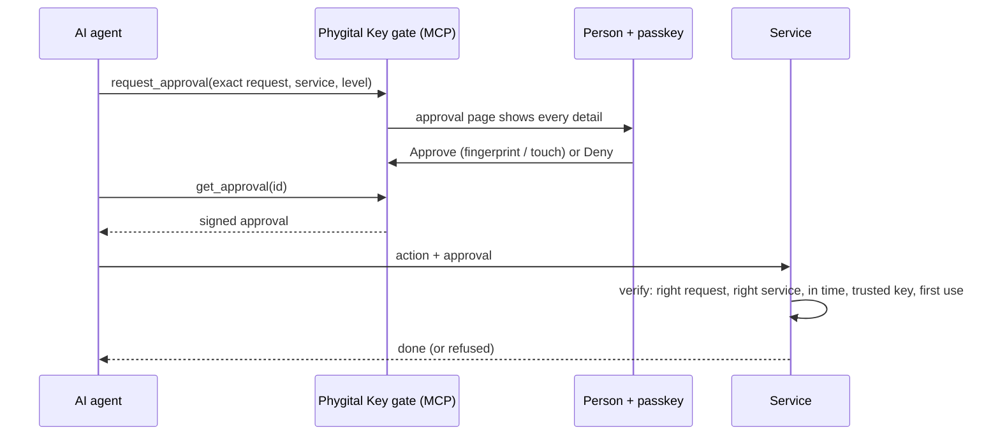

# Phygital Key

**A person's signed yes, for one exact request, that anyone can check.**

Before an AI agent (or any app, business or person) does something that matters, like deploying code, paying, deleting data or sending a message, a person approves **that exact action** with a passkey, fingerprint, face unlock or hardware key. The service that runs the action checks the signed approval itself, offline, in a few lines of code.

- **Can't be faked:** only the person's own key can sign. The AI never holds a key.
- **Can't be changed:** change one character of the request and the approval is refused.
- **Can't be reused:** each approval works once, for one service, for 60 seconds.
- **Works anywhere:** passkeys run on almost every phone, laptop and security key. One small program, no account, no cloud.

> [!WARNING]
> Pre-audit. No outside security review has happened yet. Read the [threat model](docs/threat-model.md) before using it for anything real.



## Try it in 2 minutes

You need [Rust](https://rustup.rs) (or download a ready binary from [Releases](../../releases)).

```bash
cargo install --locked --git https://github.com/s17sh70x2jfl031ag/phygital-key-mcp phygital-key
phygital-key demo
```

`demo` starts the gate on `http://localhost:7468` and a fake service on `http://localhost:7469` that only acts with a valid approval. It prints a link: open it and add your passkey (Touch ID, Windows Hello, your phone or a security key).

Connect your AI app to `http://localhost:7468/mcp` (Claude Code: `claude mcp add --transport http phygital-key http://localhost:7468/mcp`), then ask it: *"Deploy api 2.4.1 to production through the demo service at http://localhost:7469."* You will get a page to approve or deny. Nothing real ever happens in the demo.

## Connect an AI app

The gate is a normal MCP server. Two ways to run it:

| Your app | How |
|---|---|
| Launches local servers (Claude Code, Claude Desktop, Cursor, most apps) | command `phygital-key mcp` |
| Connects to a URL | run `phygital-key serve`, then use `http://localhost:7468/mcp` |

Claude Code:

```bash
claude mcp add phygital-key -- phygital-key mcp
```

Claude Desktop (`claude_desktop_config.json`), and most other apps take the same shape:

```json
{ "mcpServers": { "phygital-key": { "command": "phygital-key", "args": ["mcp"] } } }
```

Add your key once: `phygital-key enroll` prints a one-time link (valid 10 minutes).

The agent gets three tools: `request_approval`, `get_approval`, `cancel_approval`. It can ask, wait and cancel. It can never approve.

## Check approvals in your service

**Rust**, in about five lines:

```rust
use phygital_key_verify::{Config, Keyring, Level, Verifier};

let verifier = Verifier::new(
    "https://deploy.example.com",                       // who you are (the approval's audience)
    Keyring::from_json(&std::fs::read_to_string("keyring.json")?)?, // trusted keys: `phygital-key keys`
    Config { origins: vec!["https://approve.example.com".into()], rp_ids: vec!["approve.example.com".into()] },
);
let request = serde_json::json!({"type": "deploy", "params": {"service": "api", "env": "production", "version": "2.4.1"}});
verifier.verify(&approval, &request, Level::High)?; // refuses on any doubt
// ...now deploy.
```

**Any language:** call the command line and check the exit code.

```bash
phygital-key verify --approval "$APPROVAL" --request '{"type":"deploy","params":{"service":"api","env":"production","version":"2.4.1"}}' --aud https://deploy.example.com --level high
```

It prints `{"ok": true, ...}` and exits 0, or prints `{"ok": false, "error": "REQUEST_MISMATCH"}` and exits 1. (The command line cannot remember used approvals, so record each `id` yourself, or use the library.)

**Give services your public keys:** `phygital-key keys` prints them, and the gate serves them at `/.well-known/phygital-key.json`. They are public key cards only. Private keys never leave your devices.

## Levels

| Level | For | You do |
|---|---|---|
| `medium` | Edits, messages, small orders | Touch your key |
| `high` | Production deploys, deletes, money, contracts | Fingerprint, face or PIN |

The **service** decides the level it needs. An agent asking for less is refused.

## Run it for real

Passkeys need `https` (or `localhost`). Put the gate behind any TLS proxy and tell it its public address:

```bash
phygital-key serve --origin https://approve.example.com
```

Run the gate where the AI agent cannot change its files (another machine, or another OS user). See [where to run it](docs/threat-model.md#where-to-run-it-important).

## What is inside

| Path | What |
|---|---|
| [`docs/spec.md`](docs/spec.md) | The open spec (PKA v0.1): format, checks, error codes |
| [`crates/phygital-key-verify`](crates/phygital-key-verify) | The verifier library. Pure, offline, fail closed |
| [`crates/phygital-key`](crates/phygital-key) | The gate: MCP server, approval page, enrollment, audit log, demo |
| [`test-vectors/`](test-vectors) | 48 shared test cases every implementation must pass |
| [`tests/e2e/`](tests/e2e) | End-to-end and red-team tests: real browser, virtual passkey, real MCP client |
| [`docs/threat-model.md`](docs/threat-model.md) | What it defends against, what it trusts, known limits |
| [`docs/decisions.md`](docs/decisions.md) | Why each choice was made |
| [`docs/research.md`](docs/research.md) | Landscape: AP2, MCP, similar projects |

## Data and privacy

The gate keeps three things in its data folder (`~/.phygital-key`): the public keyring, a hash-chained audit log (ids, hashes and results, never the request itself) and, briefly, a one-time enrollment token. Pending requests live only in memory. No analytics, no third-party scripts, no network calls.

## Status

v0.1: single approver, one approval per action, MCP adapter. Next: Python and JavaScript wrappers of the same verifier, standing approvals, 2-of-3 approvers, and end-to-end encrypted requests. See the [spec](docs/spec.md#11-open-questions).

## License

[Apache-2.0](LICENSE).
