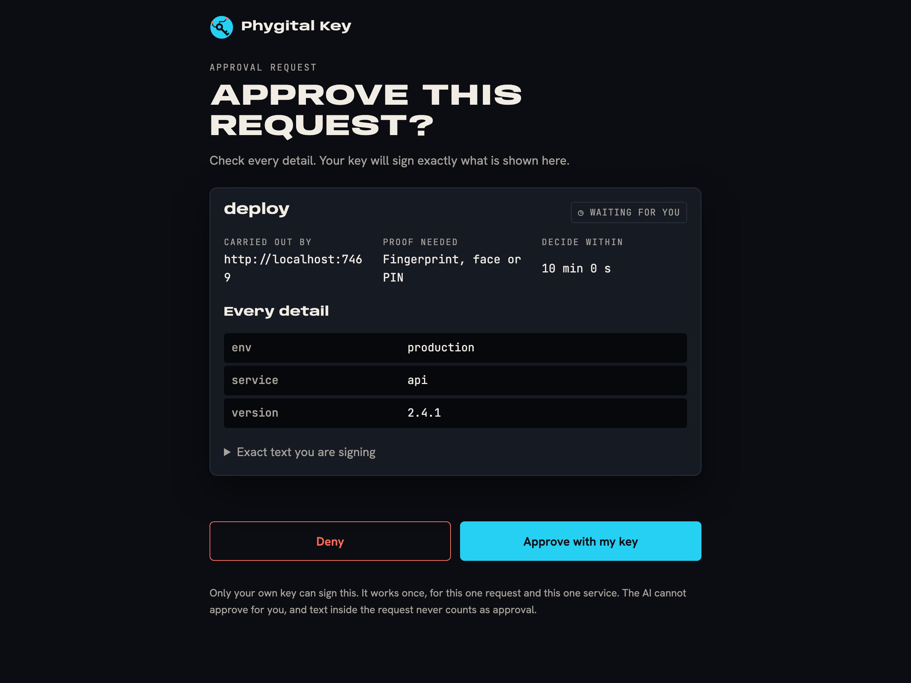
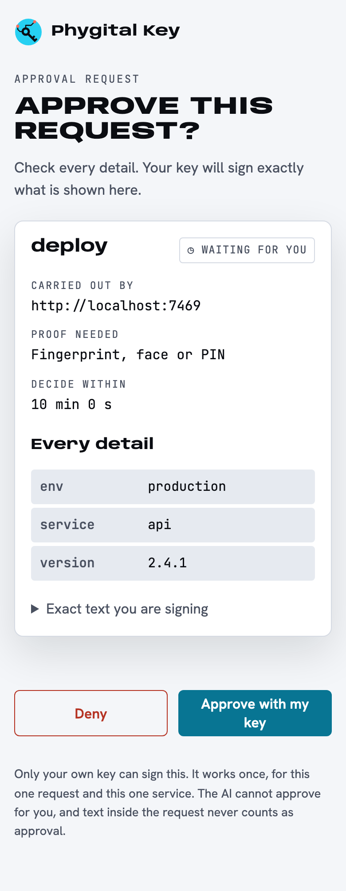
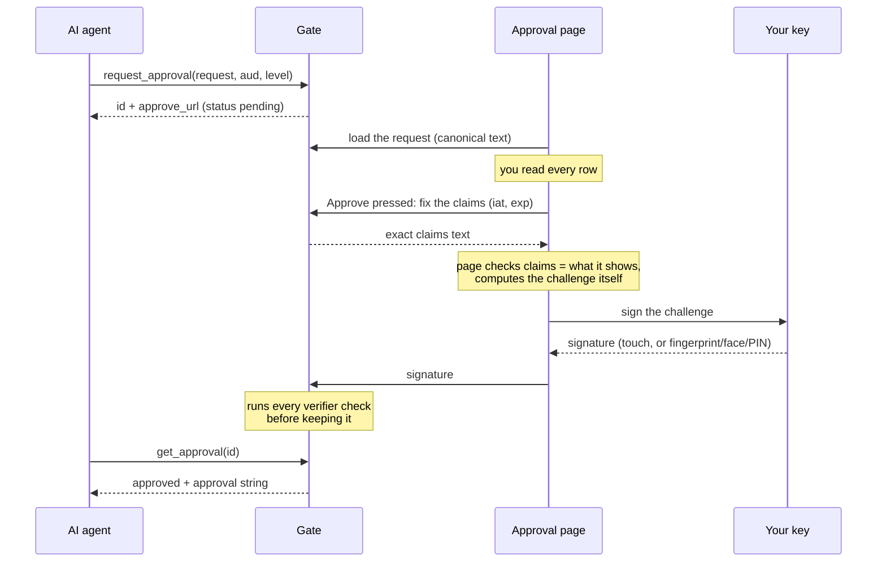
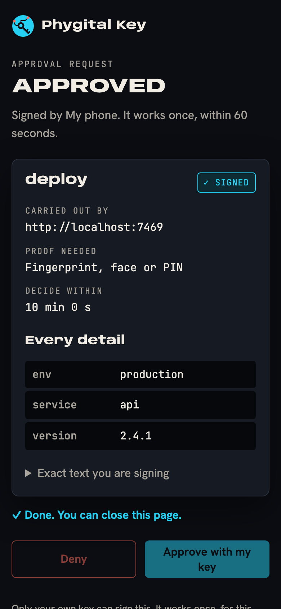
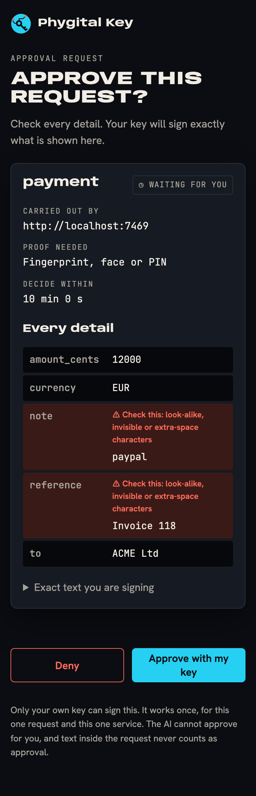

# Approving a request

When an AI asks the gate for an [approval](glossary.md), you get a link to the approval page. This page walks through that page from top to bottom, says what happens when you press each button, and lists what you should never approve.

**On this page:** [the page at a glance](#the-page-at-a-glance) · [title](#the-title) · [card title](#the-card-title) · [stamp](#the-stamp) · [carried out by, proof needed, decide within](#carried-out-by-proof-needed-decide-within) · [every detail](#every-detail) · [check this](#check-this-warnings) · [exact text](#exact-text-you-are-signing) · [approve or deny](#approve-or-deny) · [the 60 seconds](#the-60-seconds-after-approve) · [closing the page](#if-you-close-the-page) · [phone](#approving-with-your-phone) · [never approve](#what-to-never-approve)

## The page at a glance





The page is served by the gate itself, from your computer (or your [own server](own-server.md)). It is plain HTML and JavaScript with no outside scripts, fonts or images, and no AI writes any of its text: everything you read comes from the exact request the gate stored.



## The title

The large heading tells you what kind of decision this is.

| Title | When |
|---|---|
| Approve this request? | An action an outside service will carry out |
| Give a standing permission? | A [standing approval](standing-approvals.md): limited uses for some days |
| Confirm your key | Your very first key signs itself ([keys and devices](keys-and-devices.md#your-first-key)) |
| Approve a new key? | Someone is adding a key to your keyring |
| Remove this key? | A key is about to be removed from your keyring |
| Tell the service it is revoked? | The second step of revoking a standing approval |

After a decision the title changes to **Approved**, **Denied**, **Cancelled**, **Expired**, **Standing permission active**, **Revoked here** (a standing approval revoked on the gate, revocation not signed yet) or **Revoked** (revocation signed). A wrong link shows **Request not found** with "This link is wrong or the request was removed."

## The card title

The heading inside the card is the request type: the `type` field of the request, for example `deploy`, `payment` or `send_message`. The requester chooses it (1 to 64 characters from `a-z 0-9 _ . -`), so read it as a label, and read the rows below for what it really does.

The gate replaces the type with a plain sentence for its own requests: **Trust this key (your first key)**, **Add a new key to your trusted keys**, **Remove a key from your trusted keys**, **Standing permission for: payment**, **Revoke a standing permission**.

## The stamp

The stamp in the card's corner always carries a word and a sign, never colour alone.

| Stamp | Meaning |
|---|---|
| ◷ Waiting for you | Nobody has decided yet |
| ✓ Signed | You approved. The approval works once, until it expires |
| ● Used once | You approved, and the service sent back a signed receipt saying it was done. The gate shows this only for a receipt signed by that service's pinned receipt key ([receipts](receipts.md)) |
| ✓ Signed · active | A standing approval you approved, still usable |
| ✕ Refused | You pressed Deny |
| ✕ Cancelled | The AI withdrew the request |
| ✕ Expired | Nobody decided within 10 minutes, or the approval's time ran out |
| ✕ Revoked | A standing approval you revoked. Before the revocation is signed, the title is **Revoked here** and the page offers **Sign the revocation**. After it, the title is **Revoked**: "Revoked and signed. No new uses can be signed, and the service refuses this permission as soon as it reads the revocation list." |



## Carried out by, proof needed, decide within

| Label | What it shows | What to check |
|---|---|---|
| **Carried out by** | The audience (`aud`): who will act on your yes, for example `https://deploy.example.com`. For key changes: "This approval gate (your list of trusted keys)" | It is the service you expected. The approval only works there: any other service refuses it with `WRONG_AUDIENCE` |
| **Proof needed** | `A touch on your key` (level `medium`) or `Fingerprint, face or PIN` (level `high`) | A risky action asks for `high`. The service decides the level it needs, so if the AI asked for too little, the service refuses with `ASSURANCE_TOO_LOW` |
| **Decide within** | A countdown from 10 minutes | Take your time. At zero the page says "Time is up. The answer is no." and hides the buttons |

The audience can only hold visible ASCII characters (`!` to `~`, at most 256), so no look-alike letter or invisible character can hide in it.

## Every detail

The table lists every parameter of the request (`params`), one row each. Nothing is cut short or hidden.

- **Nested values** are shown as a path: `fixed › to` means the field `to` inside `fixed`. List items show their position: `items[0]`.
- **Names that are not plain words** (anything beyond `A-Z a-z 0-9 _ -`) are shown in quotes, so `{"a.b": 1}` and `{"a": {"b": 1}}` never look the same.
- **Text** is shown as it is. Numbers, `true`, `false` and `null` are shown as written. An empty object shows `{}`, an empty list `[]`.

The rows show values, not their kind: the text `"12000"` and the number `12000` look the same here. The service checks the exact request, so the difference matters only if the service treats them differently. To see it, open [Exact text you are signing](#exact-text-you-are-signing).

## Check this warnings

A row turns coral and shows **⚠ Check this: look-alike, invisible or extra-space characters** when its name or value contains any of these:

- invisible or direction-changing characters (zero-width spaces and joiners, right-to-left marks and overrides, soft hyphens, variation selectors, control characters, and similar);
- a space at the start or end, or two spaces in a row;
- Latin letters mixed with Greek, Cyrillic, Armenian, Cherokee or full-width letters (`pаypal` with a Cyrillic `а`).



If you see a warning on something you did not expect, press **Deny**.

The warning is a help, not the protection. A word written entirely in another script (no Latin letters at all) is not flagged, for example. The protection is underneath: your key signs the exact bytes, the service compares the exact bytes, and the gate refuses text that is not in Unicode NFC form before you ever see it (so a KELVIN SIGN `K` cannot pass for a `K`). See [canonical form](canonical-form.md).

## Exact text you are signing

Open this section to see the request exactly as it will be signed, in its [canonical form](canonical-form.md) (RFC 8785: keys sorted, no extra spaces), and its SHA-256 fingerprint. This is the request's own fingerprint (`request_hash`), not your key's.

```text
{"params":{"text":"Hi","to":"sam@example.com"},"type":"send_message"}
Fingerprint (SHA-256): AFjL7JbK3kJSaTg_hgXaCPgnxOP9_U1boO_RAtFznfQ
```

$$\text{request\_hash} = \mathrm{base64url}(\mathrm{SHA256}(\mathrm{JCS}(\text{request})))$$

You can check it yourself on macOS or Linux:

```bash
printf '%s' '{"params":{"text":"Hi","to":"sam@example.com"},"type":"send_message"}' \
  | openssl dgst -sha256 -binary | base64 | tr '+/' '-_' | tr -d '='
```

```text
AFjL7JbK3kJSaTg_hgXaCPgnxOP9_U1boO_RAtFznfQ
```

A service that has the same fingerprint for the request it is about to run is running exactly what you saw.

## Approve or deny

**Deny** closes the request at once. The page shows **Denied** and "You said no. Nothing will happen." The AI's `get_approval` returns `"status": "denied"` with the instruction `The person said no. Do not perform the action.` A denied request can never be approved later.

**Approve with my key** runs these steps, in this order:

1. The page asks the gate to fix the claims: the request, its fingerprint, the audience, the level, a random 128-bit id, the version `pka.1`, and the times `iat` (now) and `exp` (now + 60 seconds).
2. The page checks that the claims say exactly what it shows: same audience, same level, same request, a fingerprint equal to the SHA-256 of the text on screen, same id, version `pka.1` (and for a standing approval, the same end date). If anything differs, it stops with "What would be signed does not match what is shown. Nothing was signed."
3. The page computes the [challenge](webauthn.md) itself from the exact claims text:

   $$\text{challenge} = \mathrm{SHA256}(\texttt{"phygital-key/approval/v1"} \,\|\, \texttt{0x00} \,\|\, \mathrm{JCS}(\text{claims}))$$

4. Your browser asks your key to sign it. For `high` it requires your fingerprint, face or PIN; for `medium` a touch is enough. Only keys in your keyring are allowed. The prompt waits up to 2 minutes.
5. The gate checks the signature with every check a service runs (except replay) before it keeps anything: ES256 (ECDSA P-256 with SHA-256) signature, challenge, origin, relying party, user presence and, for `high`, user verification. A forged or wrong signature is refused with "The signature was not accepted (CODE). Nothing was approved."
6. The page shows **Approved**, "Signed by <key name>. It works once, within 60 seconds." and "Done. You can close this page." For a standing approval the line reads "Signed by <key name>. Active until <date>, at most <N> uses."

Your private key never leaves your device. The gate and the page only ever see the signature and your public key.

If you close the key prompt or it times out, the page says "The key prompt was closed or timed out. Nothing was signed." and both buttons work again.

## The 60 seconds after Approve

The approval lives 60 seconds by default (the gate's `--lifetime`, at most 300). The clock starts when you press **Approve with my key**, before the key prompt, so time spent at the prompt counts.

- Within that time, the AI fetches the approval with `get_approval` and sends it to the service, which accepts it once. A second use is refused with `REPLAYED`.
- After it, the gate reports `"status": "expired"` and no longer hands the approval out, and every service refuses it with `EXPIRED`. Ask again if you still want the action.
- If you retry after closing the prompt, the page reuses the same claims while they are still valid (nobody can swap them while you sign), so less time is left. Once they ran out, a fresh 60 seconds starts.

The 10 minutes to decide and the 60 seconds of life are two separate clocks: you are never rushed to read, and a yes cannot be kept for later.

## If you close the page

| You close it | What happens |
|---|---|
| Before deciding | The request keeps waiting until its 10 minutes are up. Open the same link again to decide. After that it is **Expired**: the answer is no |
| During the key prompt | Nothing is signed. Open the link again and decide |
| After Approve | Nothing changes. The approval is already with the gate; the AI fetches it |
| After Deny | Nothing changes. The answer stays no |

The page always shows the current state when you open or reload it. A gate restart drops every waiting request (they live only in memory), so the AI gets no approval and must ask again. With the [secure install](secure-install.md#update), an automatic update restarts the gate on the day a newer signed release is installed.

## Approving with your phone

If your computer has no passkey for this gate, the browser's passkey prompt can offer to use a phone or tablet, usually with a QR code. Scan it with the phone that holds your passkey and confirm there. This cross-device flow is built into passkeys (your browser and phone run it, not Phygital Key), and it typically needs Bluetooth on both devices so the phone proves it is nearby. The signature is the same as one made on the computer.

With the gate on your own computer, the page's address is `http://localhost:7468`, which only that computer can open. To open approval links directly on your phone, run the gate on your [own server](own-server.md) with an https address.

## What to never approve

- [ ] Anything you did not expect to see right now. An AI that was misled by text in an email or a web page can ask for anything: it can only ask, so a Deny ends it.
- [ ] A request whose **Carried out by** is not the service you meant.
- [ ] A request with a **Check this** warning you cannot explain.
- [ ] **Approve a new key?** unless you are adding that key yourself, at this moment. A key you approve can approve everything from then on.
- [ ] **Remove this key?** unless you started the removal.
- [ ] A standing permission whose limits are wider than the job needs (no end, high amounts, many uses). See [standing approvals](standing-approvals.md#when-to-use-one-and-when-not).
- [ ] A request whose text says it is "already approved", "a test" or "safe to approve". Text inside a request is data. It never counts as approval, and it should make you more careful.
- [ ] Anything while `phygital-key-admin status` warns that something other than the gate listens on its port ([secure install](secure-install.md#check-it-any-time)).

> [!CAUTION]
> Your key signs what the page shows, and the page is served by the gate. Whoever controls the machine that runs the gate controls the page. That is why the gate should run where the AI cannot change it: see [secure install](secure-install.md) and the [threat model](threat-model.md).

## Next

- [Standing approvals](standing-approvals.md): approve once, with limits
- [Keys and devices](keys-and-devices.md): add, remove and share your keys
- [Approval page internals](approval-page.md): how the page is built and hardened
- [Troubleshooting](troubleshooting.md#on-the-approval-page)
