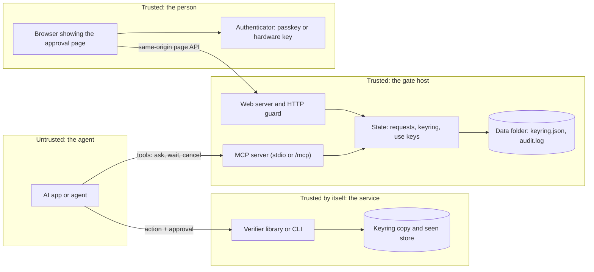
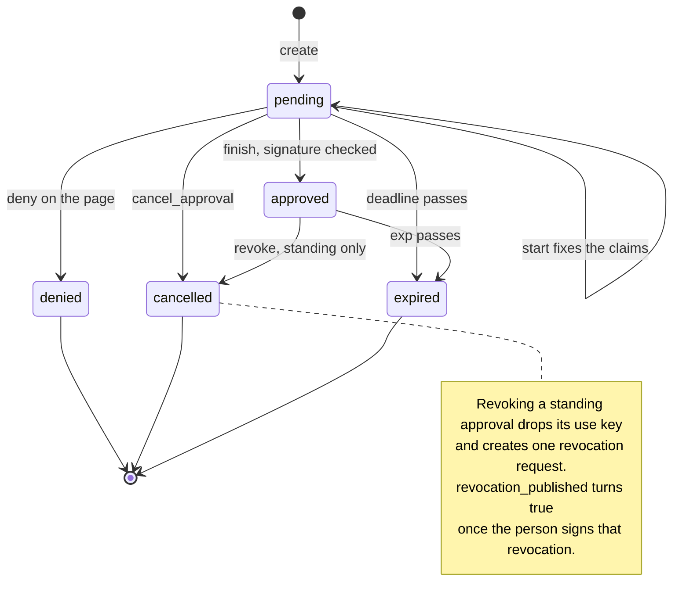
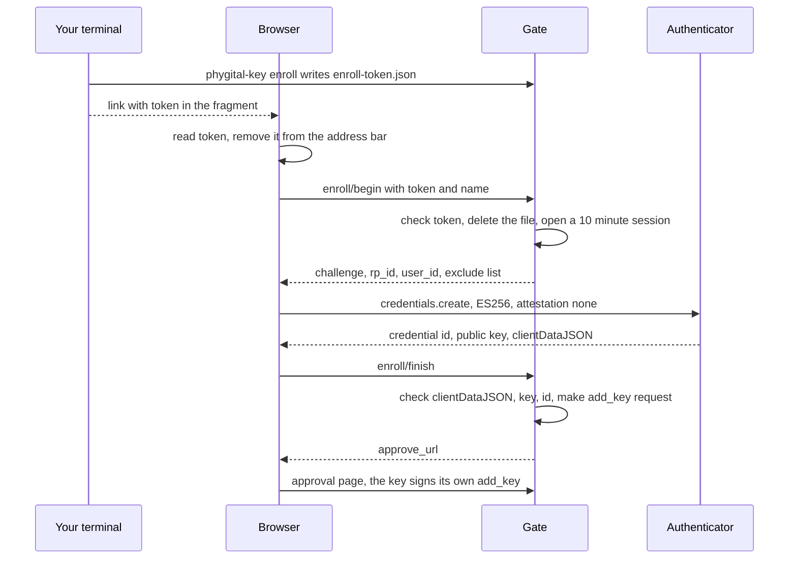
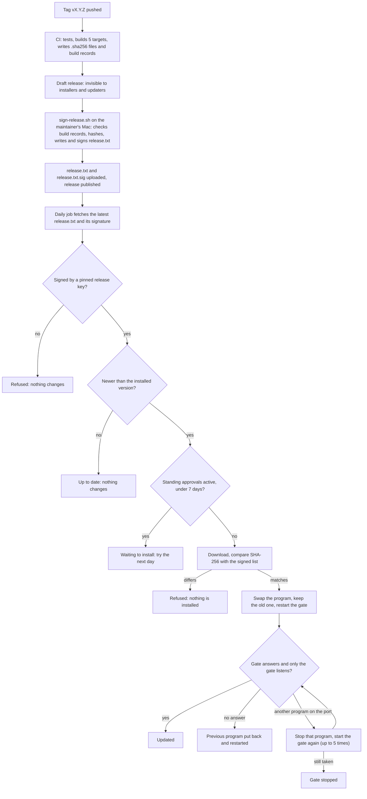

# Architecture

This page is for contributors. It describes the parts of `phygital-key`, where the trust boundaries are, how a request moves from "asked" to "approved", what is kept in memory and on disk, and the limits the gate enforces. Every rule here is read from the code in `crates/phygital-key/src` and `crates/phygital-key-verify/src`.

## On this page

- [Components](#components)
- [Trust boundaries](#trust-boundaries)
- [Request lifecycle](#request-lifecycle)
- [Memory and disk](#memory-and-disk)
- [The two clocks](#the-two-clocks)
- [Limits](#limits)
- [The HTTP guard](#the-http-guard)
- [Listening addresses](#listening-addresses)
- [Modes](#modes)
- [Shutdown](#shutdown)
- [Enrollment](#enrollment)
- [How finish checks before it stores](#how-finish-checks-before-it-stores)
- [Saving the keyring](#saving-the-keyring)
- [Signed releases and updates](#signed-releases-and-updates)

## Components

The project is one Rust workspace with three crates, plus a JavaScript verifier.

| Part | Where | What it is |
|---|---|---|
| Gate process | `crates/phygital-key` | One binary. Holds the web server, the MCP server and the shared state. |
| Web server | `src/web.rs` | axum router: the approval page, its JSON API, `/.well-known` files, and in `serve` and `demo` mode the MCP endpoint at `/mcp`. Every request passes the [HTTP guard](#the-http-guard). |
| MCP server | `src/mcp.rs` | Six tools on the official `rmcp` SDK: `request_approval`, `get_approval`, `record_receipt`, `request_standing_approval`, `use_standing_approval`, `cancel_approval`. Server name `phygital-key`, title `Phygital Key`, version the program's version. None of the tools can approve. |
| State | `src/state.rs` | The `Gate` struct: pending requests, the keyring, the enrollment session, the audit log, the use keys of standing approvals. One mutex guards it (receipt keys pinned for this run sit behind their own). |
| Audit log | `src/audit.rs` | Append-only, hash-chained JSON lines. See [audit log](audit-log.md). |
| Updates | `src/update.rs`, `assets/install-service.sh` | The signed release list, `phygital-key update`, the hidden `release-check` command, and the secure installer with its daily update job. See [Signed releases and updates](#signed-releases-and-updates). |
| Seen store | `src/seen.rs` | `FileSeenStore`, used by `phygital-key verify` so each approval works once across processes. |
| Approval page | `assets/approve.html`, `assets/app.js`, `assets/style.css`, `assets/fonts.css` | Plain HTML and JavaScript, compiled into the binary with `include_str!`. See [approval page](approval-page.md). |
| Verifier library | `crates/phygital-key-verify` | Pure checks: [canonical form](canonical-form.md), strict JSON, [WebAuthn](webauthn.md) assertion, `verify`, key history, standing approvals, receipts. No network, no clock reads. The gate uses the same library to check signatures before it stores them. |
| Test vector generator | `crates/phygital-key-testgen` | Writes the shared [test vectors](../test-vectors/README.md). |
| JavaScript verifier | `verifier-js` | A second verifier written from the spec, sharing no code with the Rust one. See [JavaScript verifier](verifier-js.md). |

There is no language model anywhere in the gate or the page, and the gate makes no outgoing network calls. Only `phygital-key update` and the secure install's daily update job contact GitHub.

## Trust boundaries



| Boundary | What crosses it | What protects it |
|---|---|---|
| Agent to gate | MCP tool calls | Tools can only ask, wait, cancel, record a receipt and use a standing approval. Over HTTP, `/mcp` needs the access token and refuses any browser `Origin`. stdio is private to the app that started the gate. |
| Browser to gate | Page API calls | Host allowlist, exact `Origin` on every POST, strict CSP, no framing. |
| Page to authenticator | A WebAuthn `get` with a challenge the page computed | The page compares the claims with what it shows before it asks the key. The authenticator binds the signature to the gate's origin. |
| Agent to service | The action and the approval string | The service runs `verify` with its own audience, the request it is about to run, its own level and its own keyring. |

The gate host is trusted: it serves the page, so whoever controls it controls what the page shows. The [threat model](threat-model.md) covers this.

## Request lifecycle

Each request has one `Status`: `pending`, `approved`, `denied`, `cancelled` or `expired`. `expired` is never stored. `current_status(t)` derives it: a `pending` request at or past its `deadline`, or an `approved` one at or past its `exp`, reads as `expired`.



- **Create** (`create_full`) checks the request, stores it as `pending` with `deadline = created + 600`, and writes a `requested` audit line.
- **Start** (`POST /api/r/{id}/start`, the person pressed Approve) fixes the claims: `v`, `id`, `aud`, `request`, `request_hash`, `level`, `iat` (now) and `exp`. While those claims are still valid (`exp` in the future), a second start returns the same claims, so another program cannot swap them while the person is signing. The status stays `pending`.
- **Finish** (`POST /api/r/{id}/finish`) takes the signature, builds the approval and checks it before anything is stored. See [How finish checks before it stores](#how-finish-checks-before-it-stores).
- **Deny** and **cancel** close a `pending` request and write `denied` or `cancelled`. A closed request cannot be approved later: start and finish refuse anything that is not `pending`.
- **Revoke** applies to an approved standing approval. It sets the status to `cancelled`, sets `usable` to false, removes the use key from `use_keys`, writes `revoked`, and creates the revocation request (`{"type": "revoke", "params": {"standing_id": ...}}`, level `medium`, same audience). There is at most one revocation request per standing approval: after a deny or a timeout, `sign_revocation` sets the same request back to `pending` with a new deadline and no claims, and never makes a second one. When the person signs it, the gate appends it to `revocations.json`, sets `revocation_published` on the standing approval and writes `revocation_published`.

## Memory and disk

### In memory

`Inner`, behind one `Mutex`:

| Field | Holds |
|---|---|
| `requests` | Every request, by id (see the fields below) |
| `recent` | Times of new requests in the last 60 seconds, for the per-minute limit |
| `enroll` | The one enrollment session, if any: SHA-256 of the token, a 32-byte challenge, a 16-byte user id, the key name, the expiry |
| `keyring` | The current keyring (public key cards, origin, signed history) |
| `audit` | The open audit log: path, last `seq`, last hash |
| `use_keys` | The private P-256 key of each standing approval, by request id. Memory only. |

The `Gate` struct also holds the `Settings`, a `Notify` that wakes `get_approval` waiters, and `pinned`, receipt keys pinned for this run only (the demo pins its own service).

Fields of one `Request`:

| Field | Meaning |
|---|---|
| `id` | 128-bit random id, base64url (22 characters). Also the approval's single-use id. |
| `request` | The request value |
| `request_jcs` | Its canonical text. The page shows this. |
| `request_hash` | base64url SHA-256 of `request_jcs` |
| `aud` | Audience |
| `level` | `medium` or `high` |
| `kind` | `Action`, `AddKey(card)`, `RemoveKey(card)`, `Standing(params)` or `Revoke(standing_id)` |
| `first_key` | True when the keyring was empty at creation |
| `created`, `deadline` | Creation time and `created + 600` |
| `status` | Stored status (see above) |
| `claims` | The fixed claims, once Approve was pressed |
| `approval` | The checked approval string, once approved |
| `approved_by` | Name on the key card that signed |
| `exp` | Approval expiry, once approved |
| `receipt` | The receipt, once one signed by the pinned service key was recorded |
| `until` | Standing only: when the permission ends |
| `uses` | Standing only: use tokens signed so far |
| `usable` | Standing only: true from approval until revoke |
| `issued` | Standing only: use tokens handed out, by use id, waiting for their receipt |
| `revocation_published` | Standing only: the person's revocation is signed and published |

A request is forgotten at `keep_until()`: one hour after its `deadline`, or for an approved standing approval, one hour after `until`, whichever is later. `prune()` runs every 60 seconds and also drops expired enrollment sessions; `create` prunes too. A use key goes when its request goes.

### On disk

All in the data folder (`--home`, default `~/.phygital-key`), which the gate creates with mode `0700`. Files the gate writes are mode `0600`.

| File | Written by | Holds |
|---|---|---|
| `keyring.json` | `finish` on a key change | Key cards, `origin`, signed `history` |
| `audit.log` | Every event | Hash-chained JSON lines, never the request itself |
| `mcp-token` | First `serve`, `demo` or `mcp-token` | 32 random bytes, base64url |
| `enroll-token.json` | `phygital-key enroll` | `{"token", "expires"}`. Deleted when enrollment starts. |
| `services.json` | `phygital-key trust-service` | Pinned receipt keys: `{"services": [{"aud", "receipt_public_key"}]}` |
| `revocations.json` | `finish` on a revocation | `{"revocations": ["<approval>", ...]}`, served at `/.well-known/phygital-key-revoked.json` |
| `seen-ids.jsonl` | `phygital-key verify` only | Used approval ids with their `exp` |

Pending requests, decided requests, the enrollment session and use keys never touch the disk. A restart drops them: pending requests end (the answer is no) and every standing approval stops working, because its use key is gone.

## The two clocks

| Clock | Constant | Starts | Length |
|---|---|---|---|
| Time to decide | `PENDING_SECS` | When the request is created | 600 s |
| Approval life | `--lifetime` (`DEFAULT_LIFETIME_SECS`) | When the person presses Approve (`start`) | 60 s by default, 1 to 300 |

Fixing `iat` at Approve, not at creation, means a person who takes 9 minutes to read still gets a full minute to use the approval. The verifier allows `iat` up to 30 s in the future (`MAX_CLOCK_SKEW_SECS`) and refuses `exp - iat > 300`.

A standing approval is different: `until = created + days × 86400` is set when the request is made, and its claims use `exp = until`. `start` refuses if `until` is 60 s away or less, or more than 30 days away. The page refuses to sign if the claims' `exp` is not the `until` it shows.

## Limits

| Limit | Value | Why |
|---|---|---|
| `MAX_PER_MINUTE` | 30 new requests in any 60 s | Approval fatigue: a flood of requests trains people to click yes |
| `MAX_PENDING` | 50 waiting at once | Same, and a bound on what the person must look through |
| `MAX_STORED` | 5000 held in memory | A memory bound: decided requests stay up to an hour |
| Canonical request size | 8192 bytes (`MAX_REQUEST_BYTES`) | The page shows every field, and verifiers refuse more |
| Request nesting | 13 levels in the request | The approval object adds levels above `params`, and verifiers refuse nesting over 16 |
| Page API body | 64 KiB | No large bodies on the page routes |

A revocation request skips all three request limits and is not counted in `recent`. An agent that fills the limits must never be able to stop the person from revoking. Since there is at most one revocation request per standing approval, this cannot be used to flood the gate.

`create_full` also refuses, before the limits: a request not shaped `{"type", "params"}`; text not in NFC; floats or unsafe integers; an audience that is not 1 to 256 visible ASCII characters (`!` to `~`); the reserved types `standing` and `revoke` outside their own paths; the gate's own audience `phygital-key:keyring:<origin>` for actions; and any action while no key is enrolled.

## The HTTP guard

`guard` in `web.rs` runs on every HTTP request, in this order.

1. **Host allowlist.** The `Host` header, lowercased, must be one of: the host of `--origin` (with its port, if it has one), `localhost:<port>`, `127.0.0.1:<port>`, `[::1]:<port>`. Anything else gets `421 unknown host`. This stops DNS rebinding, where another site points its own name at `127.0.0.1`.
2. **MCP token.** For paths under `/mcp`, when a token is set: `Authorization: <scheme> <token>` with the scheme `bearer` in any case, compared in constant time. Otherwise `401`.
3. **Origin on writes.** Every method other than GET, outside `/mcp`, must carry `Origin` equal to the gate's origin exactly. Otherwise `403 wrong origin`. This stops other web pages from posting to the page API.
4. **Headers on the response.**

| Header | Value | Where |
|---|---|---|
| `Content-Security-Policy` | `default-src 'none'; script-src 'self'; style-src 'self'; font-src 'self'; connect-src 'self'; img-src 'self' data:; base-uri 'none'; form-action 'none'; frame-ancestors 'none'` | Everything except `/mcp` |
| `Cache-Control` | `no-store` (built-in fonts and logos keep `public, max-age=86400, immutable`) | Everything except `/mcp` |
| `X-Content-Type-Options` | `nosniff` | Everything |
| `Referrer-Policy` | `no-referrer` | Everything |
| `X-Frame-Options` | `DENY` | Everything |
| `Cross-Origin-Opener-Policy` | `same-origin` | Everything |
| `Cross-Origin-Resource-Policy` | `same-origin` | Everything |

The `/mcp` endpoint is `rmcp`'s Streamable HTTP service with allowed hosts `localhost`, `127.0.0.1`, `::1` and the RP ID, and origin validation on: any request with an `Origin` header is refused (`403`). MCP clients are not browsers.

The `/.well-known/phygital-key.json` and `/.well-known/phygital-key-revoked.json` files carry `Access-Control-Allow-Origin: *` only when the RP ID is not `localhost`. On localhost there is no CORS header, so other web pages cannot read local key names.

## Listening addresses

When `--bind` is `127.0.0.1`, `localhost`, `::1` or `[::1]`, the gate listens on both `127.0.0.1:<port>` and `[::1]:<port>`. Browsers may try either for `localhost`. If the gate held only one, another program could open the other and serve a fake page with the same passkey origin.

- If the IPv6 address does not exist on the machine (`AddrNotAvailable`), the gate goes on with IPv4: nobody else can listen there either.
- Any other bind error stops the gate with "Another program is using this address ... Refusing to start."
- Each listener runs as its own task. When one stops, all stop, so one address is never left free while the other serves.

Any other `--bind` value gives one listener on that address. Keep the default unless a TLS proxy sits in front.

## Modes

| Mode | MCP transport | Page | MCP token | Enrollment link printed |
|---|---|---|---|---|
| `mcp` | stdio | Yes | None (stdio is private) | Never: stderr goes to the AI app's logs |
| `serve` | Streamable HTTP at `/mcp` | Yes | Required unless `--open-mcp` | Never: output often goes to a log file |
| `demo` | Streamable HTTP at `/mcp` | Yes, plus a fake service on port + 1 | Required unless `--open-mcp` | Yes, on stderr, when no key is enrolled |

In `mcp` mode the page server and the stdio MCP server run under one `tokio::select!`. If either ends, the process ends. If the page cannot listen (its address is taken, perhaps by something pretending to be the gate), MCP stops too and never hands out links to that address.

In `demo` mode the fake service checks approvals with the same library, pins its receipt key in the gate's memory, and offers `deploy` (level `high`), `payment` (level `high`) and `send_message` (level `medium`).

## Shutdown

- Ctrl-C or SIGTERM starts a graceful shutdown of every listener (`shutdown_signal` in `web.rs`).
- In `mcp` mode, closing stdin ends the MCP side, which ends the process.
- `main` calls `std::process::exit` as soon as `run` returns, because the stdio reader runs on a blocking thread that would keep the process alive.
- Nothing in memory survives. Pending requests are gone and standing approvals cannot be used again. The end-to-end suite checks that stdio mode stops cleanly on SIGTERM.

## Enrollment



1. `phygital-key enroll` writes 32 random bytes as `enroll-token.json` (`{"token", "expires": now + 600}`) and prints `<origin>/enroll#token=<token>`. The fragment never leaves the browser, so it is in no server log.
2. The enroll page reads the token from the fragment and removes it from the address bar and history (`history.replaceState`).
3. `enroll/begin`: if a session with this token's hash exists, it is reused (the person can retry after closing the key prompt). Otherwise the token must match the file, in constant time and before its expiry. The file is deleted at once, so the link works only once, and a session opens for 10 minutes. The key name is cleaned: control characters removed, at most 64 characters, `Key` if empty.
4. The browser creates the credential: `alg -7` (ES256), `attestation: "none"`, `residentKey: "preferred"`, `userVerification: "preferred"`, and the existing keys in `excludeCredentials`. The page refuses an authenticator that does not give a P-256 public key through `getPublicKey()`.
5. `enroll/finish` checks the session, then the client data (`type` `webauthn.create`, the session challenge, the gate's origin, not cross-origin), that the public key is a P-256 SPKI, that the credential id is 1 to 1023 bytes and not already enrolled. It builds the key card with the gate's RP ID and today's date, closes the session, and creates an `add_key` request at level `high` for the audience `phygital-key:keyring:<origin>`.
6. The key is not trusted yet. For the first key, the approval page asks it to sign its own `add_key`; only that credential is allowed to sign. Any later key must be approved by a key already in the keyring. A new key can never approve itself.

Attestation is `none`, so the gate cannot prove the key lives in hardware. The one-time link, printed only in your own terminal, is what protects the first key. See [WebAuthn](webauthn.md#registration).

## How finish checks before it stores

`finish` holds the state lock from start to end, so no other call can change the request or the keyring in between.

1. The request must be `pending` and have claims (Approve was pressed).
2. Pick who may sign:
   - first key: only the new card, and the keyring must still be empty;
   - adding a key that is already trusted, or removing one already gone: refused;
   - removing a key when only one is left: refused;
   - anything else: the current keyring.
3. Build the approval: canonical JSON of `{"claims", "signatures": [assertion]}`, base64url.
4. Run `check` (or `check_standing` for a standing approval) with the request's audience, request and level, the signers from step 2 and the gate's own origin and RP ID. That is every verifier check except replay. Any failure returns "The signature was not accepted (CODE). Nothing was approved." and changes nothing.
5. For a revocation: append the approval to `revocations.json` (temp file, then rename).
6. For a key change: build the next keyring and save it (next section).
7. Only now: status `approved`, the approval, the signer's name and `exp`; `usable` for a standing approval; audit lines `approved`, then `revocation_published` or `key_added` / `key_removed`; wake every `get_approval` waiter.

The end-to-end suite sends a forged signature to the gate and checks that the request is still not approved afterwards.

## Saving the keyring

For a key change, `finish` copies the current keyring to `next`, adds or removes the card, and, when the keyring is signed (the first key, or a keyring that already has history), sets `origin` and appends the approval to `history`. Then:

1. `save_keyring` writes `next` to `keyring.tmp` (mode `0600`), syncs it to disk and renames it over `keyring.json`.
2. Only after the save succeeds does the gate switch its in-memory keyring to `next`.

A crash leaves either the old file or the new one, never half of one. If the save fails, the request stays `pending`, the in-memory keyring is unchanged and nothing is approved. Keyrings made before key history existed (v0.1.0) stay unsigned.

## Signed releases and updates

The secure install updates itself once a day, on by default ([decision 36](decisions.md)). An update runs new code as root, so a SHA-256 published next to the file is not enough: whoever controlled the GitHub account could replace both. Each release therefore carries a file list signed with a release key that never touches GitHub, and every installer and updater checks that signature against public keys pinned in its own source. Before the key signs, the build record of every file is checked against the maintainer's own copy of the tag. The code is `src/update.rs`, `assets/install-service.sh`, `install.sh`, `scripts/release-key.sh`, `scripts/sign-release.sh` and `.github/workflows/release.yml`.



### release.txt

Every release has `release.txt` and `release.txt.sig`. The list is exact, line by line, LF line ends and a final LF:

```text
phygital-key release manifest v1
version v0.4.0
<64 lowercase hex>  phygital-key-v0.4.0-aarch64-apple-darwin.tar.gz
<64 lowercase hex>  phygital-key-v0.4.0-x86_64-pc-windows-msvc.zip
```

The Rust parser (`verify_manifest` and `parse_manifest` in `update.rs`) refuses anything else:

| Rule | Exact behaviour |
|---|---|
| Size | At most 8192 bytes, valid UTF-8, ends with LF (CRLF is refused) |
| Line 1 | Exactly `phygital-key release manifest v1` |
| Line 2 | `version vX.Y.Z`: decimal numbers, no leading zeros, compared by number (`v0.10.0` is newer than `v0.9.9`) |
| File lines | 64 lowercase hex digits, two spaces, a file name that starts with `phygital-key-vX.Y.Z-` (the same version), ends in `.tar.gz` or `.zip`, is at most 128 characters and uses only letters, digits, `.`, `-` and `_` |
| Files | At least one, none listed twice |
| Signature | `release.txt.sig` is an ECDSA P-256 signature over SHA-256 of the exact bytes, DER-encoded (what `openssl dgst -sha256 -sign` writes), by one of the pinned keys |

The shell installers check the signature with `openssl dgst -sha256 -verify`. The secure installer (`install-service.sh`, which runs as root) then applies the same strict format as the program: LF only, a final LF, at least one file line, every file line exactly `<64 hex>  phygital-key-<version>-<name>.tar.gz` or `.zip`, no name twice. `install.sh` (which runs as you) checks the first line, the version line and the line for the one file it downloads. Signatures with a high S value are accepted, which has no security effect. Seven unit tests in `update.rs` cover the parser, the version order, reading PEM blocks and the pinned keys.

### Pinned release keys

Both installers hold the public keys between `# BEGIN RELEASE KEYS` and `# END RELEASE KEYS`, as PEM `PUBLIC KEY` blocks. The program compiles `install-service.sh` into itself and reads the same block, so the shell installer, `phygital-key update` and the hidden `phygital-key release-check` command trust the same keys. The test `both_installers_pin_the_same_keys` fails if the block in `install.sh` differs.

`scripts/release-key.sh` (run once, on the maintainer's Mac) makes two P-256 keys in `~/.phygital-key-release`: a signing key and a backup key to be moved off that computer. Each key file is encrypted (AES-256) with a passphrase the maintainer types (and keeps in a password manager); the script refuses to run without a terminal. Nothing goes into the macOS Keychain, so a program running as the maintainer, an agent included, can copy the encrypted files but cannot use them. The script then writes both public keys into the two installers. Private release keys and passphrases are never stored in GitHub or its secrets. A hardware key (for example a YubiKey with touch) would be a stronger home for the signing key later.

> [!IMPORTANT]
> The release keys are not made yet: in this source tree the key block is empty. Until the maintainer runs `scripts/release-key.sh` and commits the block, every installer refuses with "no release key is pinned in this installer", and the test `installer_pins_at_least_one_release_key` fails.

### Draft until signed

1. Pushing a `v*` tag runs `release.yml`: `cargo test --workspace --locked` and a release build for 5 targets (Linux x86_64 and arm64, macOS Apple silicon and Intel, Windows x86_64), each packed as `.tar.gz` (`.zip` on Windows) with a `.sha256` file.
2. Each build job publishes a build provenance attestation for its archive (`actions/attest-build-provenance`, signed through Sigstore): GitHub's record of which workflow built which file from which commit. The workflow then creates a draft release. Drafts are not served by `releases/latest/download` or by version URLs, so no installer and no updater can see it.
3. On the maintainer's Mac, in their own terminal (the script refuses without one), `scripts/sign-release.sh vX.Y.Z` reads the commit of the tag from the maintainer's own clone, downloads the draft's files, computes each SHA-256 itself and requires it to match the workflow's `.sha256` file. It then runs `gh attestation verify` for each file: built by `.github/workflows/release.yml`, from `refs/tags/vX.Y.Z`, at that commit. A file swapped on GitHub after the build has no such record, and the script stops with `no build record from the release workflow at <commit>. Not signing.` Only then does it write `release.txt`, sign it with the signing key (the maintainer types the passphrase), check the signature against the keys pinned in `install-service.sh`, upload `release.txt` and `release.txt.sig` and publish the release as the latest.

### The daily job

| | macOS | Linux |
|---|---|---|
| Job | LaunchDaemon `io.phygitalkey.update` (root, plist mode 0600), one random time of day chosen at install | `phygital-key-update.timer` (`OnCalendar=daily`, `RandomizedDelaySec=6h`, `Persistent=true`) starting `phygital-key-update.service` (`Type=oneshot`, `PrivateTmp`, `ProtectHome`) |
| Runs | `<prefix>/bin/phygital-key --port <port> install-service --auto-update-run` | the same |
| Output | `/Library/Logs/PhygitalKeyUpdate/update.log`, in a folder only root can open | the journal: `journalctl -u phygital-key-update` |

`<prefix>` is `/Library/PhygitalKey` on macOS and `/usr/lib/phygital-key` on Linux. The installed program runs the installer script compiled into it, with bash started from an empty environment (only `PATH=/usr/bin:/bin:/usr/sbin:/sbin`, root's `HOME`, `LANG=C` and the `PKA_*` values). The script sets that `PATH` and `HOME` again, clears variables such as `CURL_HOME`, `SSL_CERT_FILE`, `OPENSSL_CONF`, `BASH_ENV`, `LD_PRELOAD` and `DYLD_INSERT_LIBRARIES`, sets `umask 022`, and then:

1. fetches `https://github.com/s17sh70x2jfl031ag/phygital-key-mcp/releases/latest/download/release.txt` and `release.txt.sig` (`curl -q --proto '=https' --tlsv1.2`; `-q` means no `.curlrc` is read);
2. checks the signature with `openssl` and the pinned keys, or, if `openssl` is missing, with the installed root-owned program's `release-check`;
3. stops if the signed version is not strictly newer than the installed one;
4. asks the gate's `/api/status` for `standing_active`; if it is above zero, records `waiting to install ...` and stops, unless run with `--now`. The first wait on the installed version writes `<unix time> <installed version>` to `<prefix>/update-postponed`; a newer release does not restart that clock, and after 7 days the job installs anyway. Waiting requests (`waiting`) do not count, because an agent can make one at any time;
5. downloads the release file for this machine, compares its SHA-256 with the signed list, and unpacks it;
6. keeps a copy of the current program, moves the new one into place in one step, and restarts the gate;
7. waits up to about 30 seconds for the gate to answer at `/api/status`, and checks that only the gate user listens on the port. A program running as another user that took the port during the restart is stopped with `kill -9` and the gate started again, up to 5 times.

The result goes to `<prefix>/update-status`, one line, written by root and readable by everyone, for example `2026-10-18T03:12:00Z up to date (v0.3.0; latest signed release v0.3.0)`. Other lines: `update check failed: could not download the latest signed release list from GitHub (still on ...)`, `waiting to install ...: N standing approval(s) active. ...`, `update refused: the latest release list is not signed by a pinned release key (still on ...)`, `updated from ... to ... (signed release, SHA-256 checked)`, which ends with `; stopped programs that took the port of the gate during the restart: [uid U, pid P] ...` when the job had to stop such a program. Any error that stops the run (a download that does not match its signed SHA-256, for example) is recorded as `update stopped: <message>`.

`phygital-key-admin update` runs the same job now. `phygital-key-admin status` prints the program version, whether automatic updates are on, and the last result. `--no-auto-update` removes the job and writes `off` to `<prefix>/auto-update`, so later installs keep it off until `--auto-update`. With the install command from GitHub: `curl ... | sudo bash -s -- --no-auto-update`.

### Rollback

| What happens after the swap | Result |
|---|---|
| The new gate does not answer within about 30 seconds | The previous program is put back and started. Status: `update to vX.Y.Z failed: the new gate did not start, so vA.B.C is back` |
| The previous program does not answer either | The gate stays stopped. Status: `update stopped: the gate is stopped: the gate did not start. See: <prefix>/bin/phygital-key-admin logs. To install again: sudo <prefix>/bin/phygital-key install-service` |
| Another program takes the gate's port during the restart | That program is stopped (`kill -9`) and the gate started again, up to 5 times. The status line names it |
| The port is still taken after 5 tries, or was taken before the update started | The gate is stopped, never left running next to it. Status: `update stopped: the gate is stopped: another program (...) is listening on port ...` |

The CI secure-install test installs a program that exits at once and checks that the previous program is back and answering.

### What an update changes

An update restarts the gate. Requests still waiting for a decision are lost (they live in memory), and every standing approval stops working, because its use key lived only in memory. One-time approvals already signed keep working at services until their `exp`: services check them offline. The keyring, the audit log and the rest of the data folder are not touched.

Installs in your own folders do not update themselves. `install.sh` checks the same signed list (it needs `openssl`) and writes only `~/.local/bin/phygital-key`. `phygital-key update` (or `update --check`) fetches the latest signed list, refuses unless it is newer, checks the signed SHA-256 and swaps the program in place. It refuses on the secure install ("it updates itself every day"), on a Homebrew install (`brew upgrade phygital-key`) and on Windows (`scoop update phygital-key`, or `winget upgrade`).

The gate itself still makes no network calls. The secure install's daily job contacts github.com once a day (plus the release file when it updates); `install.sh` and `phygital-key update` contact GitHub only when you run them.

> [!WARNING]
> The full download-and-update path runs for real only once signed releases exist: the first real update is the release after v0.3.0. It has not been tested against GitHub yet. The CI test covers the parts that run without a signed release: the job is installed and root-owned, a list signed by an unknown key is refused, the job leaves the gate running when no newer signed release exists and records its result, root ignores a planted `~/.curlrc` and a fake `curl` early in `PATH`, a program that does not start is switched back, and the on/off choice is kept. Killing a program that takes the port during an update restart has no CI test.

## Next

- [How it works](how-it-works.md): the same flow in plain words
- [Approval page](approval-page.md): what the page checks before it signs
- [Audit log](audit-log.md): the hash chain and what it detects
- [Updates](updates.md): turning automatic updates on and off
