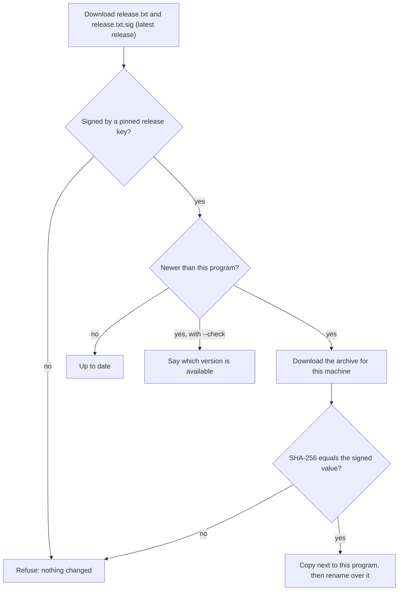

# Command line

Every Phygital Key product is one program: the gate (its agent endpoint and the approval page) and a set of tools for services, scripts and the person who owns the keys. The commands come from the base, so they are the same in every product. This page covers every command and option, the output and exit codes, the files it writes, and how to call `verify` from shell scripts and other languages. Commands are shown with `phygital-key-mcp`; `phygital-key-a2a` takes the same commands and options (its port, data folder and environment names are in [reference](reference.md#names-per-product)). Terms are in the [glossary](glossary.md).

On this page:

- [Commands](#commands)
- [Global options](#global-options)
- [Exit codes and output](#exit-codes-and-output)
- [verify](#verify)
- [keys](#keys)
- [receipt-check](#receipt-check)
- [trust-service](#trust-service)
- [audit-check](#audit-check)
- [enroll and token](#enroll-and-token)
- [stdio, serve and demo](#stdio-serve-and-demo)
- [install-service](#install-service)
- [update](#update)
- [Files it writes](#files-it-writes)
- [The seen-ids file](#the-seen-ids-file)
- [Calling it from scripts and other languages](#calling-it-from-scripts-and-other-languages)

The help texts, `serve`, `enroll`, `token`, the usage errors and `update --check` on this page come from `phygital-key-mcp 0.4.0`. The `verify`, `keys`, `receipt-check`, `trust-service` and `audit-check` results were recorded with the same commands in 0.3.0 (then named `phygital-key`), run with the public test keys in `test-vectors/keys/` (their names end in "TEST ONLY"); only the program name in error lines differs. The `update` messages marked as taken from the code were not run.

## Commands

```text
A person approves exact AI actions with a passkey or hardware key. MCP edition.

Usage: phygital-key-mcp [OPTIONS] <COMMAND>

Commands:
  stdio            Run the gate for one AI app over stdio (what most MCP apps launch)
  serve            Run the gate over HTTP: the approval page at / and the agent endpoint
  enroll           Print a one-time link to add a passkey or hardware key (valid 10 minutes)
  token            Print the access token for the agent endpoint, and how to connect an AI app or agent
  install-service  Run the gate as its own locked-down system user (macOS, Linux). Needs sudo
  update           Update this program to the latest signed release (for installs in your own folders)
  keys             Print the trusted public key cards (give this to services that verify)
  verify           Check an approval from the command line (any language can call this)
  receipt-check    Check a service's signed receipt for an approval
  trust-service    Pin a service's receipt key, so the gate only shows receipts that service really signed
  audit-check      Check that the audit log has not been changed
  demo             Try it: the gate plus a fake service on port+1 that only acts with a valid approval
  help             Print this message or the help of the given subcommand(s)
```

The first line is the product's own. A product without a stdio mode (Phygital Key A2A) does not list `stdio`.

| Who uses it | Commands |
|---|---|
| The person who owns the keys | `enroll`, `keys`, `trust-service`, `audit-check`, `token`, `install-service`, `update` |
| AI apps (they start the gate) | `stdio`, `serve` |
| Services and scripts that check approvals | `verify`, `keys --check`, `receipt-check` |
| Anyone trying it | `demo` |

## Global options

Every command accepts these options. They can come before or after the command name.

```text
      --home <HOME>          Data folder [env: PHYGITAL_KEY_MCP_HOME] [default: ~/.phygital-key-mcp]
      --port <PORT>          Port for the approval page (and the agent endpoint in serve mode) [env: PHYGITAL_KEY_MCP_PORT=] [default: 7468]
      --bind <BIND>          Address to listen on. Keep 127.0.0.1 unless a TLS proxy sits in front [env: PHYGITAL_KEY_MCP_BIND=] [default: 127.0.0.1]
      --origin <ORIGIN>      Public origin of the approval page, e.g. https://approve.example.com [default: http://localhost:<port>] [env: PHYGITAL_KEY_MCP_ORIGIN=]
      --no-token             Serve the agent endpoint without an access token (anyone on this machine could then create requests)
      --lifetime <LIFETIME>  Approval life in seconds (max 300) [default: 60]
  -h, --help                 Print help
  -V, --version              Print version
```

| Option | Rules checked at start |
|---|---|
| `--home` | Used as given; otherwise `PHYGITAL_KEY_MCP_HOME`; otherwise `$HOME/.phygital-key-mcp` (`%USERPROFILE%` on Windows). Created with mode 0700 when a command writes to it. |
| `--origin` | `scheme://host[:port]` with no path or query. Must be `https` unless the host is `localhost`: `--origin must be https (passkeys only work on https, or on localhost)`. Its host becomes the relying party id (rp_id). |
| `--lifetime` | 1 to 300: `--lifetime must be 1 to 300 seconds`. |

For `verify`, `--origin` also sets which approval page counts: `origins` is `[origin]` and `rp_ids` is `[host of origin]`. Leave it out and the check expects a gate on `http://localhost:<port>` (`7468` for Phygital Key MCP, `7478` for Phygital Key A2A).

## Exit codes and output

| Exit code | Meaning | Output |
|---|---|---|
| `0` | Success: approval valid, receipt valid, keyring checks out, audit log intact, file written, update done or not needed | Result on stdout (JSON for `verify` and `receipt-check`) |
| `1` | Refused | `verify`, `receipt-check`: `{"ok": false, "error": "<CODE>"}` on stdout. `keys --check`: `keyring NOT ok: <reason>` on stdout. |
| `1` | Could not run: bad file, bad option value, damaged data | `phygital-key-mcp: <message>` on stderr, nothing on stdout |
| `2` | Usage error (missing or unknown argument) | Usage text on stderr |

A refusal and an error both exit with 1. Tell them apart by stdout: a refusal always prints a result there; an error prints nothing there. Either way, do not act.

```text
$ phygital-key-mcp verify --approval x --request '{}'
error: the following required arguments were not provided:
  --aud <AUD>

Usage: phygital-key-mcp verify --approval <APPROVAL> --request <REQUEST> --aud <AUD>

For more information, try '--help'.
$ echo $?
2
```

## verify

Checks one approval exactly as a service would, with `phygital_key_verify::verify`, and remembers its id in a file so it works once on this machine.

```text
Usage: phygital-key-mcp verify [OPTIONS] --approval <APPROVAL> --request <REQUEST> --aud <AUD>

Options:
      --approval <APPROVAL>    The approval string (or @file)
      --request <REQUEST>      The exact request JSON you are about to run (or @file)
      --aud <AUD>              Your audience id
      --level <LEVEL>          Lowest level you accept: medium or high [default: high]
      --keyring <KEYRING>      Keyring file [default: <home>/keyring.json]
      --seen-file <SEEN_FILE>  File that remembers used approvals, so each works once [default: <home>/seen-ids.jsonl]
```

(The global options are accepted too.) `@file` reads the value from a file and trims surrounding whitespace.

A valid approval, then the same one again, then a changed request:

```bash
phygital-key-mcp --origin https://approve.example.com verify \
  --approval @approval.txt --request @request.json \
  --aud https://deploy.example.com --level high --keyring keyring.json
```

```text
{"approved_by":"alice (TEST ONLY)","exp":1792273462,"id":"IndRsb1x5UAclXKSU4dcnA","level":"high","ok":true}
exit 0
{"error":"REPLAYED","ok":false}
exit 1
{"error":"REQUEST_MISMATCH","ok":false}
exit 1
```

| Output field | Meaning |
|---|---|
| `ok` | `true`: act. `false`: do not. |
| `id` | The approval's single-use id. Log it. |
| `approved_by` | The name on the key card that signed. |
| `level` | The level the person approved (`medium` or `high`). |
| `exp` | When the approval expires (Unix seconds). |
| `error` | One of the [error codes](error-codes.md). |

Common mistakes and what they print:

| Mistake | Output |
|---|---|
| No `--origin`, gate on `https://approve.example.com` | `{"error":"UNTRUSTED_KEY","ok":false}` (the key's rp_id is not `localhost`) |
| `--approval ""` | `{"error":"APPROVAL_REQUIRED","ok":false}` |
| `--request 'not json'` | `phygital-key-mcp: --request: expected ident at line 1 column 2` |
| `--level low` | `phygital-key-mcp: --level is medium or high` |
| `--keyring nope.json` | `phygital-key-mcp: nope.json: No such file or directory (os error 2)` |

The request is parsed as ordinary JSON, then checked in canonical form: floats, text that is not Unicode NFC, and integers beyond ±(2^53 - 1) are refused (`MALFORMED`).

## keys

Prints the keyring, or checks a keyring's signed key history.

```text
Usage: phygital-key-mcp keys [OPTIONS]

Options:
      --check <FINGERPRINT>  Check a keyring's signed history against the first key's fingerprint
      --file <FILE>          Keyring file to print or check [default: <home>/keyring.json]
      --signed-on <ORIGIN>   The approval page origin the history must be signed on (needed with --file)
      --previous <PREVIOUS>  The keyring you accepted last time: the new one must extend it (stops rollbacks)
```

Without `--check`, it prints the keyring as JSON on stdout, and the first key's fingerprint on stderr, so `phygital-key-mcp keys > keyring.json` gives a clean file:

```text
$ phygital-key-mcp keys --file valid_two_keys.json --signed-on https://approve.example.com > out.json
first key fingerprint (share this so others can check): Pp0IrvTI9djhcmFJeel-FJXJd1_u_tJ2R8j8hpMh1xo
```

With `--check`, it runs `verify_history`, or `verify_history_update` when `--previous` is given. Without `--file` it checks `<home>/keyring.json` against `--origin`. With `--file` you must say where it was signed with `--signed-on`, otherwise: `phygital-key-mcp: with --file, say where it must be signed: --signed-on https://approve.example.com`.

Results on the key-history test vectors (`test-vectors/keyrings.json`, saved as files):

```text
$ phygital-key-mcp keys --check Pp0IrvTI9djhcmFJeel-FJXJd1_u_tJ2R8j8hpMh1xo --file valid_single_key.json --signed-on https://approve.example.com
keyring ok: 1 keys, every change signed, starting from Pp0IrvTI9djhcmFJeel-FJXJd1_u_tJ2R8j8hpMh1xo
$ phygital-key-mcp keys --check Pp0Irv... --file rollback.json --signed-on https://approve.example.com --previous rollback-accepted.json
keyring NOT ok: the new history does not extend the one accepted before (rollback or fork)
$ phygital-key-mcp keys --check Pp0Irv... --file extra_unsigned_key.json --signed-on https://approve.example.com
keyring NOT ok: the listed keys are not the keys the history signs
$ phygital-key-mcp keys --check Pp0Irv... --file valid_single_key.json --signed-on https://other.example.com
keyring NOT ok: the history was signed on another approval page
$ phygital-key-mcp keys --check Pp0Irv... --file tampered_entry.json --signed-on https://approve.example.com
keyring NOT ok: history entry 2: not signed by a trusted key
$ phygital-key-mcp keys --check Pp0Irv... --file unsigned.json --signed-on https://approve.example.com
keyring NOT ok: the keyring has no signed history
```

(`Pp0Irv...` stands for the full fingerprint, shortened here.) Entry numbers in messages count from 1. Exit code 0 for `ok`, 1 for `NOT ok`. What each rule means: [key history](key-history.md).

## receipt-check

Checks a service's signed receipt for a one-time approval with `receipt::verify`.

```text
Usage: phygital-key-mcp receipt-check [OPTIONS] --receipt <RECEIPT> --key <KEY> --iss <ISS> --approval <APPROVAL>

Options:
      --receipt <RECEIPT>    The receipt (or @file)
      --key <KEY>            The service's receipt public key, SPKI DER base64url (or @file)
      --iss <ISS>            The service's audience id (who should have signed)
      --approval <APPROVAL>  The approval the receipt is about (or @file)
```

```text
$ phygital-key-mcp receipt-check --receipt @receipt.txt --key @service-key.txt --iss https://deploy.example.com --approval @approval.txt
{"error":null,"iat":1792273402,"ok":true,"status":"success"}
$ phygital-key-mcp receipt-check --receipt @receipt.txt --key @service-key.txt --iss https://other.example.com --approval @approval.txt
{"error":"MISMATCH","ok":false}
$ phygital-key-mcp receipt-check --receipt @receipt.txt --key <another key> --iss https://deploy.example.com --approval @approval.txt
{"error":"BAD_SIGNATURE","ok":false}
$ phygital-key-mcp receipt-check --receipt garbage --key @service-key.txt --iss https://deploy.example.com --approval @approval.txt
{"error":"MALFORMED","ok":false}
$ phygital-key-mcp receipt-check --receipt @receipt.txt --key notakey --iss https://deploy.example.com --approval @approval.txt
phygital-key-mcp: --key is not a P-256 public key (SPKI DER, base64url)
```

On success, `status` is what the service reported (`success` or `error`) and `error` its short error code, if any. A signed `error` receipt is valid: the service says it did not complete. A receipt for one use of a standing approval carries a `use_id` and is refused here (`MISMATCH`); check those with `receipt::verify_use_receipt` in code. See [receipts](receipts.md).

## trust-service

Pins a service's receipt key on this gate, so the gate records a receipt for that service only when that key signed it.

```text
Usage: phygital-key-mcp trust-service [OPTIONS] --aud <AUD> --key <KEY>

Options:
      --aud <AUD>            The service's audience id
      --key <KEY>            Its receipt public key, SPKI DER base64url (or @file), from its /.well-known/phygital-key-service.json
```

```text
$ phygital-key-mcp trust-service --aud https://deploy.example.com --key MFkwEwYHKoZIzj0CAQYIKoZIzj0DAQcDQgAEjAztYF...
pinned the receipt key of https://deploy.example.com
$ phygital-key-mcp trust-service --aud https://deploy.example.com --key @service-key.txt
pinned the receipt key of https://deploy.example.com
```

It writes `<home>/services.json` (mode 0600), replacing any earlier key for the same audience:

```json
{
  "services": [
    { "aud": "https://deploy.example.com", "receipt_public_key": "MFkwEwYHKoZIzj0CAQYIKoZIzj0DAQcDQgAEjAzt..." }
  ]
}
```

`--key` takes the key itself, or `@file` to read it from a file (surrounding whitespace is trimmed), as in `receipt-check`. A value that is not a P-256 SPKI key is refused with `phygital-key-mcp: --key is not a P-256 public key (SPKI DER, base64url)`, and a missing file with `phygital-key-mcp: service-key.txt: No such file or directory (os error 2)`. Nothing is written in either case.

## audit-check

Checks the hash chain of `<home>/audit.log`: each line's `prev` must equal the previous line's `hash`, `seq` must count up from 1, and each `hash` must equal base64url SHA-256 of the canonical line without its `hash` field.

$$\texttt{hash}_n = \mathrm{base64url}\big(\mathrm{SHA256}(\mathrm{JCS}(\text{line}_n \text{ without } \texttt{hash}))\big), \qquad \texttt{prev}_n = \texttt{hash}_{n-1}, \qquad \texttt{prev}_1 = \texttt{"genesis"}$$

| Situation | Output | Exit code |
|---|---|---|
| Chain intact | `audit log ok: 2 entries, last hash mszFCemsPHJroxq7950DxTv_lXkvS1WPv5-iaWBqjko` | 0 |
| A value in line 2 edited by hand | `phygital-key-mcp: audit log line 2: hash does not match (line changed)` | 1 |
| The `hash` field of line 1 removed | `phygital-key-mcp: audit log line 1: no hash` | 1 |
| A line removed, or two lines swapped | `phygital-key-mcp: audit log line 1: chain broken (prev does not match)` (the first line whose `prev` no longer fits) | 1 |
| No `audit.log`, but `keyring.json` holds a key | `phygital-key-mcp: no audit log at <home>/audit.log, but a key is enrolled: the log was deleted or moved` | 1 |
| No `audit.log`, and `keyring.json` cannot be read or is damaged | `phygital-key-mcp: <home>/keyring.json: damaged keyring (<reason>)` (or the read error) | 1 |
| No `audit.log`, and no `keyring.json` (or one with no keys) | `no audit log yet: nothing has happened on this gate` | 0 |

The output names the last hash. Copy it somewhere the gate cannot write (a note, a ticket, another machine): the chain detects edited, removed and reordered lines, not a log rewritten from the start or cut off at the end. A deleted log is caught only while `keyring.json` is still there. See [audit log](audit-log.md).

## enroll and token

`enroll` writes a one-time enrollment token to `<home>/enroll-token.json` and prints the link to add a key. The gate must be running to use it.

```text
$ phygital-key-mcp --port 18300 enroll
Open this link in your browser to add a passkey or hardware key (valid 10 minutes, works once):

  http://localhost:18300/enroll#token=G3mFefa214aS-hB8Xk5ZX_t9sjagUZ_pLH2fx93cfI8

The gate must be running (phygital-key-mcp serve, or your AI app running it).
```

`token` prints the access token for the agent endpoint in HTTP mode (made once and kept in `<home>/access-token`), and how to connect. What it prints is the product's own; Phygital Key MCP prints the endpoint and the line for Claude Code:

```text
$ phygital-key-mcp --port 18300 token
  MCP endpoint    http://localhost:18300/mcp  (needs header  Authorization: Bearer ztQPOWlX...)
  Claude Code:    claude mcp add --transport http phygital-key-mcp http://localhost:18300/mcp --header "Authorization: Bearer ztQPOWlX..."
```

(Tokens shortened here.) Both print secrets: run them in your own terminal, never where an AI app can read the output. See [keys and devices](keys-and-devices.md) and, for Phygital Key MCP, [connect your AI app](https://github.com/Phygital-Key/phygital-key-mcp/blob/main/docs/connect-your-ai.md).

## stdio, serve and demo

These run the gate. They take only the global options.

| Command | What runs | Output |
|---|---|---|
| `stdio` | The gate for one AI app over stdio, plus the approval page on `--port`. If the page cannot start (port taken), the gate stops. Only in products with a stdio mode (Phygital Key MCP); others answer `<name> has no stdio mode: run <program> serve`. | Never prints an enrollment link (stderr goes to the AI app's logs). |
| `serve` | The approval page at `/` and the agent endpoint over HTTP at the product's path (`/mcp`, `/a2a`), which needs `Authorization: Bearer <token>` unless `--no-token`. | Prints the page and endpoint addresses, never the token or a link: safe to log. |
| `demo` | The gate as `serve`, plus a fake service on `--port` + 1 that offers `POST /deploy` (high), `/payment` (high) and `/send_message` (medium), and pins its own receipt key. | Prints how to connect, with the token, and an enrollment link if no key is enrolled. |

```text
$ phygital-key-mcp --port 18320 serve
phygital-key-mcp: no key enrolled yet. In your own terminal, run: phygital-key-mcp enroll (or phygital-key-mcp-admin enroll for the secure install)
phygital-key-mcp
  approval page   http://localhost:18320
  agent endpoint  http://localhost:18320/mcp  (access token: run  phygital-key-mcp token)
```

The demo service answers like a real verifier. With no approval:

```text
$ curl -s -X POST http://localhost:18311/deploy -H 'content-type: application/json' -d '{"service":"api","env":"production","version":"2.4.1"}'
{"error":"APPROVAL_REQUIRED","ok":false}
```

With a valid approval in `Phygital-Approval` it answers `{"ok": true, "done": "Deployed (demo: nothing real happened)", ..., "receipt": "<JWS>"}`, and the same approval a second time gives `{"error":"REPLAYED","ok":false}`. Its receipt key is at `GET /.well-known/phygital-key-service.json`. Walkthrough: [getting started](getting-started.md).

## install-service

```text
Usage: phygital-key-mcp install-service [OPTIONS]

Options:
      --uninstall            Remove the service (keeps keys and log unless --purge)
      --binary <BINARY>      Install this binary instead of downloading the official release. It and every folder above it must be owned by root only
      --release <VERSION>    Release to install, e.g. v0.4.0 (default: this program's version). Use it to update
      --purge                With --uninstall: also delete the service user, keys and log
      --auto-update          Update automatically every day to the latest signed release (the default)
      --no-auto-update       Turn automatic updates off (kept on later installs until --auto-update)
```

It runs the install script built into the program (the base template, filled for this product) with `bash` and needs root. `--auto-update` and `--no-auto-update` cannot be given together.

| Step | What the script does |
|---|---|
| Download | Fetches `release.txt` and `release.txt.sig` for the release from the product's repository, checks the signature against the release keys pinned in the script (with `openssl`, or with the installed root-owned program's hidden `release-check` command when `openssl` is missing), then downloads the archive and compares its SHA-256 with the one in the signed list. Any mismatch: nothing is installed. |
| `--binary <path>` | Skips the download. The file and every folder above it must be owned by root, with no group or other write bit and no symlinks. |
| Daily updates | On by default. Your choice is kept in `<prefix>/auto-update` and reused by later installs until you pass the other option. See [update](#update) for what the daily job does. |

Of the global options it passes on only `--port`; it always serves `http://localhost:<port>` and keeps its data in its own folder, so `--home`, `--origin`, `--bind`, `--lifetime` and `--no-token` have no effect on it. With curl: `curl -q -fsSL .../install-service.sh | sudo bash -s -- --no-auto-update`. Steps, what it refuses, the names per product and the admin helper: [secure install](secure-install.md).

## update

Updates the program file you are running to the latest signed release of its product. It is for installs in your own folders: the install script (`~/.local/bin`) and `cargo install`.

```text
Usage: phygital-key-mcp update [OPTIONS]

Options:
      --check                Only say whether a newer release exists
```



The messages below are taken from the code (`crates/phygital-key-gate/src/update.rs`), not from a run: no signed product release exists yet to run them against. Only the last example in this section was run. The versions are examples.

| Result | Output |
|---|---|
| Up to date | `phygital-key-mcp v0.4.0 is up to date (latest signed release: v0.4.0).` |
| `--check`, newer exists | `phygital-key-mcp v0.5.0 is available (you have v0.4.0). Run: phygital-key-mcp update` |
| Updated | `Updated <path> from v0.4.0 to v0.5.0 (signed release, SHA-256 checked).` then `Restart your AI app, or any running phygital-key-mcp serve, to use it.` |
| Download does not match | `phygital-key-mcp: the download does not match the signed SHA-256. Nothing was changed.` |
| List not signed by a pinned key | `phygital-key-mcp: release list is not signed by a pinned release key` |
| Secure install | `phygital-key-mcp: this is the secure install: it updates itself every day. To update now: phygital-key-mcp-admin update` |
| Homebrew | `phygital-key-mcp: installed with Homebrew: run  brew upgrade phygital-key-mcp` |
| Windows | `phygital-key-mcp: on Windows, update with Scoop (scoop update phygital-key-mcp), or download the new .zip from the Releases page` |

The release list is `release.txt`, checked line by line before anything is downloaded: line 1 `phygital-key release manifest v1`, line 2 `version vX.Y.Z`, then one `<64 lowercase hex>  <program>-vX.Y.Z-<target>.tar.gz` (or `.zip`) line per file, LF line ends and a final LF, at most 8192 bytes. `release.txt.sig` is an ECDSA P-256 / SHA-256 signature (DER) made with the product's release key, which only a release run from a `v*` tag can use (only repository admins can push those tags). The program and both install scripts of a product pin the same public release keys.

It contacts GitHub only when you run it (`curl -q` over HTTPS, TLS 1.2 or later; `-q` means no `.curlrc` is read). Until the product publishes a signed release, it stops at the first download:

```text
$ phygital-key-mcp update --check
curl: (56) The requested URL returned error: 404
phygital-key-mcp: download of https://github.com/Phygital-Key/phygital-key-mcp/releases/latest/download/release.txt failed
```

> [!NOTE]
> The secure install updates itself with a daily job (macOS LaunchDaemon `io.phygitalkey.<id>.update`, Linux `<program>-update.timer`). It installs only a strictly newer signed release and keeps the previous program. If the new gate does not answer within about 30 seconds, it switches back to the previous program. If another program takes the gate's port during the restart, it stops that program and starts the gate again, up to 5 times, then stops the gate instead and records why in `<prefix>/update-status`. Updating restarts the gate, so requests still waiting for a decision are lost and standing approvals end (their use keys live in memory); approvals already signed are not affected. The daily job waits while standing approvals are active (waiting requests do not count), for up to 7 days from the first wait on the installed version, then installs anyway. More: [updates](updates.md), [secure install](secure-install.md#update).

## Files it writes

| File in `<home>` | Written by | Mode | What |
|---|---|---|---|
| `seen-ids.jsonl` (+ `.lock`, `.tmp`) | `verify` | 0600 | Used approval ids, see below |
| `services.json` | `trust-service` | 0600 | Pinned service receipt keys |
| `enroll-token.json` | `enroll` | 0600 | One-time enrollment token and its expiry |
| `access-token` | `token`, `serve`, `demo` (first run) | 0600 | The access token for the agent endpoint |
| `keyring.json` | the gate, when keys change | 0600 | Key cards, origin, signed key history |
| `audit.log` | the gate | 0600 | Hash-chained log of requests, approvals, key changes, receipts |
| `revocations.json` | the gate | 0600 | Signed revocations it publishes |

The gate and `trust-service`, `enroll` and `token` write each file to a `.tmp` file first, flush it, then rename it over the old one; `audit.log` is only ever appended to. `keys`, `keys --check`, `receipt-check` and `audit-check` only read (`keys` without `--file` creates an empty `<home>` if there is none). `verify` writes only the seen-ids file (and creates `<home>` if needed). The home folder is created with mode 0700. `update` writes nothing in `<home>`: it replaces its own program file (through a freshly created `.<program>.update` file next to it, mode 0755, never a file or link that was already there) and uses a private temporary folder that it deletes. Full list: [reference](reference.md#files-in-the-data-folder).

## The seen-ids file

`verify` spends each approval in `<home>/seen-ids.jsonl` (or `--seen-file`), one JSON line per id:

```text
{"exp":1792273462,"id":"IndRsb1x5UAclXKSU4dcnA"}
```

| Property | How |
|---|---|
| Atomic between processes on one machine | Holds an exclusive lock on `seen-ids.jsonl.lock` while it reads and rewrites the list. |
| Crash-safe | Writes the new list to `seen-ids.jsonl.tmp`, flushes it, renames it over the old file, then syncs the folder (Unix). A crash leaves the old list or the new one. |
| Small | Drops ids once `exp + 30` has passed. |
| Fails closed | A line that cannot be read makes every check fail. Each approval is then refused as `REPLAYED` until you fix or remove the damaged line. |

It is shared only by processes that use the same file on the same machine. Several machines need a shared store in your own code: see [integrate](integrate.md#the-seen-store).

## Calling it from scripts and other languages

`verify` lets any language check approvals without a library. Pass the request your program is about to run; act only on exit code 0. Any product's program works: the check is the same.

Bash:

```bash
#!/usr/bin/env bash
set -u
if out=$(phygital-key-mcp --origin https://approve.example.com verify \
    --approval @approval.txt --request @request.json \
    --aud https://deploy.example.com --level high --keyring keyring.json); then
  echo "approved: $out"
  # ...run the deploy here
else
  echo "refused: ${out:-verifier error, see stderr}" >&2
  exit 1
fi
```

```text
approved: {"approved_by":"alice (TEST ONLY)","exp":1792273778,"id":"14c9U91ePnFxRuvGDRqu3A","level":"high","ok":true}
refused: {"error":"REPLAYED","ok":false}
```

Python (a sketch you can adapt; it ran as shown with 0.3.0):

```python
import json, subprocess

def check_approval(approval: str, request: dict, aud: str, level: str = "high"):
    """Returns (True, id) or (False, error code). Any doubt is a no."""
    try:
        p = subprocess.run(
            ["phygital-key-mcp", "--origin", "https://approve.example.com", "verify",
             "--approval", approval, "--request", json.dumps(request),
             "--aud", aud, "--level", level, "--keyring", "keyring.json"],
            capture_output=True, text=True, timeout=10)
    except (OSError, subprocess.TimeoutExpired):
        return False, "VERIFIER_UNAVAILABLE"
    if p.returncode == 0:
        return True, json.loads(p.stdout)["id"]
    if p.stdout.strip():
        return False, json.loads(p.stdout)["error"]
    return False, "VERIFIER_ERROR"  # usage or file problem: message is in p.stderr
```

```text
(True, 'jzFl1fQFODTdlNfIW6iHPw')
(False, 'REPLAYED')
(False, 'REQUEST_MISMATCH')
```

Notes for any language:

- Pass arguments as a list, never through a shell string, so a request with quotes or `$` cannot change the command.
- Build the request with integers or strings for amounts. Python's `json.dumps(1.5)` is a float and is refused.
- Command-line arguments are visible to other users of the machine (`ps`). An approval can be used by whoever holds it until `exp`, so on a shared machine write it to a file in a private folder and pass `@file`.
- The CLI starts a process per check and serializes checks through one lock file. For many checks per second, or several machines, use the [Rust](verifier-rust.md) or [JavaScript](verifier-js.md) library with a shared seen store.

## Next

- [Integrate](integrate.md)
- [Error codes](error-codes.md)
- [Updates](updates.md)
- [Reference](reference.md)
