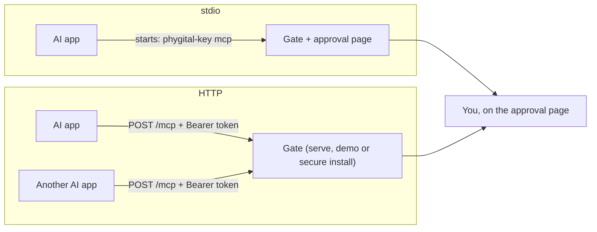

# Connect your AI app

The gate is a normal MCP server, so any app that speaks MCP can use it. This page shows the two ways to connect, the exact settings for Claude Code and Claude Desktop, the shape for any other MCP client, and a test that proves the connection works.

**On this page:** [two ways](#two-ways-to-connect) · [stdio](#stdio-the-app-starts-the-gate) · [HTTP](#http-the-app-connects-to-a-url) · [what the endpoint refuses](#what-the-endpoint-refuses) · [how the page reaches you](#how-the-approval-page-reaches-you) · [check that it works](#check-that-it-works)

## Two ways to connect

| | stdio | HTTP |
|---|---|---|
| Who starts the gate | Your AI app runs `phygital-key mcp` | You (`phygital-key serve`), the [secure install](secure-install.md), or `phygital-key demo` |
| What the app needs | A command and its arguments | A URL and an `Authorization` header |
| Access token | None: only the app that started the gate can talk to it | Required: `Authorization: Bearer <token>` |
| Approval page | `http://localhost:7468`, while the app runs | `http://localhost:7468` (or your [own server](own-server.md)'s https address) |
| Several AI apps at once | No: each app would start its own gate on the same port | Yes: every app connects to the one gate |
| Use it for | The [quick install](getting-started.md#quick-install) | The secure install, the demo, a shared or remote gate |



Either way the app sees an MCP server named `phygital-key` (title `Phygital Key`, version the program's version, for example `0.3.0`), and the AI gets the same six [tools](tools.md): `request_approval`, `get_approval`, `cancel_approval`, `record_receipt`, `request_standing_approval` and `use_standing_approval`. None of them can approve. Only your key can sign.

## stdio: the app starts the gate

### Claude Code

```bash
claude mcp add phygital-key -- phygital-key mcp
```

Everything after `--` is the command Claude Code runs. To use a different data folder or port, add the options there:

```bash
claude mcp add phygital-key -- phygital-key --home /path/to/folder --port 7468 mcp
```

### Claude Desktop

Claude Desktop reads its MCP servers from `claude_desktop_config.json` (the app's settings can open it for you; look for a developer or MCP section). Add the gate under `mcpServers`:

```json
{
  "mcpServers": {
    "phygital-key": {
      "command": "phygital-key",
      "args": ["mcp"]
    }
  }
}
```

If the file already has other servers, add the `"phygital-key"` entry next to them. Restart the app after saving.

### Any other MCP client (stdio)

Most apps that start local servers ask for the same two things:

| Field | Value |
|---|---|
| Command | `phygital-key` |
| Arguments | `mcp` |
| Environment (optional) | `PHYGITAL_KEY_HOME` (data folder), `PHYGITAL_KEY_PORT` (port of the approval page) |

Desktop apps sometimes do not search the same folders as your terminal. If the app says it cannot find `phygital-key`, use its full path as the command. Find it with `which phygital-key` (macOS, Linux) or `where phygital-key` (Windows).

### Add your key

In stdio mode the gate never prints an enrollment link, because its output goes to the AI app's logs and the AI could read it. Once the app has started the gate, add your key from your own terminal:

```bash
phygital-key enroll
```

The link it prints works once, for 10 minutes. Use the same `--home` (or `PHYGITAL_KEY_HOME`) and `--port` as the app's command, or the gate will not know the link. Details: [keys and devices](keys-and-devices.md#your-first-key).

## HTTP: the app connects to a URL

### Get the URL and token

The gate makes an access token once and keeps it in `<home>/mcp-token` (file mode 0600). Print it, together with the line for Claude Code:

```bash
phygital-key mcp-token
```

```text
  MCP endpoint    http://localhost:7468/mcp  (needs header  Authorization: Bearer o63AlJdLK4pwPgH-...)
  Claude Code:    claude mcp add --transport http phygital-key http://localhost:7468/mcp --header "Authorization: Bearer o63AlJdLK4pwPgH-..."
```

With the secure install, run `phygital-key-admin token` instead (the token is in the gate's own data folder, which you cannot read without your administrator password). `phygital-key demo` prints the same two lines when it starts.

`phygital-key serve` itself never prints the token, so its output is safe to keep in a log. It prints where to get it:

```text
phygital-key: no key enrolled yet. In your own terminal, run: phygital-key enroll (or phygital-key-admin enroll for the secure install)
phygital-key
  approval page   http://localhost:7468
  MCP endpoint    http://localhost:7468/mcp  (access token: run  phygital-key mcp-token)
```

(The first line appears only while no key is enrolled.)

### Claude Code

Paste the line `mcp-token` printed:

```bash
claude mcp add --transport http phygital-key http://localhost:7468/mcp --header "Authorization: Bearer <token>"
```

### Any other MCP client (HTTP)

The app needs a Streamable HTTP MCP endpoint and one header:

| Field | Value |
|---|---|
| URL | `http://localhost:7468/mcp` (or `https://<your gate>/mcp`) |
| Header | `Authorization: Bearer <token>` |

Many apps take a JSON entry of roughly this shape. Field names differ between apps, so check your app's documentation for the exact ones:

```json
{
  "phygital-key": {
    "url": "http://localhost:7468/mcp",
    "headers": { "Authorization": "Bearer <token>" }
  }
}
```

If your app can only start a command and cannot send a header, use stdio instead.

### What the endpoint refuses

HTTP mode always needs the token, unless you start the gate with `--open-mcp`. These checks run before any MCP message is read:

| What the request does | Answer |
|---|---|
| No `Authorization` header, or a wrong token | `401` and ``{"error":"missing or wrong MCP access token (see `phygital-key mcp-token`)"}`` |
| Carries a browser `Origin` header (a web page trying to call it) | `403` and `Forbidden: Origin header is not allowed` |
| Uses a host name the gate does not know (DNS rebinding) | `421` `{"error":"unknown host"}` |

The word `Bearer` may be written in any case. `--open-mcp` turns the token off; then any program on the machine could create requests (they would still need your key to be approved, but they could flood you with them).

> [!IMPORTANT]
> The token keeps other programs on your machine out. It does not keep the AI out: it sits in your AI app's settings, where the AI can read it. That is fine. Through MCP the AI can only ask. It can never approve.

### Rotate the token

Stop the gate, delete `<home>/mcp-token`, start the gate again (it makes a new one), run `phygital-key mcp-token`, and update every AI app with the new line. With the secure install the file is `mcp-token` in the gate's data folder: delete it with `sudo`, then run the locked `install-service` again (see [secure install](secure-install.md#update)), which restarts the gate.

## How the approval page reaches you

When the AI calls `request_approval`, the gate asks the AI app to open the approval page for you (an MCP feature called URL [elicitation](glossary.md#elicitation)), with the message `A person must approve this request with their key. Open the page to review the exact request and decide.` If the app supports it, you are offered the page directly, and the tool result tells the AI `The approval page was offered to the person. Call get_approval to wait for their decision.` If it does not, the tool result tells the AI: `Show the person approve_url and ask them to open it and decide. Then call get_approval.` The AI then gives you the link. Either way, "opening the page" is never a yes. Only your key's signature on the page is.

## Check that it works

With your key added, ask your AI app:

> Use the phygital-key tool request_approval with request `{"type": "send_message", "params": {"to": "sam@example.com", "text": "Hi"}}`, aud `http://localhost:7469` and level `medium`. Then call get_approval and tell me the status.

What you should see:

1. The tool returns an `id`, an `approve_url` like `http://localhost:7468/r/7RLxvFl6e7CNs1Jz65rE6g` and `"status": "pending"`.
2. The page shows the card title `send_message`, **Carried out by** `http://localhost:7469`, **Proof needed** `A touch on your key`, and two rows: `text Hi` and `to sam@example.com`.
3. Press **Approve with my key** and touch your key. The page says `Approved` and `Signed by <your key name>. It works once, within 60 seconds.`
4. `get_approval` returns `"status": "approved"`, `"approved_by": "<your key name>"`, a long `approval` string, and `next`: ``Approved. Send `approval` with the action to the service, in the Phygital-Approval header (or the field the service names). It works once, before `exp`.``

The gate never contacts the audience, so this test works whether or not the demo is running. Nothing is sent to anyone. If you also run `phygital-key demo` (HTTP), the AI can then post the approval to `http://localhost:7469/send_message` and get back `Sent (demo: nothing real happened)`.

If the tool answers ``No key is enrolled yet. Ask the person to run `phygital-key enroll` and add their passkey first.``, add your key first. Other messages are in [troubleshooting](troubleshooting.md#the-ai-app-and-mcp).

## Next

- [Approving](approving.md): what each part of the page means
- [Tools](tools.md): every tool, argument and result
- [Secure install](secure-install.md): run the gate where the AI cannot change it
- [Troubleshooting](troubleshooting.md)
