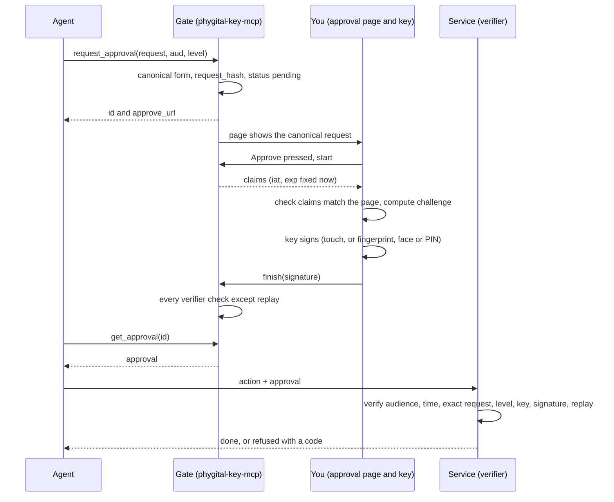

# How it works

This page explains Phygital Key in plain words: who does what, what happens during one approval, and why the yes cannot be faked. It is for anyone, technical or not. Contributors who want the inside of the program should read [architecture](architecture.md) next. The agent's side is shown with the tool names of Phygital Key MCP (`request_approval`, `get_approval` and the rest); other products reach the same gate steps through their own protocol.

## The idea

An AI agent, an app or a business wants to do something that matters: deploy code, pay, delete, send. Before it may, a person says yes to that exact thing with their own [key](glossary.md#key): a passkey on a phone or laptop (Touch ID, Face ID, Windows Hello) or a hardware key such as a YubiKey.

The yes is a small signed note called an [approval](glossary.md#approval). The service that does the work checks the approval itself, in its own code, before acting. If anything about it is off, the answer is no.

## The four roles

| Role | Who | What it does | What it can never do |
|---|---|---|---|
| Requester | The AI agent, or any app | Asks for a yes for one exact [request](glossary.md#request) | Hold the person's key, or approve |
| [Gate](glossary.md#gate) | A product's program (`phygital-key-mcp` or `phygital-key-a2a`), on your computer or a server | Shows the request on the [approval page](approval-page.md), collects the signature, hands back the approval | Create a yes by itself: it has no private key |
| Approver | You, with your key | Reads the request, then approves with your key or says no | Be asked to sign something the page does not show (the page checks this, see [approval page](approval-page.md)) |
| [Verifier](glossary.md#verifier) | The service that does the work | Checks the approval before acting | Accept an approval meant for another service, another request or a weaker [level](glossary.md#level) than it requires |

The gate talks to AI apps through the agent protocol of its product: Phygital Key MCP speaks MCP (the Model Context Protocol), so any AI app that supports MCP can use it, and Phygital Key A2A, which is new, speaks A2A. Everything else (the page, keys, standing approvals, receipts, the audit log) is the same shared base. The verifier is a small library in Rust or JavaScript, or one command (`phygital-key-mcp verify`). The two verifiers share no code and pass the same [test vectors](../test-vectors/README.md).

## One approval, step by step

1. The agent calls `request_approval` with the exact request, for example `{"type": "deploy", "params": {"service": "api", "env": "production", "version": "2.4.1"}}`, the audience (`aud`, who will carry it out) and the level (`medium` or `high`).
2. The gate turns the request into one exact text, the [canonical form](canonical-form.md), and computes its SHA-256 hash (`request_hash`). It stores the request as pending for up to 10 minutes and gives the agent a link to the approval page.
3. You open the page. It shows every field of the canonical request, the audience, the level and the time left. Nothing comes from the agent's own words.
4. You press **Approve with my key**. The gate fixes the claims at that moment: the request, audience, level, a single-use id, the time (`iat`) and the expiry (`exp`, 60 seconds later by default).
5. The page checks that these claims say exactly what it shows, computes the [challenge](glossary.md#challenge) itself, and asks your key to sign. Your key never leaves your device.
6. The gate runs the verifier's checks on the signature before it stores anything. Then the agent can fetch the approval with `get_approval`.
7. The agent sends the approval with the action. The service runs `verify`: same request to the last byte, meant for this service, still in time, at least the level it needs, signed by a key it trusts, never used before. Only then does it act.

Pressing Deny records a refusal, and the agent gets status `denied` with no approval. If nobody decides within 10 minutes, the status becomes `expired` and the answer is no.

## Why it cannot be faked

Each reason below is a mechanism in the code, with the test that proves it.

| Reason | Mechanism | Proof |
|---|---|---|
| Only your key can sign | Signatures are ES256 (ECDSA on the P-256 curve with SHA-256) made inside your authenticator. The gate and the verifier only ever hold public keys. | Vector `untrusted_key` (`UNTRUSTED_KEY`), vector `flipped_signature_bit` (`BAD_SIGNATURE`) |
| The signature covers the exact text | The challenge is a SHA-256 hash of the canonical claims, which contain the whole request. The verifier hashes the request it is about to run and compares. | Vector `request_one_char_changed`: approved `2.4.1`, about to run `2.4.2`, `REQUEST_MISMATCH` |
| One service | The claims name the audience. The verifier compares it with its own id. | Vector `wrong_audience` (`WRONG_AUDIENCE`) |
| One use | Every approval has a 128-bit random id. The verifier records it and refuses it the second time. | Vector `replayed_id` (`REPLAYED`) |
| One minute | `exp` is 60 seconds after `iat` by default, 300 at most. | Vectors `expired_exactly_at_exp`, `lifetime_301s` (`EXPIRED`) |
| The service sets the level | The verifier passes the level it needs. An agent asking for `medium` on a production deploy gets an approval the service refuses. | Vector `medium_when_high_required` (`ASSURANCE_TOO_LOW`) |
| Look-alike text fails | Text is compared byte for byte. Text that is not in Unicode NFC is refused, never rewritten. | Vectors `unicode_homoglyph` (`REQUEST_MISMATCH`), `kelvin_sign_payee_refused` (`MALFORMED`) |
| Fake pages do not work | Passkeys sign only for the real address of the gate, and the verifier checks the page origin and the RP ID hash. | Vectors `wrong_origin`, `wrong_rp_id`, `cross_origin_frame` (`BAD_SIGNATURE`) |
| Text in a request is never a yes | A request is data. Only a signature counts. | Vector `prompt_injection_is_data` (`APPROVAL_REQUIRED`) |
| The AI cannot change the gate | With the secure install, the gate runs as its own system user: the AI, even acting as you, cannot change its program, read its data or write its keys. Only the administrator password can. | Each product's `tests/secure-install.sh`: installs it for real on macOS and Linux in CI on every push to `main` and every pull request, then checks this user cannot change the program, read the data folder or write the keyring |

The full list of the 141 shared vectors is in [test vectors](../test-vectors/README.md). Phygital Key MCP's end-to-end suite (124 checks) drives a real browser with a virtual passkey and the official MCP SDK, and tries each attack an agent can make through the gate and the page. See [testing](testing.md).

## Standing approvals

For small repeated actions you can approve a [standing approval](glossary.md#standing-approval) once, at level `high`:

> Allow `payment` to `ACME Ltd` in `EUR`, from 1 to 2000 cents each, at most 5 times, for 7 days.

For each use, the gate signs a short [use token](glossary.md#use-token) with a key it made for this standing approval and holds only in memory. A use token covers one exact request and lives at most 60 seconds. The service checks your standing approval, the use token, that the request is inside the limits, and counts uses itself.

You can revoke it at any time. The gate throws the use key away at once, so no new uses can be signed. Then you sign a [revocation](glossary.md#revocation) with one more touch, and the gate publishes it for services. Until a service picks up the revocation, use tokens already handed out work for up to 60 seconds. Details: [standing approvals](standing-approvals.md), [revocations](revocations.md).

## Keys

- **Your first key** is added through a one-time link that only your own terminal prints (`phygital-key-mcp enroll`). The link works for 10 minutes. The first key then signs its own addition, which proves it works and starts the [key history](glossary.md#key-history).
- **Adding or removing a key** later is itself an approval at level `high`, signed by a key you already trust. A new key can never approve itself. The last key cannot be removed.
- **Your key list is signed.** Anyone who knows one short [fingerprint](glossary.md#fingerprint) (shown on the gate's home page) can check the whole list and spot an old copy.

Details: [keys and devices](keys-and-devices.md), [key history](key-history.md), [WebAuthn](webauthn.md).

## Receipts

After acting, a service can send back a signed [receipt](glossary.md#receipt): "done" or "failed", pointing at your approval by hash. The agent carries it back to the gate, so the gate records it only if it is signed by the receipt key you pinned for that service (`phygital-key-mcp trust-service`). Only then does the approval page say "The service reported: done." Details: [receipts](receipts.md).

## Updates

The [secure install](secure-install.md) updates itself once a day, on by default. It installs only a release whose file list (`release.txt`) is signed by a release key pinned in the installer, checks the SHA-256 of the download against that signed list, and switches back to the previous program if the new gate does not start. `--no-auto-update` turns it off. Updating restarts the gate: requests still waiting for a decision are lost, and standing approvals stop working because their use keys live only in memory. One-time approvals already signed are not affected. Details: [architecture](architecture.md#signed-releases-and-updates), [updates](updates.md).

## What it does not do

> [!IMPORTANT]
> Approvals are signed and verified, not secret. Anyone holding an approval can read the request in it. Keep passwords, keys and personal data out of requests.

- It does not make a bad request safe. It makes sure a person agreed to exactly that request.
- It cannot protect a service that does not check the approval.
- It cannot protect you if the machine that runs the gate is taken over: that machine serves the approval page. See the [threat model](threat-model.md).
- A stolen approval works once, for that request and that audience, until it expires (60 seconds by default).
- It is pre-audit: no outside paid security audit has been done yet.
- The signed update path runs for real only once signed releases exist. It has not yet been tested against GitHub end to end.

## Next

- [Architecture](architecture.md): the parts of the program and how a request moves through them
- [Approval page](approval-page.md): how the page protects you
- [Canonical form](canonical-form.md): the exact text that is signed
- [Threat model](threat-model.md): attackers, defenses and limits
