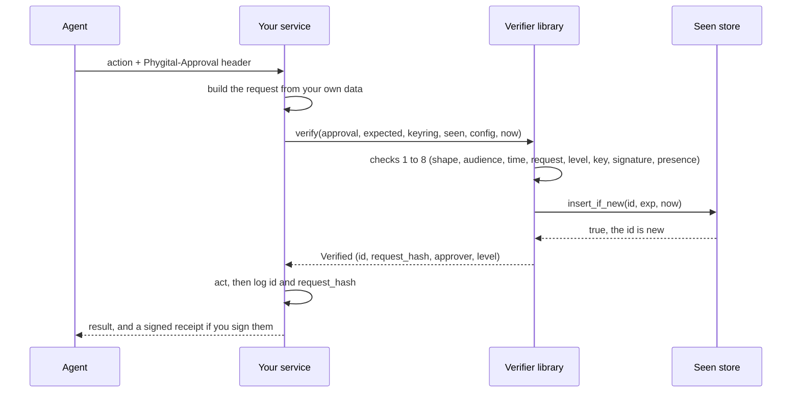

# Check approvals in your service

This guide is for the people who build a service that acts for an AI agent: a deploy endpoint, a payment API, a tool that sends mail. Your service is the **verifier**. Before it acts, it checks the person's signed approval itself, offline, and refuses on any doubt. Words in bold are defined in the [glossary](glossary.md).

On this page:

- [How a check fits into your service](#how-a-check-fits-into-your-service)
- [What you need](#what-you-need)
- [The request you check is the one you run](#the-request-you-check-is-the-one-you-run)
- [Choosing the audience and the level](#choosing-the-audience-and-the-level)
- [Where the approval travels](#where-the-approval-travels)
- [The seen store](#the-seen-store)
- [Checking, per language](#checking-per-language)
- [Standing approvals](#standing-approvals)
- [Revocations](#revocations)
- [Receipts](#receipts)
- [Trusting keys](#trusting-keys)
- [What to log and what to answer](#what-to-log-and-what-to-answer)
- [Checklist](#checklist)

## How a check fits into your service

The agent asks the person through the **gate** (a Phygital Key product such as `phygital-key-mcp` or `phygital-key-a2a`; the check below is the same for both). The person reads the exact request on the approval page and signs it with a passkey or hardware key. The agent then sends that **approval** to you with the action. You never talk to the gate during a check: everything you need is in the approval, your **keyring** and your own data.



If any check fails, the verifier returns one error code and you do not act. The first failing check wins. The full list is in [error codes](error-codes.md).

## What you need

| Thing | What it is | Where it comes from |
|---|---|---|
| Your **audience** (`aud`) | A stable id for your service, for example `https://deploy.example.com` | You choose it. Agents must ask for approvals with this exact string. |
| The **keyring** | The public **key cards** of the people allowed to approve | `phygital-key-mcp keys` on the gate, or the gate's `/.well-known/phygital-key.json`. Check its signed history first: [trusting keys](#trusting-keys). |
| The **config** | The approval page origin and the WebAuthn relying party id (rp_id, the page's host name) | For a gate at `https://approve.example.com`: `origins: ["https://approve.example.com"]`, `rp_ids: ["approve.example.com"]`. For a local gate: `http://localhost:7468` and `localhost`. |
| A **seen store** | Remembers approval ids that were used, so each approval works once | In memory for one process; a shared, durable store when you run more than one. See [the seen store](#the-seen-store). |
| A **level** per action | How strong the proof must be | You decide: `medium` (a touch) or `high` (fingerprint, face or PIN). |
| The current time | Unix seconds | Your clock. The library never reads it, except the Rust `Verifier` helper. |

The check itself is pure: no network, no global state except the seen store. It uses ES256 (ECDSA over P-256 with SHA-256), SHA-256 and RFC 8785 canonical JSON. Approvals are signed and verified, not encrypted: anyone who holds one can read the request in it, so keep secrets out of requests.

> [!IMPORTANT]
> Phygital Key is pre-audit: no outside security audit has been done yet. The Rust and JavaScript verifiers are checked against the same 123 shared test vectors, but treat them as unaudited code.

## The request you check is the one you run

A request is exactly `{"type": "<action>", "params": {...}}`. Build it from the values your service is about to use, then ask the verifier whether the person approved exactly that.

```rust
// The values your handler is about to act on.
let request = serde_json::json!({
    "type": "deploy",
    "params": {"service": service, "env": env, "version": version}
});
```

The approval carries its own copy of the request (`claims.request`), and an agent can put anything there. The verifier compares two hashes:

$$\texttt{request\_hash} = \mathrm{base64url}\big(\mathrm{SHA256}(\mathrm{JCS}(\text{request}))\big)$$

It hashes the request you pass in and the request in the claims, and both must equal the signed `request_hash`. If you passed in `claims.request`, the check would compare the approval with itself and prove nothing about what you run.

Rules that follow from this:

- One field changed is a different request. Approved `2.4.1`, about to run `2.4.2`: `REQUEST_MISMATCH`.
- Key order and whitespace do not matter: both sides are put in canonical form (RFC 8785) first.
- Text must already be Unicode NFC, and is never rewritten. A request that is not NFC has no canonical form and is refused (`MALFORMED`). This is what stops a payee written with KELVIN SIGN (U+212A) passing as `K`.
- No floats. Amounts are integers in minor units (`12000`) or strings (`"120.00"`). Integers must fit in ±(2^53 - 1).
- Your request is limited to 8192 bytes in canonical form, and nesting to 16 levels.
- The type `revoke` is never an action: `verify` refuses a request of that type with `MALFORMED`. An approval of a `standing` request is refused by `verify` too (`MALFORMED`); standing approvals go through `verify_use`.

## Choosing the audience and the level

**Audience.** The verifier compares `claims.aud` with your audience byte for byte. Pick one string per service and keep it stable: a URL (`https://deploy.example.com`), a domain, or an id (`acme-payments-eu`). The gate accepts 1 to 256 visible ASCII characters (`!` to `~`), so spaces, look-alike letters and invisible characters cannot hide in it. It refuses the audience `phygital-key:keyring:<origin>`, which is reserved for the gate's own key changes. Two services must never share an audience: an approval meant for one would then pass at the other.

If you run staging and production, give them different audiences (`https://deploy.example.com` and `https://deploy.staging.example.com`), so an approval for staging never counts in production.

**Level.** You set the lowest level each action needs. The verifier refuses an approval below it (`ASSURANCE_TOO_LOW`), whatever the agent asked for. A `high` approval also meets a `medium` requirement.

| Level | What the person did | WebAuthn flag checked | Examples |
|---|---|---|---|
| `medium` | Touched the key | user present (UP) | Send a message, edit a document, a small order |
| `high` | Fingerprint, face or PIN | user present and user verified (UV) | Production deploy, delete data, move money, sign a contract |

Reading data usually needs no approval at all. A security key without a PIN can only approve `medium`. Standing approvals are always `high`, whatever you ask for.

Keep the mapping in your code, next to the action:

```rust
fn level_for(action: &str) -> Option<Level> {
    match action {
        "deploy" | "payment" => Some(Level::High),
        "send_message" => Some(Level::Medium),
        _ => None, // unknown action: refuse
    }
}
```

This is how the demo service in `crates/phygital-key-gate/src/demo.rs` does it.

## Where the approval travels

The approval is one base64url string of at most 16384 characters. Accept it in one of two places:

| Place | Use it when |
|---|---|
| HTTP header `Phygital-Approval: <approval>` | Your API takes the action's params as the body. The demo service reads this header. |
| A JSON field `"approval": "<approval>"` next to the params | Headers are hard to set for your callers, or the call is not HTTP. |

For a standing approval the agent sends two values: the person's standing approval in `Phygital-Approval` and the use token for this one action in `Phygital-Use` (or two JSON fields). The MCP tools of Phygital Key MCP tell agents to do exactly this.

Check that proxies in front of your service allow request headers of that size. Never take the approval from a query string: URLs end up in logs, and an approval can be used by whoever holds it until `exp`.

## The seen store

Every approval has a 128-bit random `id`. The last check spends it: the verifier calls the seen store, which must record the id and say whether it was new. A second use of the same approval is `REPLAYED`. The id is spent even if your action then fails, so a failed action needs a new approval.

A seen store must be:

| Property | Why | What breaks without it |
|---|---|---|
| **Atomic** | Two requests with the same approval can arrive at the same moment | Both pass a separate "check, then write" and the action runs twice |
| **Shared** | Every instance that acts must see the same ids | An approval used on instance A works again on instance B |
| **Durable** | A restart must not forget ids that are still valid | An approval can be used again after a crash, until it expires |
| **Fail closed** | A store error must never count as "new" | An outage turns into unlimited replays |

Keep each id until `exp + 30` seconds. The extra 30 seconds (the allowed clock drift, `MAX_CLOCK_SKEW_SECS`) cover a clock that steps back. This is what the built-in stores do. An approval lives 60 seconds by default and 300 seconds at most, so the store stays small.

The built-in stores:

| Store | Scope | Notes |
|---|---|---|
| `MemorySeenStore` (Rust and JavaScript) | One process | Lost on restart. Fine for one instance, tests and demos. |
| `seen-ids.jsonl` of `phygital-key-mcp verify` | One machine | Lock file, temp file then rename, fsync. A damaged line makes every check fail. See [CLI](cli.md#the-seen-ids-file). |

For more than one instance, back the store with your database. Two designs follow. They are sketches: adapt names, error handling and connection pooling to your stack.

**SQL with a unique key.** A primary key makes the insert itself the atomic test. Exactly one inserted row means the id is new. Any error means "not new".

```sql
-- Sketch (PostgreSQL or SQLite syntax).
CREATE TABLE pka_seen (
  id         TEXT   PRIMARY KEY,
  keep_until BIGINT NOT NULL
);

-- insert_if_new(id, exp, now): new when exactly 1 row was inserted.
INSERT INTO pka_seen (id, keep_until) VALUES ($1, $2 + 30)
ON CONFLICT (id) DO NOTHING;

-- Now and then:
DELETE FROM pka_seen WHERE keep_until <= $now;
```

**Redis `SET NX` with an expiry.** `NX` sets the key only if it does not exist, and `EXAT` makes Redis forget it at a Unix time.

```text
Sketch:
  reply = SET pka:seen:<id> 1 NX EXAT <exp + 30>
  reply == "OK"   -> new
  reply == nil    -> seen before
  any error       -> treat as seen before (fail closed)
```

Redis keeps data in memory. Without persistence (for example `appendonly yes`), a Redis restart forgets ids and reopens a replay window as long as the approval lifetime (60 s by default, 300 s at most).

In JavaScript, store methods may be plain or `async`: `verify` and `verifyUse` await the answer. Only an exact `true` from `insertIfNew` counts as new; anything else is `REPLAYED`, and a store that throws or rejects (with anything but a `Refused` code) gives `MALFORMED`, so an outage is a refusal. Awaiting does not make your store atomic: the single `INSERT` or `SET NX` above still has to be the test. Contract and an async example: [verifier-js](verifier-js.md#stores). The Rust traits are synchronous; with an async client, see [verifier-rust](verifier-rust.md#implementing-seenstore).

## Checking, per language

Each page has install steps, every function and complete examples.

| Language | Page | Call |
|---|---|---|
| Rust | [verifier-rust](verifier-rust.md) | `phygital_key_verify::verify(...)` or `Verifier::verify(...)` |
| JavaScript (Node 20+, browsers) | [verifier-js](verifier-js.md) | `await verify(...)` |
| Any language | [CLI](cli.md) | `phygital-key-mcp verify ...`, exit code 0 means go |

Rust, with your own clock and seen store:

```rust
use phygital_key_verify::{Config, Expected, Keyring, Level, SeenStore, verify};

fn approve_deploy(
    approval: &str,
    version: &str,
    keyring: &Keyring,
    seen: &dyn SeenStore,
    config: &Config,
    now: i64,
) -> Result<(), String> {
    let request = serde_json::json!({
        "type": "deploy",
        "params": {"service": "api", "env": "production", "version": version}
    });
    let expected = Expected { aud: "https://deploy.example.com", request: &request, level: Level::High };
    let ok = verify(approval, &expected, keyring, seen, config, now).map_err(|code| code.to_string())?;
    // Act now, then log what was approved and by whom.
    println!("deploy {version}: approval {} ({}) by {}", ok.id, ok.request_hash, ok.approver);
    Ok(())
}
```

JavaScript:

```js
import { verify, MemorySeenStore, keyringFrom } from "phygital-key-verify";

const result = await verify(
  approval,
  { aud: "https://deploy.example.com", request, level: "high" },
  keyringFrom(JSON.parse(keyringJson)),
  seen, // new MemorySeenStore() for one process
  { origins: ["https://approve.example.com"], rp_ids: ["approve.example.com"] },
  Math.floor(Date.now() / 1000),
);
if (!result.ok) refuse(result.error); // for example "REQUEST_MISMATCH"
```

Any language, through the command line:

```bash
phygital-key-mcp --origin https://approve.example.com verify \
  --approval @approval.txt \
  --request '{"type":"deploy","params":{"service":"api","env":"production","version":"2.4.1"}}' \
  --aud https://deploy.example.com --level high --keyring keyring.json
```

```json
{"approved_by":"alice (TEST ONLY)","exp":1792273462,"id":"IndRsb1x5UAclXKSU4dcnA","level":"high","ok":true}
```

## Standing approvals

A **standing approval** lets the person approve once for the same kind of action, within fixed limits, a few times, for up to 30 days. Each action then carries a short **use token** (at most 60 seconds) signed by a key the gate holds only in memory. Read [standing approvals](standing-approvals.md) for what the person sees.

Your service checks both values with `verify_use` (Rust) or `verifyUse` (JavaScript). On top of every check of a one-time approval, it checks:

1. The standing approval is level `high` and lives at most 30 days.
2. It is not in your revocation set (`REVOKED`).
3. The use token is signed by the `use_key` named in the standing approval, for the same standing id, for your audience, inside its time window and never past the standing approval's end.
4. The request you are about to run equals the request in the use token.
5. The request has exactly the `fixed` fields with the same values and the `vary` fields within their limits, and nothing else (`NOT_ALLOWED`).
6. Your **use store** counts the use: a use id seen before is `REPLAYED`, more than `max_uses` is `USED_UP`.

```rust
use phygital_key_verify::standing::{MemoryUseStore, Revocations, verify_use};
use phygital_key_verify::{Expected, Level};

let uses = MemoryUseStore::new(); // one process only; see the use store notes below
let expected = Expected { aud, request: &request, level: Level::High };
let ok = verify_use(&standing, &use_token, &expected, &keyring, &uses, &revoked, &config, now)?;
// ok.uses_left, ok.use_id, ok.standing.id
```

The use store has the same four needs as the seen store (atomic, shared, durable, fail closed), and it holds entries longer: until the standing approval's end plus 30 seconds, up to 30 days. A use store that forgets would let the agent spend the uses again.

A SQL sketch, in one transaction:

```sql
-- Sketch. pka_uses has PRIMARY KEY (standing_id, use_id).
BEGIN;
INSERT INTO pka_uses (standing_id, use_id, keep_until) VALUES ($sid, $use_id, $until + 30);
--   unique violation      -> ROLLBACK, return REPLAYED
SELECT count(*) FROM pka_uses WHERE standing_id = $sid;
--   count > max_uses      -> ROLLBACK, return USED_UP
COMMIT;
--   return max_uses - count (uses left)
```

Run it at an isolation level that stops two transactions both seeing room for one more use (`SERIALIZABLE`, or a row lock on a per-standing counter row). With Redis, do the same steps in one Lua script so they run atomically: `SISMEMBER`, `SCARD`, `SADD`, `EXPIREAT`.

## Revocations

The person can revoke a standing approval on its approval page. The gate throws the use key away at once, so no new use tokens can be made. The person then signs a **revocation**, which the gate publishes at `/.well-known/phygital-key-revoked.json`. Your service fetches that list now and then, keeps every valid entry it has ever accepted, and passes the set to `verify_use`. Until you pick it up, use tokens already handed out keep working for up to 60 seconds.

Format, refresh cadence and why junk entries are ignored: [revocations](revocations.md).

## Receipts

After acting, your service can answer with a **receipt**: a JWS signed with your service's own ES256 key, saying `success` or `error` for this approval. The agent passes it back to the gate, and the person sees "The service reported: done." on the approval page, but only if they pinned your receipt key with `phygital-key-mcp trust-service`. Signing, publishing your key and checking: [receipts](receipts.md).

## Trusting keys

The keyring decides whose approvals count, so where it comes from matters as much as the check.

| Setup | How to get the keyring |
|---|---|
| Your service runs next to the gate, same owner | Read the gate's `keyring.json` (or the output of `phygital-key-mcp keys`). |
| The gate belongs to someone else | Fetch `https://<gate>/.well-known/phygital-key.json` over HTTPS and check its signed **key history** before using it. |

A published keyring carries a signed history of every key change, starting with the first key approving itself. Learn the first key's **fingerprint** once, from the person (their gate's home page shows it, `phygital-key-mcp keys` prints it), then check every copy against it:

```bash
phygital-key-mcp keys --check Pp0IrvTI9djhcmFJeel-FJXJd1_u_tJ2R8j8hpMh1xo \
  --file new.json --signed-on https://approve.example.com --previous accepted.json
```

```text
keyring ok: 1 keys, every change signed, starting from Pp0IrvTI9djhcmFJeel-FJXJd1_u_tJ2R8j8hpMh1xo
```

Keep the copy you accepted. A later copy must extend it entry for entry (`verify_history_update`), which stops an old copy from bringing back a removed key. In code: `history::verify_history_update` (Rust), `verifyHistoryUpdate` (JavaScript). Details and every rule: [key history](key-history.md).

> [!CAUTION]
> The first copy you fetch can be an old one: a valid history from before a key was removed still checks out. Only the copy you keep protects later fetches. Fetch the first copy through a channel you trust, or compare its key list with the person.

## What to log and what to answer

On success, log `id`, `request_hash`, the time, the approver (`approver` and `credential_id`) and your result. That links your action to one signed approval without storing the request twice. The gate's audit log records the same `id` and `request_hash`.

On refusal, return the error code and do nothing else. The demo service answers `403` with `{"ok": false, "error": "<CODE>"}`, and `404` with `UNKNOWN_ACTION` for an action it does not offer. Error codes are safe to show to the agent: they say which check failed, never anything secret. What each one means and what the agent should do next: [error codes](error-codes.md).

## Checklist

- [ ] Choose one audience per service and environment, and tell agents to use it exactly.
- [ ] Build the request from your own data, never from the approval.
- [ ] Decide the level per action in your code.
- [ ] Use a seen store that is atomic, shared by every instance, durable, and fails closed. Keep ids until `exp + 30`.
- [ ] In JavaScript, plain or `async` store methods both work; make each one a single atomic step, return exactly `true` only for a new id, and let errors throw.
- [ ] Pass the current time in Unix seconds, from a clock kept in sync (NTP).
- [ ] Load the keyring from a source you trust; check its signed history against the person's fingerprint and keep the last accepted copy.
- [ ] Set `origins` and `rp_ids` to the gate's approval page origin and host, nothing else.
- [ ] Standing approvals: count uses in a durable, shared use store; fetch revocations often, merge, never drop accepted ones.
- [ ] Spend the approval before acting, and ask for a new one if the action fails.
- [ ] Log `id`, `request_hash`, approver and result. Return the error code on refusal.
- [ ] Optional: sign receipts, publish your receipt key, and ask people to pin it.

## Next

- [Rust verifier](verifier-rust.md)
- [JavaScript verifier](verifier-js.md)
- [Command line](cli.md)
- [Error codes](error-codes.md)
