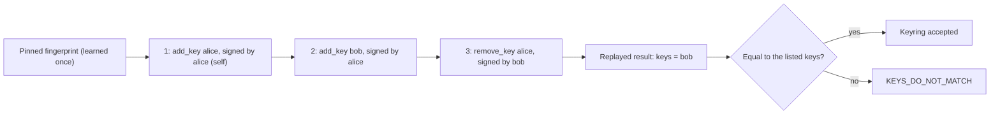

# Key history

The keyring decides whose approvals a service accepts. A signed key history lets anyone check a published keyring from one short fingerprint: every key that was ever added or removed is itself an approval, signed by a key that was trusted at that moment. This page is for developers who fetch keyrings from a gate they do not run, or who implement the check in another language. Terms are in the [glossary](glossary.md).

On this page:

- [The idea](#the-idea)
- [Key changes are approvals](#key-changes-are-approvals)
- [A keyring with history](#a-keyring-with-history)
- [verify_history, rule by rule](#verify_history-rule-by-rule)
- [Refetching: verify_history_update](#refetching-verify_history_update)
- [Error codes](#error-codes)
- [The limit of a first fetch](#the-limit-of-a-first-fetch)
- [Using it](#using-it)
- [The 25 test vectors](#the-25-test-vectors)

## The idea

You learn one value from the person, once: the **fingerprint** of their first key.

$$\text{fingerprint} = \mathrm{base64url}\big(\mathrm{SHA256}(\text{SPKI DER of the first key's public key})\big)$$

It is 43 characters, short enough to read out on a call or print on a card. The gate's home page shows it, and `phygital-key-mcp keys` prints it. From that one value and the approval page origin, you can check every later copy of the keyring. Whoever controls the website or the file cannot add a key without a signature from a key that was trusted at that point, and cannot bring back a removed key once you keep the last copy you accepted.



This chain is the vector `valid_add_then_remove`: Alice adds Bob, Bob removes Alice.

## Key changes are approvals

Every key change is a one-time approval made on the gate's approval page, with these fixed properties:

| Property | Value |
|---|---|
| Audience | `phygital-key:keyring:<origin>`, for example `phygital-key:keyring:https://approve.example.com` (`history::keyring_aud`) |
| Level | `high` (fingerprint, face or PIN) |
| Signed by | The new key itself for the first entry; a key trusted at that point for every later entry |

The audience names the origin, so a change approved on one gate never counts on another. The gate refuses agents that ask for this audience.

**Adding a key:** request `{"type": "add_key", "params": <key card>}` (`history::add_key_request`). The params are the whole card, every field:

```json
{"type": "add_key", "params": {
  "credential_id": "1FLautRX85-ro_1VvWjbuQ",
  "public_key": "MFkwEwYHKoZIzj0CAQYIKoZIzj0DAQcDQgAEjAztYFodVt_sxz_nC75LqZCRK-wN-hvqPvbwhnanpftOqwvRcGy6j1jNBNJWX6BsRH74xTdfdsmUV7DC48k0og",
  "rp_id": "approve.example.com",
  "name": "bob (TEST ONLY)",
  "created": "2026-10-17"}}
```

**Removing a key:** request `{"type": "remove_key", "params": {"credential_id": ..., "name": ...}}` (`history::remove_key_request`).

**The first key signs itself.** When the person enrolls their first key, the gate does not trust it until it has signed its own `add_key`. This proves the key works and starts the history. A new key can never approve its own addition later: from the second entry on, the signers are the keys already trusted.

The last key cannot be removed, so a keyring with a history always has at least one key.

## A keyring with history

```json
{
  "keys": [ { "credential_id": "...", "public_key": "...", "rp_id": "...", "name": "...", "created": "..." } ],
  "origin": "https://approve.example.com",
  "history": [ "<approval: add first key>", "<approval: add second key>", "<approval: remove a key>" ]
}
```

| Field | Meaning |
|---|---|
| `keys` | The key cards a verifier trusts. |
| `origin` | The approval page origin the history was signed on. |
| `history` | Every key-change approval, oldest first, as approval strings. |

The gate serves this document at `/.well-known/phygital-key.json` and keeps it in `keyring.json`. A plain `{"keys": [...]}` with no history still works for `verify`, but cannot be checked this way (`UNSIGNED`).

## verify_history, rule by rule

```rust
pub fn verify_history(ring: &Keyring, root_fingerprint: &str, origin: &str) -> Result<(), HistoryError>
```

```js
await verifyHistory(ring, rootFingerprint, origin) // null, or an error code string
```

`origin` comes from you, never from the file. The rules run in this order, and the first failure wins:

| # | Rule | Error |
|---|---|---|
| 1 | The keyring has an `origin` and a non-empty `history`. | `UNSIGNED` |
| 2 | The keyring's `origin` equals the origin you expect. | `WRONG_ORIGIN` |
| 3 | Each entry is an approval string whose claims and `iat` can be read. | `BAD_ENTRY` (not an approval) |
| 4 | `iat` never goes back from one entry to the next (equal is fine). | `BAD_ENTRY` (out of time order) |
| 5 | No approval `id` appears twice. | `BAD_ENTRY` (used twice) |
| 6 | Entry 1 is `add_key`; anything else (including `remove_key`) is refused. | `WRONG_ROOT` |
| 7 | An `add_key` card has exactly the five card fields as strings, and its public key is a valid P-256 key. | `BAD_ENTRY` (bad key card, bad public key) |
| 8 | Entry 1's card has the pinned fingerprint. | `WRONG_ROOT` |
| 9 | A later `add_key` does not add a credential id that is already trusted. | `BAD_ENTRY` (key added twice) |
| 10 | A `remove_key` removes a key that is trusted now. | `BAD_ENTRY` (removes a key that is not there) |
| 11 | A `remove_key` does not remove the last trusted key. | `BAD_ENTRY` (removes the last key) |
| 12 | Later entries are `add_key` or `remove_key`. | `BAD_ENTRY` (not a key change) |
| 13 | The entry passes every check of a one-time approval (`check`), as of its own `iat`: audience `phygital-key:keyring:<origin>`, its own request, level `high`, signed by one of the allowed signers (entry 1: its own card; later: the keys trusted at that point), origin equal to `origin`, rp_id of a signer, valid ES256 signature, user presence and user verification. | `BAD_ENTRY` (not signed by a trusted key) |
| 14 | Replaying all entries gives exactly the listed `keys`: the same cards, every field (`credential_id`, `public_key`, `rp_id`, `name`, `created`), each once. | `KEYS_DO_NOT_MATCH` |

Expiry is the one check of `verify` that does not apply: an entry is checked with `now` equal to its own `iat`, so a history stays valid long after each approval's 60 seconds. Replay protection inside the history is rule 5.

The Rust `BadEntry(n, reason)` carries the 0-based index and the reason in parentheses above; its message counts from 1 (`history entry 2: not signed by a trusted key`). JavaScript returns only `"BAD_ENTRY"`.

## Refetching: verify_history_update

A valid history proves that every listed key was approved. It does not prove the copy is the latest: a copy from before a key was removed is a valid history too. So whoever fetches a keyring more than once keeps the last accepted copy and takes a new one only if it extends that copy.

```rust
pub fn verify_history_update(accepted: &Keyring, new: &Keyring, root_fingerprint: &str, origin: &str) -> Result<(), HistoryError>
```

```js
await verifyHistoryUpdate(accepted, next, rootFingerprint, origin) // null, or an error code string
```

| # | Rule | Error |
|---|---|---|
| 1 | The new history starts with every entry of the accepted history, in the same order, byte for byte. Any number of new entries may follow, including none. | `NOT_AN_UPDATE` |
| 2 | The whole new keyring passes `verify_history`. | as above |

This stops two attacks:

- **Rollback:** serving an old copy that still lists a key the person removed. The old copy is shorter than the accepted one, so it is not an extension.
- **Fork by a removed key:** a removed key signs a new entry on top of an old copy. The new branch does not contain the removal you already accepted.

## Error codes

| Code | Cause | What to do |
|---|---|---|
| `UNSIGNED` | No `history` or no `origin`: a plain keyring, or one with the history stripped | Get the published copy from the gate's `/.well-known/phygital-key.json`, or ask the person. |
| `WRONG_ORIGIN` | The history was signed on another approval page | Check you pass the right origin. If you do, this keyring belongs to another gate. |
| `WRONG_ROOT` | Entry 1 is not `add_key` of the key with your pinned fingerprint | Check the fingerprint with the person. Never "fix" this by pinning the fingerprint from the file. |
| `BAD_ENTRY` | An entry is unreadable, out of order, repeated, not a key change, adds a key twice, removes a missing or the last key, or is not a valid high-level approval by a key trusted at that point | Refuse the copy and keep using the last accepted one. Tampering, a broken file, or a change made on another gate. |
| `KEYS_DO_NOT_MATCH` | The listed keys differ from what the history produces: a key slipped in, a removed key still listed, a key swapped, or a name or date changed after signing | Refuse the copy. |
| `NOT_AN_UPDATE` | The new history does not start with your accepted history | Refuse it and keep the accepted copy: a rollback or a fork. If the person started a new keyring on purpose (every key lost), they give you a new fingerprint and you start over. |

## The limit of a first fetch

> [!CAUTION]
> On the first fetch there is no accepted copy, so `verify_history` cannot tell an old copy from the latest one. If the first copy you get is from before a key was removed, you will trust that removed key until you fetch a newer copy that extends it.

Ways to narrow this:

- Fetch the first copy over HTTPS from the gate you expect, close to when you learn the fingerprint.
- Compare the key list with the person (names and count) when you pin the fingerprint.
- Fetch again soon after, through `verify_history_update`: a newer copy that extends yours replaces the old key list, and the removal applies from then on.

## Using it

From the command line, with `--previous` for refetches:

```bash
phygital-key-mcp keys --check Pp0IrvTI9djhcmFJeel-FJXJd1_u_tJ2R8j8hpMh1xo \
  --file new.json --signed-on https://approve.example.com --previous accepted.json
```

```text
keyring ok: 1 keys, every change signed, starting from Pp0IrvTI9djhcmFJeel-FJXJd1_u_tJ2R8j8hpMh1xo
```

In Rust:

```rust
use phygital_key_verify::Keyring;
use phygital_key_verify::history::{verify_history, verify_history_update};

fn accept(accepted: Option<&Keyring>, fetched: &str, pinned: &str, origin: &str) -> Result<Keyring, Box<dyn std::error::Error>> {
    let new = Keyring::from_json(fetched)?;
    match accepted {
        Some(old) => verify_history_update(old, &new, pinned, origin)?,
        None => verify_history(&new, pinned, origin)?,
    }
    Ok(new) // store as the accepted copy; pass it to verify
}
```

In JavaScript, see [verifier-js](verifier-js.md#key-history). `history::root_fingerprint(&ring)` reads the fingerprint of entry 1 without checking anything: use it to display, never to decide what to pin.

## The 25 test vectors

`test-vectors/keyrings.json` holds 25 cases. Each has a `keyring`, a `root_fingerprint`, an `origin`, an optional `accepted` copy (then `verify_history_update` is used) and the expected result. Both verifiers pass all of them. The keys are public test keys named alice, bob and mallory.

| Vector | Expected | What it proves |
|---|---|---|
| `valid_single_key` | ok | The first key approving itself is a complete history. |
| `valid_add_then_remove` | ok | Alice adds Bob, Bob removes Alice: a removal by a later key works. |
| `valid_two_keys` | ok | Alice adds Bob. |
| `unsigned` | `UNSIGNED` | A keyring with no history at all is refused. |
| `wrong_root` | `WRONG_ROOT` | The pinned fingerprint is Bob's, the history starts with Alice. |
| `first_not_self_signed` | `BAD_ENTRY` | Alice's first entry was signed by Bob: the first key must sign itself. |
| `extra_unsigned_key` | `KEYS_DO_NOT_MATCH` | Mallory is listed but was never approved. |
| `added_by_untrusted_key` | `BAD_ENTRY` | Mallory approved her own addition: a new key cannot approve itself. |
| `removed_key_still_listed` | `KEYS_DO_NOT_MATCH` | Alice was removed but is still listed. |
| `tampered_entry` | `BAD_ENTRY` | A signed entry was edited afterwards. |
| `replayed_entry` | `BAD_ENTRY` | The same entry twice. |
| `medium_level_change` | `BAD_ENTRY` | Key changes need level `high`. |
| `change_from_other_gate` | `BAD_ENTRY` | A change approved on another gate's page does not count here. |
| `remove_before_add` | `BAD_ENTRY` | Entries out of time order. |
| `swapped_key` | `KEYS_DO_NOT_MATCH` | Same number of keys, but Mallory instead of Bob. |
| `first_entry_is_a_removal` | `WRONG_ROOT` | A history must start by adding the root key. |
| `key_added_twice` | `BAD_ENTRY` | The same key cannot be added again. |
| `remove_unknown_key` | `BAD_ENTRY` | Removing a key that was never added. |
| `remove_last_key` | `BAD_ENTRY` | The last key cannot be removed. |
| `valid_same_second` | ok | Two key changes in the same second are fine. |
| `relabeled_card` | `KEYS_DO_NOT_MATCH` | Same key, but the listed name was changed after signing. |
| `wrong_origin` | `WRONG_ORIGIN` | A real history, but signed on another gate's page. |
| `valid_update` | ok | A new history that extends the accepted one. |
| `rollback` | `NOT_AN_UPDATE` | An old copy from before Alice was removed. |
| `fork_by_removed_key` | `NOT_AN_UPDATE` | Alice, already removed, signs a new key on top of an old copy. |

The end-to-end suite also checks the gate itself: a second key is not trusted before the first key approves it, a key slipped into the file without a signature is caught, an older copy (rollback) is caught by `--previous`, a key list signed on another gate is refused, and the last key cannot be removed.

## Next

- [Keys and devices](keys-and-devices.md)
- [Integrate](integrate.md#trusting-keys)
- [Command line](cli.md#keys)
- [Spec, section 5](spec.md)
