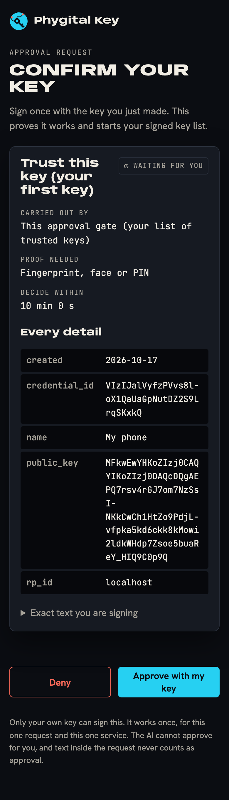
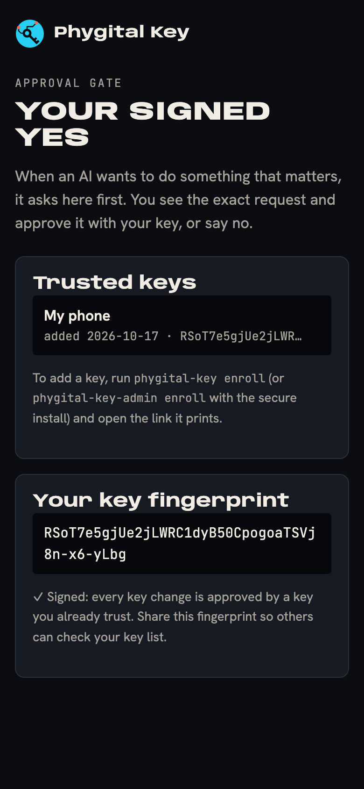

# Keys and devices

Your [keys](glossary.md) are what make an approval yours: only a key in your keyring can sign one. This page covers adding your first key, adding and removing more, your key fingerprint, the signed key history, what to do when a device is lost, and which kind of key to choose.

**On this page:** [your first key](#your-first-key) · [add more keys](#add-more-keys) · [remove a key](#remove-a-key) · [your fingerprint](#your-key-fingerprint) · [signed key history](#the-signed-key-history) · [lost device](#if-you-lose-a-device) · [kinds of keys](#which-kind-of-key) · [levels](#levels-and-what-each-key-can-approve)

## What the gate keeps

The gate keeps only the public half of each key, as a **key card**, in `keyring.json` in its data folder:

```json
{
  "credential_id": "ANIE-FTReccPlqNgEDXHLi53Ah_Rqoy8eJy4qdApT1k",
  "public_key": "MFkwEwYHKoZIzj0CAQYIKoZIzj0DAQcDQgAE...",
  "rp_id": "localhost",
  "name": "My laptop",
  "created": "2026-10-17"
}
```

The private key never leaves your device (your phone, your laptop's secure chip, your password manager or your security key). Keys are P-256 and sign with ES256 (ECDSA over P-256 with SHA-256). Other key types are refused with "Only P-256 (ES256) keys are supported."

## Your first key

1. Make sure the gate is running with the data folder you will use: your AI app running `phygital-key mcp`, or `phygital-key serve`, `phygital-key demo`, or the [secure install](secure-install.md).
2. In your own terminal, ask for a link:

   ```bash
   phygital-key enroll
   ```

   ```text
   Open this link in your browser to add a passkey or hardware key (valid 10 minutes, works once):

     http://localhost:7468/enroll#token=fB9BO3uHKMTSzuWdatRYwAX_UNwfqAag7FsAvC2_wVY

   The gate must be running (phygital-key serve, or your AI app running phygital-key mcp).
   ```

   With the secure install, run `phygital-key-admin enroll` instead.
3. Open the link. Type a name you will recognise later (for example `My laptop`; at most 64 characters) and press **Add key**.
4. Your browser asks you to create a passkey: Touch ID, Windows Hello, your phone, a password manager or a security key.
5. The page moves to **Confirm your key**, with the card title **Trust this key (your first key)** and **Carried out by** "This approval gate (your list of trusted keys)". Press **Approve with my key** and use the same key again, with your fingerprint, face or PIN.



Only after step 5 is the key trusted. The confirmation is the first entry of your [signed key history](#the-signed-key-history): your first key signs its own addition, which proves it works.

How the link is protected:

- The token is 32 random bytes in the link's `#fragment`. Browsers never send a fragment to a server, and the page removes it from the address bar at once.
- The link works for 10 minutes. It is used up when you press **Add key**; you can retry the key prompt with the same page until the 10 minutes run out.
- Only the newest link works: each `enroll` replaces the previous token.
- The gate prints a link only in your terminal (`enroll`, and `demo` at start). In `mcp` mode and in `serve` logs it never does.

> [!IMPORTANT]
> The gate cannot prove a key is real hardware (attestation is `none`, which is what phones and password managers give). Whoever opens a valid enrollment link first can add the first key. Open the link yourself, at once, and do not paste it anywhere an AI can read it.

## Add more keys

Add a second key early, so losing one device does not lock you out.

1. Run `phygital-key enroll` (or `phygital-key-admin enroll`) again and open the new link.
2. Name the new key and press **Add key**. Create the passkey on the new device, or insert the new security key.
3. The page moves to **Approve a new key?** with "Someone is adding a new key. Approve only if you are adding it yourself, right now."
4. Approve with a key you **already trust**. The new key cannot approve itself: the page only lets keys already in your keyring sign.

Until step 4, the new key is listed nowhere and can approve nothing. The approval is a request of type `add_key`, level `high`, with the gate's own audience `phygital-key:keyring:<origin>`, so it can never count as an approval anywhere else.

If the trusted key is on your phone and the new key is a security key on your computer, the browser's prompt in step 4 can offer to use your phone ([approving with your phone](approving.md#approving-with-your-phone)).

## Remove a key

1. Open the gate's home page (`http://localhost:7468`). It lists your trusted keys, each with the date it was added and the start of its own fingerprint.
2. Press **Remove** next to the key. The button appears only when you have more than one key.
3. The page moves to **Remove this key?** with "This key will no longer be able to approve anything." Approve with any trusted key (fingerprint, face or PIN: removal is level `high`).



Rules the gate enforces:

| Situation | Message |
|---|---|
| You try to remove your only key | `You cannot remove your only key. Add another key first.` |
| A removal of the same key is already waiting | `A removal of this key is already waiting for approval.` |
| The key was removed in the meantime | `This key was already removed.` |

Until you approve, the key stays trusted. After it, the gate's keyring no longer lists it, and its signature is refused with `UNTRUSTED_KEY` by any service that uses the new keyring. A service that copied your keyring earlier keeps trusting the removed key until it fetches the new one, so tell the services you work with.

## Your key fingerprint

Your **key fingerprint** is the SHA-256 of your first key's public key (its SPKI DER bytes), in base64url:

$$\text{fingerprint} = \mathrm{base64url}(\mathrm{SHA256}(\mathrm{SPKI\ DER}(\text{first public key})))$$

It is shown on the home page under **Your key fingerprint**, and `phygital-key keys` prints it (with the whole keyring):

```bash
phygital-key keys
```

```text
first key fingerprint (share this so others can check): kZyphIeQPnodbJgeBkVfoywg4zpYwZuIQtI9w2gK2kE
{
  "keys": [ ... ],
  "origin": "http://localhost:7468",
  "history": [ ... ]
}
```

The fingerprint stays the same when you add or remove keys later, because it names the start of the history. Give it once to each service that checks your approvals, through a channel they already trust (in person, on a call, in a signed contract). With it, they can check your whole keyring, including keys you add years later, without trusting the file or the website it came from.

## The signed key history

Every change to your keys is itself an approval:

1. Your first key signs its own addition.
2. Every later addition or removal is signed (level `high`) by a key that was trusted at that moment.
3. `keyring.json` keeps all of these approvals, oldest first, in `history`, together with the address (`origin`) of the approval page they were signed on.

Anyone with your fingerprint can replay that history and check that it produces exactly the keys listed, every field, and nothing else. A key slipped into the file without a signature, a relabelled key, an entry signed by an untrusted key, or a history signed on another gate is caught:

```bash
phygital-key keys --check kZyphIeQPnodbJgeBkVfoywg4zpYwZuIQtI9w2gK2kE --file keyring.json --signed-on http://localhost:7468
```

```text
keyring ok: 2 keys, every change signed, starting from kZyphIeQPnodbJgeBkVfoywg4zpYwZuIQtI9w2gK2kE
```

```text
keyring NOT ok: the history does not start with the pinned key
keyring NOT ok: the history was signed on another approval page
```

An old copy of a keyring (from before a key was removed) is still a valid history. So whoever checks your keyring more than once keeps the copy they accepted and takes a new one only if it extends it:

```bash
phygital-key keys --check <fingerprint> --file new.json --signed-on https://approve.example.com --previous accepted.json
```

The home page runs the same check on the gate's own keyring and shows "✓ Signed: every key change is approved by a key you already trust. Share this fingerprint so others can check your key list." or, if it fails, "✕ Check this: the key history does not check out. Do not share or trust this key list until it is fixed." The format is in [key history](key-history.md).

> [!NOTE]
> A keyring belongs to one approval page address (`--origin`, including the port). Keys made for `localhost` work only on `localhost`, and a history signed on `http://localhost:7468` does not check out on another address. Keep the same address for the life of a keyring. Moving to a new address means starting a new keyring ([the same steps as a lost key](#if-you-lose-a-device)), with a new fingerprint.

## If you lose a device

**You still have another trusted key.** Open the home page, press **Remove** next to the lost key and approve with the other key. Then tell the services you work with to fetch your keyring again.

**You lost every key.** There is no recovery: nothing can approve a change without a trusted key. Start a new keyring:

1. Stop the gate.
2. Move `keyring.json` out of the data folder (keep it as a record).
3. Start the gate and run `phygital-key enroll`. Your new first key gives you a new fingerprint.
4. Give the new fingerprint to every service, the same way you gave the old one.

With the secure install, the keyring is in the gate's data folder (`/Library/Application Support/PhygitalKey` or `/var/lib/phygital-key`): move it with `sudo`, run the locked `install-service` again to restart the gate, then `phygital-key-admin enroll`.

What someone holding your lost device can do depends on the key. A phone or laptop passkey asks for the device's unlock (fingerprint, face or PIN) before it signs `high`. A security key without a PIN signs `medium` requests with a touch. Approvals still need a waiting request on your gate, and each works once, for one service, for 60 seconds.

## Which kind of key

| | Passkey on phone or laptop (Touch ID, Face ID, Windows Hello, Android) | Passkey in a password manager | Hardware security key (FIDO2) |
|---|---|---|---|
| Where the private key lives | The device's secure hardware, or synced by your platform account, depending on your device and settings | Your password manager, synced to your devices | Inside the key; it never leaves |
| Fingerprint, face or PIN | Yes | Usually (the manager's unlock) | Only if the key has a PIN or fingerprint reader |
| Can approve `high` | Yes | When it verifies you | With a PIN or fingerprint set |
| Lost with the device? | Not if synced | No, while you keep the account | Yes: keep a second key |
| Who else can reach it | Your platform account, if synced | Your password manager account | Nobody without the key in hand |

A synced passkey survives a lost phone, and it is only as safe as the account that syncs it. A hardware key cannot be copied, and it can be lost: pair it with a second key.

The gate does not check who made a key (no hardware attestation, [decision 35](decisions.md)). A service that wants only hardware keys trusts only those key cards in its own keyring: anything else is refused with `UNTRUSTED_KEY`.

The signature counter of passkeys is never used (synced passkeys do not keep it reliably). Replays are stopped by each approval's single-use id instead.

## Levels and what each key can approve

| Level | Proof | Flag the service checks | Used for |
|---|---|---|---|
| `medium` | A touch on the key | User present (UP) | Edits, messages, small orders; signing a revocation |
| `high` | Fingerprint, face or PIN | User present and user verified (UV) | Deploys, deletes, money, contracts; every key change; every standing approval |

A **security key without a PIN** proves presence only, so it can approve `medium` requests and sign revocations, and nothing at level `high`:

- it cannot be your first key (the first key must sign its own addition at `high`);
- it can be added later, approved by a key that can verify you;
- it cannot approve key changes or standing approvals, which are always `high`.

When a request needs `high`, the browser may ask you to set a PIN on such a key. Once it has one, it can approve `high` too.

The service decides the level each action needs, not the AI. An approval at `medium` for an action the service treats as `high` is refused with `ASSURANCE_TOO_LOW`.

## Next

- [Approving](approving.md): reading the approval page
- [Standing approvals](standing-approvals.md)
- [Key history](key-history.md): the format and the checks in detail
- [Privacy](privacy.md): what the keyring reveals and who can see it
