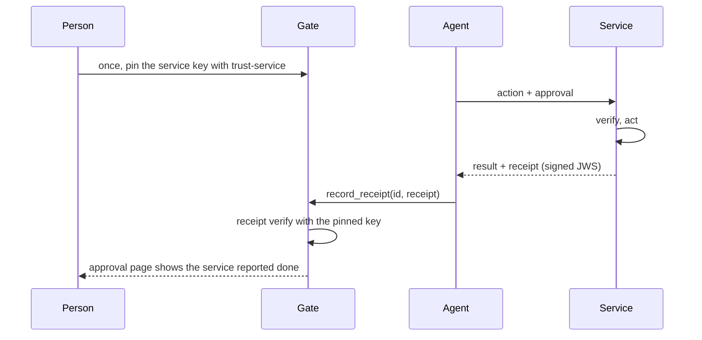

# Receipts

A receipt is a service's signed answer to one approval: "done" or "it did not complete". This page is for service developers who want to sign receipts, and for anyone who checks them. It covers the exact format, signing in Rust, publishing the service key, pinning it on the gate, checking, receipts for standing approvals, what the person sees, and every failure case. Terms are in the [glossary](glossary.md). The agent's side is shown with the tool names of Phygital Key MCP (`request_approval`, `get_approval` and the rest); other products reach the same gate steps through their own protocol.

On this page:

- [Why receipts exist](#why-receipts-exist)
- [The flow](#the-flow)
- [Format](#format)
- [Signing (Rust)](#signing-rust)
- [Publishing the service key](#publishing-the-service-key)
- [Pinning the key on the gate](#pinning-the-key-on-the-gate)
- [Checking a receipt](#checking-a-receipt)
- [Receipts for standing approvals](#receipts-for-standing-approvals)
- [What the person sees](#what-the-person-sees)
- [Failure cases](#failure-cases)

## Why receipts exist

An approval proves the person said yes. It says nothing about whether the service then acted. A receipt closes that loop: the service signs a short statement, bound to the exact approval string by its hash, and the person sees the result on the approval page. Receipts are optional. A service that does not sign them still checks approvals the same way.

A service is not a person, so a receipt is signed with an ordinary key file held by the service (ES256: ECDSA over P-256 with SHA-256), not with a passkey.

## The flow



The agent carries the receipt back, so the agent could also make one up. That is why the gate records a receipt only if it is signed by the key the person pinned for that service.

## Format

A receipt is a compact JWS (JSON Web Signature): three base64url parts without padding, joined by dots.

$$\text{receipt} = \mathrm{base64url}(\text{header}) \,\|\, \texttt{"."} \,\|\, \mathrm{base64url}(\text{payload}) \,\|\, \texttt{"."} \,\|\, \mathrm{base64url}(r \,\|\, s)$$

The signature is ES256 over the ASCII text `base64url(header) "." base64url(payload)`, encoded as the raw 64-byte `r || s` (not DER). Any JWT library can read a receipt.

**Header.** It must be exactly these bytes, the canonical form of the header (RFC 8785, keys sorted, no spaces):

```text
{"alg":"ES256","typ":"pka-receipt+jwt"}
```

A header with the same JSON in another key order, extra fields or another `alg` (such as `none`) is refused as `MALFORMED`.

**Payload.** JSON of these fields. `receipt::sign` writes it in canonical form (RFC 8785); a checker reads it with the strict parser (no duplicate keys, no trailing data) and does not require canonical bytes, since the signature covers the bytes as sent. Unknown fields are refused.

| Field | Type | Required | Meaning |
|---|---|---|---|
| `v` | string | yes | Always `pka.receipt.1`. |
| `iss` | string | yes | The service's audience id, equal to the approval's `aud`. |
| `approval_id` | string | yes | The approval's `claims.id`. For a standing use: the standing approval's id. |
| `reference` | string | yes | base64url SHA-256 of the exact approval string the service received. |
| `request_hash` | string | yes | The `request_hash` of the request the service ran. |
| `status` | string | yes | `success` or `error`. |
| `error` | string | no | A short code when `status` is `error`. Must be absent when `status` is `success`. |
| `use_id` | string | no | For one use of a standing approval: the use token's `id`. Absent for one-time approvals. |
| `iat` | integer | yes | When the service answered, Unix seconds. |

$$\texttt{reference} = \mathrm{base64url}\big(\mathrm{SHA256}(\text{approval string})\big)$$

A receipt from the demo service, decoded:

```text
{"alg":"ES256","typ":"pka-receipt+jwt"}
{"approval_id":"3xUWxPP66U6cjVAzZ1dRoQ","iat":1792273453,"iss":"http://localhost:18311","reference":"iv3y2VHqU0UXXM2A2f_0zCLx6Je0yujzJTcGWMSDXNE","request_hash":"hUXvlpWHC4xarFlhKwaU26H6q05m3gBpMoyE_YKRK7o","status":"success","v":"pka.receipt.1"}
```

A receipt is at most 4096 characters; longer input is refused before parsing.

## Signing (Rust)

`phygital_key_verify::receipt::sign` builds the header and payload in canonical form and signs them. You need `p256` for the key type:

```toml
[dependencies]
phygital-key-verify = { git = "https://github.com/Phygital-Key/phygital-key", rev = "<commit>" }
p256 = { version = "0.14", features = ["ecdsa", "pkcs8"] }
```

```rust
use p256::ecdsa::SigningKey;
use phygital_key_verify::receipt::{self, Receipt};
use phygital_key_verify::Verified;

/// Sign the answer for one approval. `key` is your service's receipt key.
fn receipt_for(
    approval: &str,              // the exact string the agent sent
    ok: &Verified,               // what verify() returned
    failed: Option<&str>,        // Some("OUT_OF_STOCK") if the action did not complete
    key: &SigningKey,
    now: i64,
) -> Result<String, receipt::ReceiptError> {
    let r = Receipt {
        v: "pka.receipt.1".into(),
        iss: "https://deploy.example.com".into(),
        approval_id: ok.id.clone(),
        reference: receipt::reference_of(approval),
        request_hash: ok.request_hash.clone(),
        status: if failed.is_some() { "error".into() } else { "success".into() },
        error: failed.map(String::from),
        use_id: None,
        iat: now,
    };
    receipt::sign(&r, key)
}
```

Keep the receipt key like any service secret. Load it with `SigningKey::from_slice(&secret_32_bytes)`. The demo service makes a fresh key on every run (`crates/phygital-key-gate/src/demo.rs`); a real service keeps one key, so pinned keys stay valid.

Return the receipt with your normal response, for example as a `receipt` field. The demo service answers:

```json
{"ok": true, "done": "Deployed (demo: nothing real happened)", "approval_id": "3xUWxPP66U6cjVAzZ1dRoQ", "approved_by": "alice (TEST ONLY)", "use_id": null, "receipt": "eyJhbGciOiJFUzI1NiIsInR5cCI6InBrYS1yZWNlaXB0K2p3dCJ9.eyJh...", "request": {...}}
```

JavaScript has no receipt functions yet. A receipt is a standard ES256 JWS with a raw `r || s` signature, so another JOSE library can sign one, as long as the header is exactly the bytes above and the payload holds exactly the fields above.

## Publishing the service key

Publish the public half of your receipt key at `/.well-known/phygital-key-service.json` on your service:

```json
{"iss": "https://deploy.example.com", "receipt_public_key": "<base64url SPKI DER of the P-256 public key>"}
```

`iss` is your audience id. The demo service serves exactly this shape:

```text
$ curl -s http://localhost:18311/.well-known/phygital-key-service.json
{"iss":"http://localhost:18311","receipt_public_key":"MFkwEwYHKoZIzj0CAQYIKoZIzj0DAQcDQgAEZ5tLsFaFhvSYdqtljQgUO06LZDr2Rty4Hpzb2Hz3MaUT3pZpq0X3xhSoVz1u8lqIGjBECSQmvDqH9nc91rIu6w"}
```

In Rust, the SPKI text comes from `key.verifying_key().to_public_key_der()` (trait `p256::pkcs8::EncodePublicKey`), encoded with `phygital_key_verify::b64::encode`. The gate never fetches this file: the person reads it and pins the key.

## Pinning the key on the gate

The person tells their gate which key signs receipts for your service:

```bash
phygital-key-mcp trust-service --aud https://deploy.example.com --key MFkwEwYHKoZIzj0CAQYIKoZIzj0DAQcDQgAE...
# or, with the key saved in a file:
phygital-key-mcp trust-service --aud https://deploy.example.com --key @service-key.txt
```

```text
pinned the receipt key of https://deploy.example.com
```

This writes `services.json` in the gate's data folder (mode 0600), one entry per audience; pinning again replaces the key:

```json
{"services": [{"aud": "https://deploy.example.com", "receipt_public_key": "MFkwEwYHKoZIzj0CAQYIKoZIzj0DAQcDQgAE..."}]}
```

The demo pins its own service in memory, so receipts show up in the demo without this step.

> [!IMPORTANT]
> Get the key from a source you trust (your service's HTTPS site, the service's operator). Whoever controls the pinned key can make the approval page say "done". Receipts change what the person sees, never whether an approval verifies.

## Checking a receipt

| Where | Call | Use for |
|---|---|---|
| Rust | `receipt::verify(jws, &service_key, iss, approval)` | One-time approvals |
| Rust | `receipt::verify_use_receipt(jws, &service_key, iss, standing_approval, use_token)` | One use of a standing approval |
| Command line | `phygital-key-mcp receipt-check --receipt ... --key ... --iss ... --approval ...` | One-time approvals |
| Gate | The agent hands it to the gate (in Phygital Key MCP, the `record_receipt` tool) | Both, with the pinned key |

`receipt::verify` checks, in order:

1. At most 4096 characters, three dot-separated parts (`MALFORMED`).
2. The header is exactly `{"alg":"ES256","typ":"pka-receipt+jwt"}` (`MALFORMED`).
3. The signature decodes as 64 bytes and is valid for the service key (`MALFORMED` if it does not decode, `BAD_SIGNATURE` if it does not verify).
4. The payload is strict JSON with exactly the known fields, `v` is `pka.receipt.1`, `status` is `success` without `error`, or `error` (`MALFORMED`).
5. `iss` equals the `iss` you expect; `reference` equals SHA-256 of the approval string (constant-time compare); `approval_id` equals the approval's `claims.id`; `iss` equals the approval's `claims.aud` (`MISMATCH`).
6. No `use_id`, and `request_hash` equals the approval's `claims.request_hash` (`MISMATCH`).

```rust
use phygital_key_verify::{receipt, webauthn};

let key = webauthn::parse_public_key(&receipt_public_key_b64).ok_or("not a P-256 key")?;
let r = receipt::verify(&jws, &key, "https://deploy.example.com", &approval)?;
println!("service reported: {}", r.status);
```

From the command line:

```text
$ phygital-key-mcp receipt-check --receipt @receipt.txt --key @service-key.txt --iss https://deploy.example.com --approval @approval.txt
{"error":null,"iat":1792273402,"ok":true,"status":"success"}
```

The receipt's own `iat` is reported, not checked: a receipt does not expire.

## Receipts for standing approvals

With a standing approval, the service signs one receipt per use:

| Field | Value for a use |
|---|---|
| `approval_id` | The standing approval's id (`claims.id`) |
| `reference` | SHA-256 of the standing approval string |
| `request_hash` | The hash of this use's request (from the use token), not of the standing request |
| `use_id` | The use token's `id` |

`receipt::verify_use_receipt` runs steps 1 to 5 above against the standing approval, then checks that the approval is of type `standing`, that `use_id` is present and equals the use token's `id`, that `request_hash` equals the use token's `request_hash`, and that the use token's `standing_id` equals `approval_id` (`MISMATCH` otherwise). It reads the use token's payload without checking its signature: pass a token you issued (the gate) or already checked with `verify_use` (a service).

`receipt::verify` and `phygital-key-mcp receipt-check` refuse a receipt that carries a `use_id`:

```text
$ phygital-key-mcp receipt-check --receipt @use-receipt.txt --key @service-key.txt --iss https://pay.example.com --approval @standing.txt
{"error":"MISMATCH","ok":false}
```

The gate records one receipt per use token it handed out, and each only once.

## What the person sees

When the gate records a receipt for a one-time approval, its approval page changes like this:

| Receipt `status` | Stamp | Note |
|---|---|---|
| `success` | "Used once" | "The service reported: done." |
| `error` | "Signed" | "The service reported: it did not complete." |

The gate's audit log gets a `receipt` entry with the approval id, the use id (if any), the service, the status, the reference and `"verified": true`.

## Failure cases

| Case | Where | Result |
|---|---|---|
| No key pinned for the service | Gate, `record_receipt` | "No receipt key is pinned for this service, so the receipt cannot be checked. Pin it with `phygital-key trust-service`." (the message still names the 0.3 program; use your product's `trust-service`) |
| A receipt the agent made up | Gate, CLI, library | `BAD_SIGNATURE` |
| Signed by the service, about another approval | Gate, CLI, library | `MISMATCH` |
| Wrong `iss` (another service) | Gate, CLI, library | `MISMATCH` |
| `alg: none`, reordered header, extra header field | Gate, CLI, library | `MALFORMED` |
| `status` other than `success` or `error`, or `success` with an `error` code | Gate, CLI, library | `MALFORMED` |
| Unknown payload field | Gate, CLI, library | `MALFORMED` |
| Over 4096 characters | Gate, CLI, library | `MALFORMED` |
| A one-time receipt carrying `use_id` | `receipt::verify`, CLI | `MISMATCH` |
| A second receipt for the same one-time approval | Gate | "A receipt was already recorded." |
| A use receipt for a use the gate did not hand out, or one that already has a receipt | Gate | "This use was not handed out by this gate, or already has a receipt." |
| A use receipt without `use_id` | Gate | "This receipt names no use." |
| `--key` is not a P-256 SPKI key | CLI | `phygital-key: --key is not a P-256 public key (SPKI DER, base64url)` |

On the gate, a refused receipt comes back to the agent as "The receipt was not accepted (`<code>`)." The receipt unit test in `crates/phygital-key-verify/src/receipt.rs` covers another key, another service, another approval, `alg: none`, a reordered header, `success` with an error code, an unknown status, oversize input and a one-time receipt with a use id; `tests/units.rs` checks that per-use receipts are bound to their use. The end-to-end suite (`tests/e2e/run.mjs`) checks that the gate refuses a made-up receipt, records a receipt only once (for a one-time approval and for one use of a standing approval), and that `phygital-key-mcp receipt-check` accepts the demo service's real receipt and refuses it for another approval.

## Next

- [Integrate](integrate.md)
- [Rust verifier](verifier-rust.md#receipts-receipt)
- [Command line](cli.md#receipt-check)
- [Standing approvals](standing-approvals.md)
