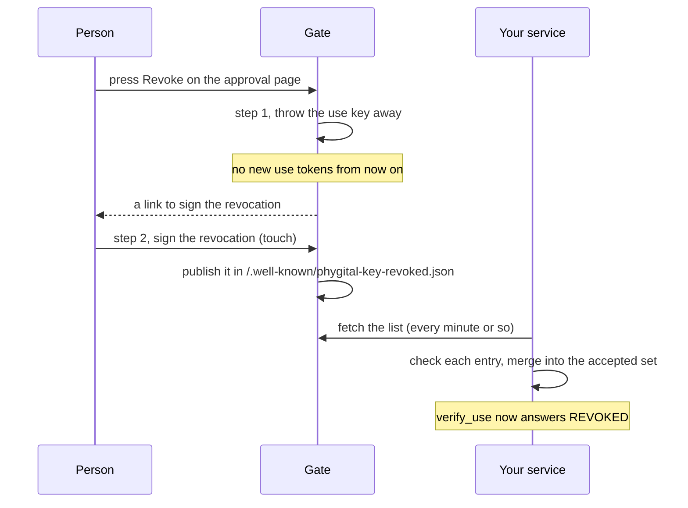

# Revocations

A revocation is the person's signed statement that a standing approval must stop counting. This page is for services that accept standing approvals: the format, where the list is published, how to read it in Rust and JavaScript, what you must keep, and the time window before a revocation takes effect at your service. Terms are in the [glossary](glossary.md).

## Two steps

Revoking a standing approval happens in two places, because a gate cannot reach into your service.



1. **On the gate, at once.** The person presses Revoke on the standing approval's page (or the agent calls `cancel_approval`). The gate deletes the use key, which it only ever held in memory, so it can sign no more use tokens. A restart of the gate also ends every standing approval it holds.
2. **At your service, once you pick it up.** The gate asks the person to sign a revocation and publishes it. Until your service has it, the standing approval itself still verifies there.

The person sees both steps on the standing approval's page. After step 1 it reads "Revoked here" with a "Sign the revocation" button. After step 2 it shows the stamp "✕ Revoked", the title "Revoked" and the line "Revoked and signed. No new uses can be signed, and the service refuses this permission as soon as it reads the revocation list."

## The 60-second window

Step 1 stops new use tokens. It cannot recall tokens the gate already handed out, and each of those lives at most 60 seconds (`MAX_USE_SECS`). So after the person presses Revoke:

| Time since Revoke | At your service |
|---|---|
| Up to 60 s, before you have the signed revocation | Use tokens handed out before the revoke still pass `verify_use`, within the limits and the remaining `max_uses`. |
| After 60 s | No valid use token can exist any more: every one handed out before the revoke has expired. |
| Once you have merged the signed revocation | `verify_use` refuses the standing approval with `REVOKED`, including any token still alive. |

> [!WARNING]
> An agent can ask for several use tokens in a row before the person revokes, up to every remaining use. All of them work at your service for up to 60 seconds unless you already hold the signed revocation. Limit `max_uses` and the `vary` ranges with that in mind.

## Format

A revocation is a normal one-time approval (format `pka.1`) of this reserved request:

```json
{"type": "revoke", "params": {"standing_id": "<the standing approval's claims.id>"}}
```

| Property | Value |
|---|---|
| `aud` | The standing approval's audience: your service |
| `level` | `medium` or higher (the gate asks for `medium`) |
| Signed by | A key in your keyring |
| Lifetime | Checked as of its own `iat`, so it never expires |

`verify` refuses any request of type `revoke` (`MALFORMED`), so a revocation can never be used as an action, and the gate refuses agents that try to request one.

## The published list

The gate serves every signed revocation it has made at:

```text
GET /.well-known/phygital-key-revoked.json
```

```json
{"revocations": ["<approval>", "<approval>"]}
```

An empty gate answers `{"revocations":[]}`. On a public origin the response carries `Access-Control-Allow-Origin: *`; on `localhost` it does not. The gate keeps the list in `revocations.json` in its data folder and refuses to serve a damaged file instead of replacing it.

## Reading the list

The verifier never fetches anything. Your service fetches the list with its own HTTP client, then turns it into a set of revoked standing ids.

### Rust

```rust
use phygital_key_verify::standing::Revocations;

let mut revoked = Revocations::none();               // or rebuilt from what you stored

// Every minute or so:
// Your HTTP client: GET https://approve.example.com/.well-known/phygital-key-revoked.json
let fetched: String = fetch_revocation_list()?;
revoked.merge(Revocations::from_json(&fetched, "https://pay.example.com", &keyring, &config));

// For each use:
let ok = verify_use(&standing, &use_token, &expected, &keyring, &uses, &revoked, &config, now)?;
```

| Function | Signature | Meaning |
|---|---|---|
| `Revocations::none` | `pub fn none() -> Self` | An empty set. |
| `Revocations::from_approvals` | `pub fn from_approvals(approvals: &[String], aud: &str, keyring: &Keyring, config: &Config) -> Self` | Check each entry; keep the standing ids of the valid ones. |
| `Revocations::from_json` | `pub fn from_json(text: &str, aud: &str, keyring: &Keyring, config: &Config) -> Self` | Read `{"revocations": [...]}` and call `from_approvals`. Text that does not parse gives an empty set. |
| `Revocations::merge` | `pub fn merge(&mut self, other: Revocations)` | Add the ids of `other`, keeping all earlier ones. |
| `Revocations::contains` | `pub fn contains(&self, standing_id: &str) -> bool` | Is this standing approval revoked? |
| `Revocations::len`, `is_empty` | `pub fn len(&self) -> usize`, `pub fn is_empty(&self) -> bool` | Size of the set. |

### JavaScript

```js
import { revocationsFrom } from "phygital-key-verify";

const revoked = new Set(); // every id you ever accepted

const res = await fetch("https://approve.example.com/.well-known/phygital-key-revoked.json");
const { revocations } = await res.json();
for (const id of await revocationsFrom(revocations, "https://pay.example.com", keyring, config)) revoked.add(id);

const result = await verifyUse(standing, useToken, expected, keyring, uses, revoked, config, now);
```

`revocationsFrom(approvals, aud, keyring, config)` returns a `Promise<Set<string>>`. Add its ids to your own set; never replace your set with it.

## What counts as a valid entry

`from_approvals` and `revocationsFrom` read at most the first 1000 entries (`MAX_REVOCATIONS`) and keep an entry only if all of these hold:

1. It is a string of at most 16384 characters, base64url of strict JSON with `claims`.
2. Its `claims.iat` is an integer and `claims.request.params.standing_id` is a string.
3. `claims.request` is exactly `{"type": "revoke", "params": {"standing_id": <that id>}}`, nothing more.
4. It passes every check of a one-time approval (`check`), with your audience, that exact request and level `medium`, with `now` set to its own `iat`: signed by a key in your keyring, from an allowed origin and rp_id, a valid ES256 signature, user presence.

Anything else is skipped without an error.

## Why invalid entries are ignored

The list is served by the gate's website, and whoever controls that website (or the network path to it, without HTTPS) can put anything in it. An entry can only ever add a revocation, never remove one or grant anything. So the safe answer to a bad entry is to skip it:

| Entry | Effect |
|---|---|
| Signed by a key not in your keyring | Ignored: nobody you trust revoked anything (vector `revocation_by_untrusted_key`). |
| For another service's audience | Ignored: not about you (vector `revocation_for_other_service`). |
| About another standing approval | Counts for that one only (vector `revocation_of_other_standing`). |
| Junk next to one valid entry | The valid one still counts (vector `revoked_among_others`). |
| Not JSON, a number, an empty string | Ignored, never thrown (JavaScript test "junk in a revocation list is ignored, never thrown"). |

Failing the whole list on one bad entry would let anyone who can add junk block real revocations.

## You must keep what you accepted

> [!IMPORTANT]
> Keep every revocation you have accepted, forever (or at least until the standing approval's end). Merge new lists into your set; never replace the set with the latest list.

Two reasons, both from the code:

- Whoever serves the list could leave entries out later. A set rebuilt from the latest list would forget them.
- An entry is checked against your current keyring. If the key that signed it is later removed from the keyring, the same entry stops checking. A revocation you accepted while the key was trusted must stay accepted.

`Revocations` does not serialize, so persist the approval strings you accepted (or the standing ids) in your own storage, and rebuild at start: `from_approvals` with the keyring you had then, or your stored ids. In JavaScript the set is a plain `Set` of ids, which you can store as a list.

## How often to refresh

Step 1 relies on the gate deleting its use key. The signed revocation is the part your service enforces itself: once you hold it, no use token passes for that standing approval, whoever signed the token. So the refresh interval sets how long a standing approval can still be used at your service after the person has signed the revocation.

| Refresh interval | Worst case for a signed revocation to take effect at your service |
|---|---|
| 10 s | 10 s after the person signs |
| 60 s | 60 s after the person signs |
| Never | Never: the standing approval verifies until its own end, and only the gate's step 1 stops new uses |

Refresh at least every minute while you accept standing approvals from that gate. If a fetch fails, keep your set, keep checking, and try again.

## Limits

| Limit | Value | Where |
|---|---|---|
| Entries read per list | 1000 | `MAX_REVOCATIONS` (Rust), `.slice(0, 1000)` (JavaScript) |
| Size of one entry | 16384 characters | same as any approval |
| Revocation requests per standing approval on the gate | One; after a deny or a timeout the same request is opened again | the gate |
| Rate limits | Revocations are always let through, even when the gate refuses new requests (30 per minute, 50 waiting, 5000 held) | the gate |

Entries after the first 1000 in one list are not read. A gate has one entry per signed revocation, so this matters only for a very long-lived gate or a list padded with junk.

## Test vectors

`test-vectors/standing.json` has 5 revocation cases, run by both verifiers:

| Vector | Expected | What it proves |
|---|---|---|
| `revoked` | `REVOKED` | A signed revocation the service has picked up stops the standing approval. |
| `revocation_by_untrusted_key` | ok | A revocation signed by an untrusted key is ignored. |
| `revocation_for_other_service` | ok | A revocation for another audience is ignored. |
| `revocation_of_other_standing` | ok | A revocation of another standing approval changes nothing here. |
| `revoked_among_others` | `REVOKED` | One valid revocation among junk still counts. |

The end-to-end suite (`tests/e2e/run.mjs`, real browser and virtual passkey) runs the whole path on a live gate: after a revoke the gate signs no new uses, a use token handed out before the revoke still works at the demo service until the revocation is signed (the window above), the signed revocation is published, and from then on the service refuses the standing approval.

## Next

- [Standing approvals](standing-approvals.md)
- [Integrate](integrate.md#standing-approvals)
- [Error codes](error-codes.md#revoked)
- [Rust verifier](verifier-rust.md#revocations)
