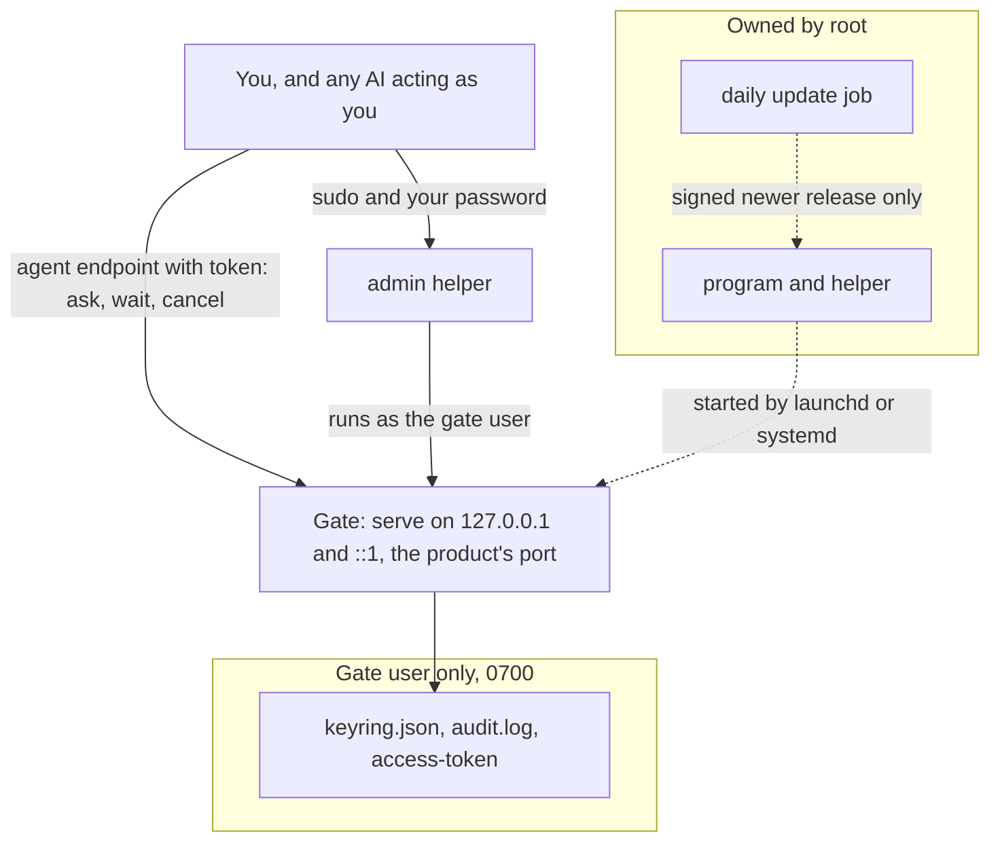

# Secure install

The secure install runs the gate as its own locked-down system user on macOS or Linux, and keeps it up to date with signed releases. This page explains why, what it creates, what it checks and refuses, how to use, update and remove it, and what it still needs from you. It is the same in every product: commands are shown for Phygital Key MCP, and Phygital Key A2A takes the same commands and options with its own names (see [the names per product](#what-it-creates)).

**On this page:** [why](#why) · [what it creates](#what-it-creates) · [install](#install) · [options](#options) · [checks and refusals](#what-it-checks-and-refuses) · [admin helper](#the-admin-helper) · [check it any time](#check-it-any-time) · [update](#update) · [uninstall](#uninstall) · [from a 0.3 secure install](#from-a-03-secure-install) · [what it needs from you](#what-it-needs-from-you) · [limits](#limits) · [how it is tested](#how-it-is-tested) · [troubleshooting](#troubleshooting)

## Why

An AI agent on your computer runs as you. If the gate also ran as you (the [quick install](getting-started.md#quick-install)), an agent with shell access could edit the gate's program, read its data, or write a key of its own into the keyring, and then approve for you.

With the secure install:

> **The AI, even acting as you, can't change the gate's program, read its data or write its keys. Only your administrator password can.**

It does this with ordinary operating-system rules, no new mechanism:

- the program is the product's official release, whose file list and SHA-256 sums are signed with that product's release key, used only in release runs from `v*` tags, which only repository admins can push ([the signed release list](updates.md#the-signed-release-list)), owned by root, in folders only root can change;
- the gate runs as a separate user with no login and no shell;
- its data folder (keyring, audit log, access token) is mode 0700 and owned by that user, so your account cannot even list it;
- every admin action goes through `sudo`, so it needs your administrator password.

An agent acting as you can then reach the gate only the way it is meant to: through the agent endpoint, with the access token, where it can ask, wait, cancel and report, but never approve.

## What it creates

Every name comes from the product's program name and its short id (`mcp` or `a2a`), so two products can be installed side by side.

| | Phygital Key MCP | Phygital Key A2A |
|---|---|---|
| Port | `7468` | `7478` |
| Agent endpoint | `/mcp` | `/a2a` |
| Gate user, macOS | `_phygitalkeymcp` | `_phygitalkeya2a` |
| Gate user, Linux | `phygitalkey-mcp` | `phygitalkey-a2a` |
| Program, macOS | `/Library/PhygitalKey/mcp/bin/phygital-key-mcp` | `/Library/PhygitalKey/a2a/bin/phygital-key-a2a` |
| Program, Linux | `/usr/lib/phygital-key-mcp/bin/phygital-key-mcp` | `/usr/lib/phygital-key-a2a/bin/phygital-key-a2a` |
| Admin helper | `phygital-key-mcp-admin` | `phygital-key-a2a-admin` |
| Data, macOS | `/Library/Application Support/PhygitalKey/mcp` | `/Library/Application Support/PhygitalKey/a2a` |
| Data, Linux | `/var/lib/phygital-key-mcp` | `/var/lib/phygital-key-a2a` |
| Gate log, macOS | `/Library/Logs/PhygitalKey/mcp/gate.log` | `/Library/Logs/PhygitalKey/a2a/gate.log` |
| launchd labels | `io.phygitalkey.mcp.gate`, `io.phygitalkey.mcp.update` | `io.phygitalkey.a2a.gate`, `io.phygitalkey.a2a.update` |
| systemd units | `phygital-key-mcp.socket` (the port, held by systemd), `phygital-key-mcp.service`, `phygital-key-mcp-update.service`, `phygital-key-mcp-update.timer` | `phygital-key-a2a.socket`, `phygital-key-a2a.service`, `phygital-key-a2a-update.service`, `phygital-key-a2a-update.timer` |

What each one is, with `<id>` for the short id, `<program>` for the program name and `<prefix>` for the program folder:

| | macOS | Linux |
|---|---|---|
| Gate user | `_phygitalkey<id>` (hidden, user id 400 to 499, shell `/usr/bin/false`, home `/var/empty`) | `phygitalkey-<id>` (system user, no home, shell `/usr/sbin/nologin`) |
| Program folder `<prefix>` (root only) | `/Library/PhygitalKey/<id>` | `/usr/lib/<program>` |
| Program and admin helper (root only) | `<prefix>/bin/<program>` and `<prefix>/bin/<program>-admin` | the same |
| Shortcut to the helper | `/usr/local/bin/<program>-admin`, only if that folder is root-only | the same |
| Data folder (gate user only, 0700) | `/Library/Application Support/PhygitalKey/<id>` | `/var/lib/<program>` |
| Gate log | `/Library/Logs/PhygitalKey/<id>/gate.log` (folder 0700, gate user) | The system journal: `journalctl -u <program>` |
| Gate service | launchd LaunchDaemon `io.phygitalkey.<id>.gate` (`/Library/LaunchDaemons/io.phygitalkey.<id>.gate.plist`), restarts if it stops | systemd unit `<program>.service` (`/etc/systemd/system/<program>.service`), restarts on failure |
| Runs | `<program> --home <data> --port <port> serve` as the gate user, file mask 077 | the same, plus systemd hardening (below) |
| Daily update job (root, unless turned off) | LaunchDaemon `io.phygitalkey.<id>.update` (plist mode 0600, so other users cannot read its time), once a day at a random time picked at install | `<program>-update.timer` (`OnCalendar=daily`, `RandomizedDelaySec=6h`, `Persistent=true`) and `<program>-update.service` (oneshot, `PrivateTmp`, `ProtectHome`) in `/etc/systemd/system/` |
| Update log | `/Library/Logs/PhygitalKey/<id>-update/update.log` (folder 0700, root) | The journal: `journalctl -u <program>-update` |
| Update settings (written by root) | `<prefix>/auto-update` (`on` or `off`) and `<prefix>/update-status` (last result) | the same |



<details>
<summary>The systemd hardening on Linux</summary>

The gate's unit runs it with:

`NoNewPrivileges=yes`, `ProtectSystem=strict`, `ProtectHome=yes`, `ProtectProc=invisible`, `PrivateTmp=yes`, `PrivateDevices=yes`, `ProtectClock=yes`, `ProtectKernelTunables=yes`, `ProtectKernelModules=yes`, `ProtectKernelLogs=yes`, `ProtectControlGroups=yes`, `ProtectHostname=yes`, `RestrictAddressFamilies=AF_INET AF_INET6 AF_UNIX`, `RestrictNamespaces=yes`, `RestrictRealtime=yes`, `RestrictSUIDSGID=yes`, `LockPersonality=yes`, `MemoryDenyWriteExecute=yes`, `SystemCallArchitectures=native`, `SystemCallFilter=@system-service`, `CapabilityBoundingSet=` (no capabilities), `IPAddressDeny=any` with `IPAddressAllow=localhost` (it can only talk to this machine), `ReadWritePaths=/var/lib/<program>` (it can write nowhere else), `UMask=0077`, `LimitNOFILE=8192`, output to the journal. On macOS the launchd job raises the open-file limit to 8192 too (`SoftResourceLimits`), so idle connections cannot fill it before the gate closes them after 10 seconds.

The update job runs as root, because it must replace the root-owned program, write the units and restart the gate, so its files stay writable and it needs the network to reach `github.com`. Everything else it never needs is closed: `PrivateTmp=yes`, `ProtectHome=yes`, `NoNewPrivileges=yes`, `PrivateDevices=yes`, `ProtectClock=yes`, `ProtectKernelTunables=yes`, `ProtectKernelModules=yes`, `ProtectKernelLogs=yes`, `ProtectControlGroups=yes`, `ProtectHostname=yes`, `RestrictAddressFamilies=AF_INET AF_INET6 AF_UNIX`, `RestrictNamespaces=yes`, `RestrictRealtime=yes`, `RestrictSUIDSGID=yes`, `LockPersonality=yes`, `SystemCallArchitectures=native`, and `Environment=HOME=/root` (launchd: `HOME=/var/root`). CI checks both units' `systemd-analyze security` levels.

</details>

## Install

Open a **fresh terminal** that no AI agent controls, and run the product's installer, pinned to a release tag. For Phygital Key MCP:

```bash
curl -q -fsSL https://raw.githubusercontent.com/Phygital-Key/phygital-key-mcp/v0.5.0/install-service.sh | sudo bash
```

The URL is pinned to the `v0.4.0` tag, so you get the install script of that release, and it installs that release. Phygital Key A2A has its own `install-service.sh` at the root of [its repository](https://github.com/Phygital-Key/phygital-key-a2a). You do not need the program installed first. It needs `curl` and `openssl` (to check the release signature).

When it finishes it prints (Phygital Key MCP on macOS shown; the update time is random):

```text
Phygital Key MCP is installed as a locked-down service.
  approval page   http://localhost:7468
  runs as         _phygitalkeymcp: you, and any AI acting as you, cannot change its program,
                  read its data or write its keys without your administrator password
  program         /Library/PhygitalKey/mcp/bin/phygital-key-mcp (official v0.4.0 release, signed list and SHA-256 checked)
  updates         daily at 03:12, signed releases only (off: sudo /Library/PhygitalKey/mcp/bin/phygital-key-mcp install-service --no-auto-update)

Next:
  1. Add your key:        phygital-key-mcp-admin enroll
  2. Connect your AI app: phygital-key-mcp-admin token    (prints the line to paste)
  3. Check it any time:   phygital-key-mcp-admin status
Update now:    phygital-key-mcp-admin update   (or a chosen version: sudo /Library/PhygitalKey/mcp/bin/phygital-key-mcp install-service --release vX.Y.Z)
Remove:        sudo /Library/PhygitalKey/mcp/bin/phygital-key-mcp install-service --uninstall
```

(On Linux the paths are the Linux ones from the table and the update line reads `daily, signed releases only (...)`. If `/usr/local/bin` is not root-only on your machine, the helper is shown by its full path.)

Then:

1. `phygital-key-mcp-admin enroll` and open the link to [add your key](keys-and-devices.md#your-first-key).
2. `phygital-key-mcp-admin token` and paste the `claude mcp add ...` line, or the URL and header, into your AI app ([connect your AI app](https://github.com/Phygital-Key/phygital-key-mcp/blob/main/docs/connect-your-ai.md#http-the-app-connects-to-a-url)).
3. `phygital-key-mcp-admin status`.

If you already used the quick install, remove the stdio entry (`phygital-key-mcp stdio`) from your AI app, so the app connects to the service and does not start a second gate of its own. Your old keyring in `~/.phygital-key-mcp` is not moved: enroll again for the service.

<details>
<summary>The shortcut: <code>sudo phygital-key-mcp install-service</code></summary>

`phygital-key-mcp install-service` runs the same script, built into the program. It still downloads and checks the official signed release (or uses `--binary`, see below) and never installs the file you started it from. But that file runs as root for a moment, so use the shortcut only if nothing else could have changed it. The pinned `curl` command above avoids that question.

`--binary <full path>` installs a program you built yourself instead of downloading one. The file and every folder above it must be owned by root, not writable by group or others, and not a symbolic link. CI uses this to test the build it has made.

</details>

## Options

| Option | What it does |
|---|---|
| `--auto-update` | Daily updates to the latest signed release. The default |
| `--no-auto-update` | No daily update job. The choice is kept on later installs until you pass `--auto-update` |
| `--release vX.Y.Z` | Install this release instead of the program's own version (newer or older) |
| `--binary <path>` | Install a root-owned program you built (see above) |
| `--uninstall` | Remove the service and the update job, keep keys and log |
| `--purge` | With `--uninstall`: also delete the gate user, keys and logs |
| `--port <port>` | The port of the approval page and the agent endpoint (default: the product's port) |

With the `curl` command, pass options after `-s --`:

```bash
curl -q -fsSL https://raw.githubusercontent.com/Phygital-Key/phygital-key-mcp/v0.5.0/install-service.sh | sudo bash -s -- --no-auto-update
```

The script itself takes only `--uninstall`, `--purge`, `--auto-update` and `--no-auto-update`, plus the hidden `--auto-update-run` and `--now` of the update job (anything else prints `unknown option: <option>`); the program passes `--release`, `--binary` and `--port` to it. Of the program's general options, only `--port` reaches the service: it always uses the data folder above and serves `http://localhost:<port>`, so `--home`, `--origin`, `--bind`, `--lifetime` and `--no-token` have no effect on it.

## What it checks and refuses

Every refusal starts with `<program> install-service:` and stops the install. If a refusal happens after the service was started, the script stops the service again, so a half-trusted gate is never left running.

| Check | Refusal |
|---|---|
| Run as root | `needs administrator rights (sudo).` |
| macOS or Linux | `only macOS and Linux for now.` |
| A known CPU (arm64 / aarch64, x86_64 / amd64) | `unsupported CPU <name>` |
| Version looks like `vX.Y.Z` | `bad version: <value>` |
| Port is 1 to 65535 | `bad port: <value>` |
| `--binary` is a full path | `--binary needs a full path (starting with /)` |
| `--binary` and every folder above it are root-only, no links | `<path> is not safe to run as root: it (or a folder above it) is not owned by root only.` with the reason: `not found`, `is a link`, `owned by <user>, not root` or `writable by others (mode <m>)` |
| The signed release list downloads over https (TLS 1.2 or newer) | `could not download the signed release list for <version>.` |
| openssl (or the installed root-owned program) can check the signature | `needs openssl to check the release signature. Install openssl, then run this again.` |
| `release.txt` is signed by a key pinned for this product | `the release list for <version> is not signed by a pinned release key. Nothing was installed.` |
| The signed list is for the version asked for | `the signed release list is for <got>, not <version>. Nothing was installed.` |
| The signed list names this machine's archive | `the signed release list has no <name>.tar.gz. Nothing was installed.` |
| The archive downloads | `download failed: <url>` |
| The archive matches the SHA-256 in the signed list | `the download does not match its signed SHA-256. Nothing was installed.` |
| The archive holds a regular file named after the program | `the release does not contain the expected program.` |
| A free system user id (macOS, 400 to 499) | `no free system user id between 400 and 499.` |
| The program folder is root-only | `<prefix>/bin is not owned by root only. Refusing to continue.` |
| Nothing else listens on the port, before starting | `the gate is stopped: another program (uid <u>, pid <p>) is listening on port <port>. Stop it, then run this again.` |
| Nothing else listens on the port, on every check while it starts | the same, plus `Do not approve anything until then.` |
| The gate answers on `/api/status` within about 30 seconds | `the gate is stopped: the gate did not start. See: <prefix>/bin/<program>-admin logs. To install again: sudo <prefix>/bin/<program> install-service` |

The download checks run before anything on the machine changes. On macOS, if `launchctl bootstrap` fails, the script prints `could not start the service (launchctl bootstrap).` and the start check then refuses.

When a gate was already installed (an update), the script keeps the old program until the new gate passes the start checks. If the new one does not start, it prints `The new gate did not start. Switching back to the previous program (<version>).`, starts the old one, and exits with an error.

The port check matters because the approval page lives at `http://localhost:<port>`. Another program holding that address (on IPv4 or IPv6) could show a fake page with the very same passkey origin. The gate itself also holds both `127.0.0.1` and `[::1]` and refuses to start if either is taken.

During an unattended update (the daily job or `<program>-admin update`) nobody is there to read a refusal, and stopping the gate would leave the other program holding the address. So in that run only, a program running as another user that took the port while the gate restarted is stopped (`kill -9`) and the gate started again, up to 5 times. The result line then ends with `; stopped programs that took the port of the gate during the restart: [uid <u>, pid <p>]`. If the port is still taken after 5 tries, the gate is stopped and the result says so. An install you run yourself keeps refusing with the message above.

**Root never takes your environment.** On macOS, `sudo` keeps your `HOME` (and your `PATH` when no `secure_path` is set). A `~/.curlrc` there could make root's `curl` download and write any file, and a folder you can write early in `PATH` (such as `/opt/homebrew/bin`) could hold a fake `curl`, `awk` or `openssl`. So `install-service` starts the script with an empty environment (only `PATH=/usr/bin:/bin:/usr/sbin:/sbin`, root's `HOME`, `LANG=C` and the `PKA_*` values), the script sets that `PATH` and `HOME` again first and clears `CURL_HOME`, `XDG_CONFIG_HOME`, `SSL_CERT_FILE`, `SSL_CERT_DIR`, `CURL_CA_BUNDLE`, `OPENSSL_CONF`, `OPENSSL_MODULES`, `BASH_ENV`, `ENV`, `LD_PRELOAD`, `LD_LIBRARY_PATH`, `DYLD_INSERT_LIBRARIES` and `DYLD_LIBRARY_PATH` (which also covers `curl ... | sudo bash`), and every `curl` starts with `-q`, so no `.curlrc` is read. The admin helper sets `PATH` to system folders before any `sudo`.

## The admin helper

`<program>-admin` (`phygital-key-mcp-admin`, `phygital-key-a2a-admin`) runs a few commands as the gate user, through `sudo`. Each asks for your administrator password (unless `sudo` remembers it from a moment ago).

| Command | What it does |
|---|---|
| `phygital-key-mcp-admin enroll` | Prints a one-time link to add a key (works once, 10 minutes) |
| `phygital-key-mcp-admin token` | Prints the agent endpoint and the access token; for Phygital Key MCP also the `claude mcp add` line |
| `phygital-key-mcp-admin keys` | Prints your keyring and your key fingerprint |
| `phygital-key-mcp-admin audit-check` | Checks the audit log's hash chain: `audit log ok: <n> entries, last hash <hash>` |
| `phygital-key-mcp-admin status` | Shows the program version, whether automatic updates are on and their last result, checks that only the gate user listens on the port, then shows the gate's status |
| `phygital-key-mcp-admin logs` | Shows the last 50 lines of the gate's log |
| `phygital-key-mcp-admin update [--now]` | Installs the latest signed release now, if it is newer; `--now` even while standing approvals are active ([update](#update)) |

Anything else prints `usage: phygital-key-mcp-admin enroll | token | keys | audit-check | status | logs | update [--now]`.

## Check it any time

```bash
phygital-key-mcp-admin status
```

When all is well:

```text
program:      phygital-key-mcp 0.4.0
auto-update:  on  (last: 2026-10-18T03:12:00Z up to date (v0.4.0; latest signed release v0.4.0))
ok: only the gate (_phygitalkeymcp) listens on port 7468
{"history_ok":true,"keys":[...],"origin":"http://localhost:7468","root_fingerprint":"...","rp_id":"localhost","standing_active":0,"waiting":0}
```

Otherwise the last lines read:

```text
WARNING: something other than the gate is listening on port 7468, or the gate is not running. Do not approve anything until this is fixed.
```

Run it after a restart, after an update, and whenever an approval page looks odd. The meaning of each `last:` result is on [updates](updates.md#see-the-last-result).

## Update

**Automatically.** With automatic updates on (the default), the daily job downloads the product's latest `release.txt` and its signature from GitHub, checks the signature against the pinned release keys, and installs the release only if it is strictly newer. It then runs every check above again. It waits while standing approvals are active (a restart would end them), for up to 7 days counted from the first wait on the installed version; requests still waiting for you do not hold it back. If the new gate does not start, the previous program is put back and started. If another program takes the port during the restart, it is stopped and the gate started again, up to 5 times; after that the gate is stopped and the result says why. Each run writes one result line to `update-status`, shown by `status`. The full flow, with every result line, is on [updates](updates.md#automatic-updates-secure-install).

**Now.** `phygital-key-mcp-admin update` runs the same job at once. `phygital-key-mcp-admin update --now` also installs while standing approvals are active, and so ends them.

**A chosen version.** Use the locked copy of the program, with the release you want:

```bash
sudo /Library/PhygitalKey/mcp/bin/phygital-key-mcp install-service --release v0.4.0      # macOS
sudo /usr/lib/phygital-key-mcp/bin/phygital-key-mcp install-service --release v0.4.0     # Linux
```

(`v0.4.0` is an example: use a version listed on the product's [Releases](https://github.com/Phygital-Key/phygital-key-mcp/releases) page.) It checks the signed list for that version, the archive's SHA-256, swaps the program in one step, and restarts the service with every check above. Without `--release` it reinstalls its own version.

**Going back.** The previous program is kept only while an install runs, to switch back when the new gate fails. To go back to an older version later, install it with `--release`, and turn automatic updates off with `--no-auto-update` if it should stay there (otherwise the next daily run moves it up again).

**On or off.** `install-service --no-auto-update` removes the job, `install-service --auto-update` puts it back. Both run the install again, so the gate restarts.

Keys, audit log and access token stay through every update. A restart drops waiting requests and ends every [standing approval](standing-approvals.md) (their keys live only in memory). Days without a newer release cause no restart.

## Uninstall

```bash
sudo /Library/PhygitalKey/mcp/bin/phygital-key-mcp install-service --uninstall           # keep keys and log
sudo /Library/PhygitalKey/mcp/bin/phygital-key-mcp install-service --uninstall --purge   # delete everything
```

(On Linux: `/usr/lib/phygital-key-mcp/bin/phygital-key-mcp`.)

`--uninstall` stops the update job and the service, removes their unit files, the program folder (with the `auto-update` choice and the last update result) and the helper shortcut, and prints `Removed the Phygital Key MCP service. Your keys and log are kept in: <data folder>`. Installing again later picks the keys and log up.

`--purge` also deletes the data folder, the gate log, the update log and the gate user, and prints `Removed Phygital Key MCP, its user, keys and log.` This cannot be undone. Your passkeys stay on your devices; delete them there if you want (see [privacy](privacy.md#delete-everything)).

## From a 0.3 secure install

Version 0.3 and older installed one program, `phygital-key`, with the names `_phygitalkey` and `phygitalkey`, `/Library/PhygitalKey/bin` and `/usr/lib/phygital-key`, the data folders `/Library/Application Support/PhygitalKey` and `/var/lib/phygital-key`, and the services `io.phygitalkey.gate` and `phygital-key.service`. Its daily job cannot move to a product: a product's release list names files that start with the product's program name, which the 0.3 job does not accept, so it refuses the list.

Remove the old service first, with its own locked program: it holds port 7468, and on macOS its data and log folders are the parent folders of the new ones, which the new gate user could not open.

```bash
sudo /Library/PhygitalKey/bin/phygital-key install-service --uninstall --purge     # macOS
sudo /usr/lib/phygital-key/bin/phygital-key install-service --uninstall            # Linux (add --purge to delete its keys too)
```

Do this before you install a product, never after: on macOS the 0.3 uninstall deletes `/Library/PhygitalKey` with everything inside, and `--purge` also deletes `/Library/Application Support/PhygitalKey` and `/Library/Logs/PhygitalKey`, which would take a product's program, data and logs with them.

Then [install](#install) the product and enroll your key again. Moving the old keyring into the new data folder is not built.

## What it needs from you

> [!IMPORTANT]
> The guarantee holds only if an AI cannot become root. Install from a terminal you trust, and keep `sudo` behind your password.

- [ ] **Install from a trusted terminal.** An agent that already controls your shell could change what you type or what `curl` fetches. Open a new terminal window yourself.
- [ ] **No password-less sudo for your account.** Check it: run `sudo -k` (forget the remembered password), then `sudo -n true`. It must answer `sudo: a password is required`. If it succeeds silently, your account can become root without a password, and so can any agent acting as you.
- [ ] **Run `sudo -k` after admin work** if an agent shares your terminal, so a remembered password cannot be reused.
- [ ] **Do not approve while `status` warns.**

## Limits

- **Windows is not supported yet.** On Windows, run the gate on another machine, or accept that an AI acting as you could change it.
- **This machine only.** The service serves `http://localhost:<port>` and, on Linux, may only talk to this machine. To approve from other devices over https, see [own server](own-server.md) (without the secure install's protections for now).
- **The token is readable by the AI.** The access token ends up in your AI app's settings. It keeps other programs out, not the agent; the agent can only ask anyway.
- **Root and the machine are trusted.** Whoever is root (or controls the machine) controls the gate and the page it serves. So does malware running as root.
- **The release keys are trusted.** Updates install whatever a pinned release key of the product signed. The keys come from the installer you first ran. See [the update channel](threat-model.md#the-update-channel).
- **It contacts GitHub daily** while automatic updates are on ([privacy](privacy.md#what-leaves-your-machine)). The gate itself makes no network calls.
- **Automatic updates are new.** No product release has been installed by the daily job against GitHub yet. Until then, CI tests the parts on their own (below). Up to MCP 0.4.0 and A2A 0.1.0 the job did not start at all from launchd or systemd (no `HOME`); after the next release, run `<program>-admin update` once to get the fixed job.
- **Restarts end standing approvals** and drop waiting requests (fail closed). An automatic update restarts the gate at the job's time.
- **macOS: a moment with a free port.** While the gate restarts, its port is free for a moment. A program that takes it during an update is stopped, but a fast one could take it again (and is stopped again, 5 times at most, then the gate stops). On Linux this cannot happen: systemd holds the port (`<program>.socket`) while the gate restarts. launchd can hand over a port too, but only through code the project would have to mark unsafe.
- **Linux with IPv6 turned off:** the socket unit cannot open `[::1]`, so the gate does not start (it fails closed). Turn IPv6 on for loopback, or run the gate under your own user.
- **Changing the port** changes the approval page's address, which your keyring is tied to. Enroll a new keyring after such a change ([keys and devices](keys-and-devices.md#the-signed-key-history)).
- **Pre-audit.** No outside security audit has happened yet ([security reviews](security-reviews.md)).

## How it is tested

Each product's CI installs its gate for real, as a separate user, on macOS and on Linux, on every push to `main` and on every pull request. The test is `tests/secure-install.sh` in the product's repository, written from the base template `crates/phygital-key-gate/assets/secure-install-test.sh`; it needs the password-less sudo that CI runners have. The release for the version under test does not exist yet in CI, so it installs the build with `--binary`. It checks that:

- [x] a relative `--binary` is refused
- [x] a binary the user could have changed is refused
- [x] the install refuses while another program holds the address
- [x] the gate answers
- [x] only the gate user listens (IPv4 and IPv6)
- [x] the gate may open 8192 files
- [x] Linux: a program running as the user tries to take the port again and again through two restarts, and never gets it (systemd holds it)
- [x] Linux: the gate answers on the sockets systemd hands it
- [x] the program is owned by root
- [x] this user cannot change the program
- [x] this user cannot read the data folder
- [x] this user cannot write the keyring
- [x] `status` confirms the listener
- [x] the admin helper makes an enrollment link
- [x] no enrollment link or token appears in the gate log
- [x] the agent endpoint refuses calls without the token
- [x] the agent endpoint accepts the token (any case of `Bearer`)
- [x] installing again (update) works
- [x] the daily update job is installed and owned by root
- [x] automatic updates are on by default
- [x] a release list signed by an unknown key is refused
- [x] the update job leaves the gate running unless a newer signed release exists
- [x] the update job records its result
- [x] the daily update job runs from its service manager (started with `systemctl start` or `launchctl kickstart`, not by hand)
- [x] Linux: the gate service keeps systemd's sandbox level OK (score 4.9 or less) and the root update service MEDIUM (6.9 or less), read from `systemd-analyze security`
- [x] root ignores the user's `~/.curlrc`
- [x] root ignores programs early in the user's `PATH`
- [x] a new program that does not start is switched back to the previous one
- [x] `--no-auto-update` removes the job
- [x] the off choice is kept on later installs
- [x] `--auto-update` turns it back on
- [x] uninstall stops it
- [x] uninstall keeps keys
- [x] purge removes everything
- [x] uninstall removes the update job

That is 36 checks on Linux and 32 on macOS (the sandbox scores and the two port checks are Linux only). Two of them have honest limits: the update job runs against GitHub, where no newer signed release exists, so it records `up to date`, `update check failed` or `update refused`; and the switch-back check installs a broken program with `--binary`, not through a real update. The base has no program, so it does not run this test itself. See [testing](testing.md) for the other suites.

## Troubleshooting

| You see | Do this |
|---|---|
| `another program (uid 501, pid 1234) is listening on port 7468` | Find it: `sudo lsof -nP -iTCP:7468 -sTCP:LISTEN`. Often it is a quick-install gate your AI app started (`phygital-key-mcp stdio`), a `phygital-key-mcp demo`, or a 0.3 secure install ([remove it](#from-a-03-secure-install)). Stop it, remove the stdio entry from the app, and run the install again |
| `phygital-key-mcp-admin: command not found` | `/usr/local/bin` is not root-only on this machine, so no shortcut was made. Use the full path: `/Library/PhygitalKey/mcp/bin/phygital-key-mcp-admin` or `/usr/lib/phygital-key-mcp/bin/phygital-key-mcp-admin` |
| `the gate did not start` | Run `phygital-key-mcp-admin logs` and read the last lines |
| `could not download the signed release list for <version>.` or `download failed` | Check the network and that the version exists on the product's Releases page |
| `needs openssl to check the release signature.` | Install openssl with your system's package manager, then run the install again |
| `... is not signed by a pinned release key. Nothing was installed.` | Do not work around it. Check that you used the pinned `curl` command of the right product, and report it ([SECURITY.md](../SECURITY.md)) |
| `status` prints the WARNING | Do not approve anything. Check what listens (`sudo lsof -nP -iTCP:7468 -sTCP:LISTEN`); restart the service by running the locked `install-service` again |
| `last:` says `update check failed` or `update refused` | The gate keeps running the version it had. See [troubleshooting](troubleshooting.md#automatic-updates) |
| The enrollment link says "This enrollment link is not valid or has expired" | Make it with `phygital-key-mcp-admin enroll`, not `phygital-key-mcp enroll` (that one writes to your own `~/.phygital-key-mcp`, which the service does not read) |

More in [troubleshooting](troubleshooting.md#secure-install).

## Next

- [Connect your AI app](https://github.com/Phygital-Key/phygital-key-mcp/blob/main/docs/connect-your-ai.md) (Phygital Key MCP)
- [Updates](updates.md)
- [Threat model](threat-model.md)
- [Privacy](privacy.md)
