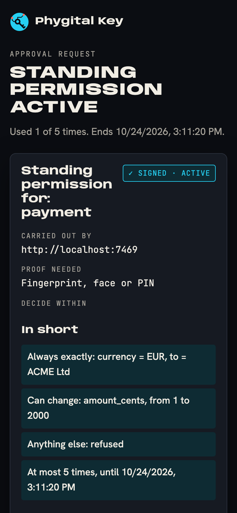
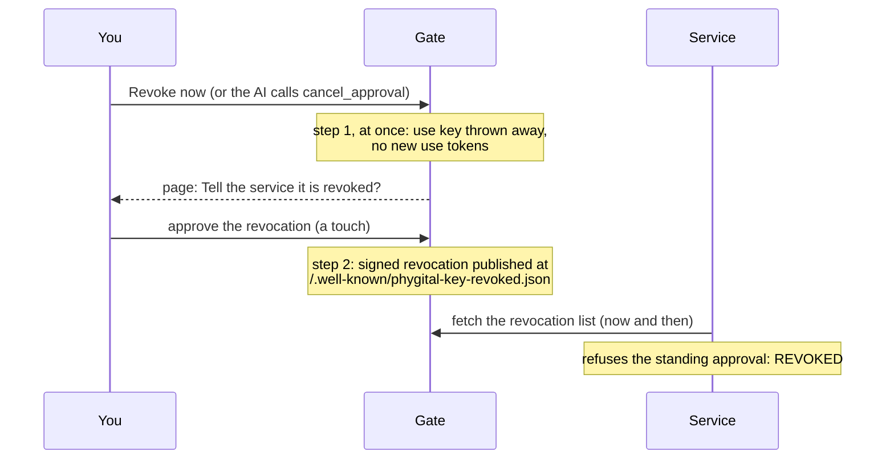

# Standing approvals

A [standing approval](glossary.md) lets an AI repeat one kind of action within limits you set, a few times, for a few days, without asking you each time. This page is for the person who approves one: what you agree to, how to read the limits, how uses show up, and how to revoke. Services that check them: see [integrate](integrate.md).

**On this page:** [what you approve](#what-you-approve) · [in short](#the-in-short-summary) · [limits](#the-limits) · [each use](#each-use) · [how uses show](#how-uses-show) · [revoke](#revoke-in-two-steps) · [the 60 seconds](#what-still-works-for-up-to-60-seconds-and-why) · [when to use one](#when-to-use-one-and-when-not)

> Allow **payment** to **ACME Ltd** in **EUR**, from **1** to **2000** cents each, **at most 5 times**, **for 7 days**.

## What you approve

The AI calls `request_standing_approval`. The gate builds a request of the reserved type `standing` and shows it to you:

| Part | What it means |
|---|---|
| **Title** | Give a standing permission? |
| **Lead** | "The AI may do this on its own, up to N times until (date), only within the limits below. You can revoke it at any time." |
| **Card title** | Standing permission for: (the action type), for example `payment` |
| **Carried out by** | The one service that may act on each use |
| **Proof needed** | Always "Fingerprint, face or PIN" (level `high`), whatever the AI asked for |
| **In short** | A plain summary of the limits (below) |
| **Every detail** | Every signed field, including `use_key (technical: signs each use)` |

The `use_key` is the public half of a key the gate makes for this one standing approval and keeps only in its memory. The gate signs each use with it. You sign the public half, so services can check that each use came from this approval.

## The "In short" summary

The page turns the limits into a few lines:

| Line | Comes from |
|---|---|
| `Always exactly: currency = EUR, to = ACME Ltd` | `fixed`: these fields must have exactly these values every time |
| `Can change: amount_cents, from 1 to 2000` | `vary` with `min` and `max`: a whole number in that range, both ends included |
| `Can change: memo, only one of: coffee, lunch` | `vary` with `one_of`: one of these texts |
| `Anything else: refused` | Always shown: a field that is not listed, or a listed field left out, is refused |
| `At most 5 times, until 10/24/2026, 2:37:14 PM` | `max_uses` and the end date, in your browser's local time |

A summary line with look-alike or invisible characters gets the same coral highlight as a row ([check this](approving.md#check-this-warnings)). The summary is a reading help. What your key signs is the full text under **Exact text you are signing**.

## The limits

| Limit | Rule | What the AI gets if it breaks it |
|---|---|---|
| `for_type` | One lowercase action name (not `standing`) | `Not a valid standing approval: ...` |
| `fixed` | Exact values, compared byte for byte in [canonical form](canonical-form.md) | A use with any other value is refused |
| `vary` range | `{"min": n, "max": n}`, whole numbers, **both required**, `min` not above `max` | `vary.amount_cents: use {"min": n, "max": n} (both) or {"one_of": ["a", "b"]}` |
| `vary` list | `{"one_of": [...]}` with 1 to 20 texts | the same |
| `fixed` and `vary` | Must not share a field | `Not a valid standing approval: ...` |
| `max_uses` | 1 to 1000 | `Not a valid standing approval: ...` |
| `days` | 1 to 30 | `days must be 1 to 30` |

Both ends of a range are required so that a forgotten lower limit can never allow a negative amount.

The end date is counted from the moment the AI asks, not from when you approve. If it would be less than a minute away (or more than 30 days) when you press Approve, the page refuses with "This standing approval would end too soon or too late. Ask again."

## Each use

For every action, the AI calls `use_standing_approval` with the exact request. The gate checks it against your limits and, only if it fits, signs a **use token** for that one request with the `use_key`. The AI sends both your standing approval and the use token to the service, which checks both and counts the uses itself.

| What the AI tries | Answer |
|---|---|
| A request inside the limits | A use token, valid 60 seconds and never past the end date, plus `uses_left` |
| A bigger amount, another payee, an extra or missing field | `This request is outside the limits the person approved. Ask for a one-time approval instead.` |
| One more use than you allowed | `No uses left on this standing approval.` |
| A use after you revoked it, or after the gate restarted | `This standing approval cannot be used: unknown, revoked, or the gate restarted.` |
| The same use token twice at the service | `REPLAYED` |

You do not touch your key for each use. That is the trade: fewer prompts, narrower limits.

## How uses show

Open the approval link again at any time. While the standing approval is usable, the page shows:

- the title **Standing permission active**;
- "Used X of N times. Ends (date)." X counts the use tokens the gate has signed;
- the stamp **✓ Signed · active**;
- one button: **Revoke now**.

Right after you approve, the page shows **Approved** and "Signed by <key name>. Active until <date>, at most <N> uses." Reload it later to see the view above.

## Revoke in two steps

**Step 1, on the gate, instant.** Press **Revoke now**. The gate throws the `use_key` away. From that second no new use can be signed, by anyone.

**Step 2, for the service, one touch.** The page moves to **Tell the service it is revoked?** with the card **Revoke a standing permission** and **Proof needed** "A touch on your key". Approve it. This signs a revocation: a one-time approval (level `medium`) of the reserved request `{"type": "revoke", "params": {"standing_id": "<id>"}}` for the same service. The gate publishes it at `/.well-known/phygital-key-revoked.json`. A service that fetches that list refuses the standing approval with `REVOKED`, including use tokens handed out before.

If you skip step 2, the standing approval's page shows **Revoked here** with the stamp **✕ Revoked**, "No new uses can be signed. Sign the revocation so the service refuses this permission too." and a **Sign the revocation** button. You can come back to it any time. There is only ever one revocation request per standing approval: after a Deny or a timeout, the same one opens again. Revocations are always let through, even when the gate is refusing new requests because of its limits. Once signed, the standing approval's page shows the title **Revoked**, the stamp **✕ Revoked** and "Revoked and signed. No new uses can be signed, and the service refuses this permission as soon as it reads the revocation list."

## What still works for up to 60 seconds, and why

A use token handed out before you revoked is already signed. The service checks it offline, so the gate cannot call it back. It keeps working at the service until the earlier of:

- its own expiry, at most 60 seconds after it was made, and
- the moment the service picks up your signed revocation.

An AI could ask for every remaining use right before you revoke, and spend them in that minute. The end-to-end tests check this case on purpose: a token handed out before the revoke still works until the revocation is signed, and after the person signs it, the service refuses the standing approval.

> [!WARNING]
> Revoking cannot undo uses that already happened, and up to 60 seconds of already handed-out tokens can still be spent. Set `max_uses` and the ranges to what you could live with if all of them were used at once.

A restart of the gate ends every standing approval it holds, because the `use_key` lives only in memory. That fails closed: no new uses can be signed, and the AI must ask again. With the [secure install](secure-install.md#update), the daily update job does not install while a standing approval is active, but it waits for 7 days at most: after that it installs, the gate restarts, and a standing approval can end before its date. Turn automatic updates off with `--no-auto-update` if that would hurt you.

## When to use one, and when not

Good fits:

- [ ] Small, repeated actions of one kind, to one fixed party: paying one supplier small amounts, posting to one channel, restarting one staging service.
- [ ] Limits you can state as exact values, whole-number ranges or short lists.
- [ ] A short time (days, not weeks) and a small number of uses.

Ask for one-time approvals instead when:

- [ ] Each action is different, or the payee, address or target changes.
- [ ] One use alone could do real harm: production deploys, deletes, contracts, large payments.
- [ ] You cannot say the limits in a few lines. If the "In short" summary surprises you, press **Deny**.
- [ ] The service does not check use tokens and count uses (ask its operator).

## Next

- [Approving](approving.md): the approval page in detail
- [Revocations](revocations.md): the revocation format and how services read it
- [Integrate](integrate.md): checking standing approvals in a service
- [Threat model](threat-model.md)
