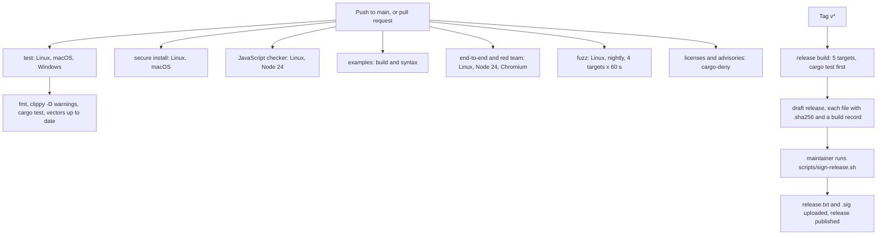

# Testing

This page lists every layer of tests in Phygital Key, with real counts and the command to run each one. It is for contributors, reviewers and anyone who wants to check a claim in the [threat model](threat-model.md) for themselves. Counts are for version 0.3.0, taken from the files in this repository.

**On this page**

- [At a glance](#at-a-glance)
- [Shared test vectors](#shared-test-vectors)
- [Rust unit and integration tests](#rust-unit-and-integration-tests)
- [Property tests](#property-tests)
- [Fuzzing](#fuzzing)
- [Mutation testing](#mutation-testing)
- [End-to-end and red team](#end-to-end-and-red-team)
- [Secure install test](#secure-install-test)
- [JavaScript checker tests](#javascript-checker-tests)
- [Supply chain](#supply-chain)
- [CI](#ci)
- [The owner's hand test](#the-owners-hand-test)

## At a glance

| Layer | Count | Where | In CI |
|---|---|---|---|
| Shared test vectors | 123 (55 approvals, 25 key histories, 43 standing approvals) | `test-vectors/` | Yes, in Rust and in JavaScript |
| Rust `#[test]` functions | 49 in 10 files (43 plain, 6 property) | `crates/` | Yes, Linux, macOS, Windows |
| Property tests | 6 functions × 2000 cases = 12,000 random cases per run | `crates/phygital-key-verify/tests/props.rs` | Yes |
| Fuzz targets | 4, 60 s each | `fuzz/fuzz_targets/` | Yes, Linux |
| Mutation testing | cargo-mutants on the verifier | by hand | No |
| End-to-end and red team | 108 checks | `tests/e2e/run.mjs` | Yes, Linux |
| Secure install | 30 checks | `tests/secure-install.sh` | Yes, macOS and Linux |
| JavaScript checker | 9 tests (3 of them run every vector) | `verifier-js/test/` | Yes, Linux |
| Supply chain | cargo-deny: advisories, licences, bans, sources | `deny.toml` | Yes |

## Shared test vectors

The vectors are part of the [spec](spec.md): every implementation must pass every one. Both verifiers, the Rust library and the [JavaScript checker](verifier-js.md), share no code, only the spec and these files. When the two agree on every vector, unclear spec text has nowhere to hide.

| File | Cases | Accepted | Refused | Codes covered |
|---|---|---|---|---|
| `vectors.json` (approvals) | 55 | 11 | 44 | `APPROVAL_REQUIRED`, `MALFORMED`, `WRONG_AUDIENCE`, `EXPIRED`, `REQUEST_MISMATCH`, `ASSURANCE_TOO_LOW`, `UNTRUSTED_KEY`, `BAD_SIGNATURE`, `REPLAYED` |
| `keyrings.json` (key histories) | 25 | 5 | 20 | `UNSIGNED`, `WRONG_ROOT`, `BAD_ENTRY`, `KEYS_DO_NOT_MATCH`, `WRONG_ORIGIN`, `NOT_AN_UPDATE` |
| `standing.json` (standing approvals) | 43 | 9 | 34 | `NOT_ALLOWED`, `USED_UP`, `REVOKED`, `REPLAYED`, `REQUEST_MISMATCH`, `BAD_SIGNATURE`, `WRONG_AUDIENCE`, `EXPIRED`, `ASSURANCE_TOO_LOW`, `MALFORMED`, `APPROVAL_REQUIRED` |
| **Total** | **123** | **25** | **98** | |

The vectors cover exact edges: 8192 and 8193 byte requests, 4096 and 4097 byte client data, 16384 and 16386 character approvals, exactly at `exp`, 30 s and 31 s clock drift, 300 s and 301 s life, NFD text, a KELVIN SIGN payee, a Cyrillic look-alike, floats, duplicate keys, deep nesting, lone surrogates, a flipped signature bit, wrong origin, wrong RP ID, a cross-origin frame, replays, rollbacks and forks of the key history, and every standing-approval limit. Each case has a `description`; see [test vectors](../test-vectors/README.md).

The file is made by `crates/phygital-key-testgen` with fixed test keys and deterministic signatures. CI makes it again and fails if anything changed:

```bash
cargo run -p phygital-key-testgen -- test-vectors && git diff --exit-code test-vectors
```

The private keys in `test-vectors/keys/test-keys.json` are public test keys. Never trust them anywhere.

## Rust unit and integration tests

Counted with `grep -c '#\[test\]'` in each file:

| File | Tests | What they check |
|---|---|---|
| `crates/phygital-key-verify/tests/vectors.rs` | 5 | Every approval, key-history and standing vector passes; every refusal code is covered; a valid approval works once |
| `crates/phygital-key-verify/tests/units.rs` | 17 | Known-answer `request_hash` and receipt reference, huge integers, level and error-code names, keyring parsing, key cards, request shapes, ids, depth counting, root fingerprint, standing rules, use tokens and use receipts |
| `crates/phygital-key-verify/tests/props.rs` | 6 | Property tests (next section) |
| `crates/phygital-key-verify/src/canonical.rs` | 7 | Key order (RFC 8785 UTF-16 order), string escapes, floats refused, non-NFC refused, NFC singletons refused rather than folded, composition exclusions |
| `crates/phygital-key-verify/src/strict.rs` | 3 | Duplicate keys and junk refused, deep nesting refused, brackets inside strings not counted |
| `crates/phygital-key-verify/src/receipt.rs` | 1 | Receipt round trip and refusals |
| `crates/phygital-key/src/audit.rs` | 1 | The hash chain detects changes |
| `crates/phygital-key/src/seen.rs` | 1 | Used ids remembered until expiry; a damaged file fails closed |
| `crates/phygital-key/src/util.rs` | 1 | Dates |
| `crates/phygital-key/src/update.rs` | 7 | Signed release lists: a signed list is accepted and parsed; a changed list, a wrong key, no key or a junk signature is refused; the strict line format (final LF, no CRLF, lowercase hex, two spaces, no duplicate or foreign file names, no paths); versions compare by number; keys are read from PEM blocks; both installers pin the same key block; at least one release key is pinned |
| **Total** | **49** | |

```bash
cargo test --workspace
```

> [!NOTE]
> `installer_pins_at_least_one_release_key` fails until the maintainer has made the release keys with `scripts/release-key.sh` and pinned them in the installers. No key is pinned in this repository yet, so this one test fails on a fresh checkout. It stops a release from being built without a pinned key.

## Property tests

`props.rs` has one `proptest!` block with `ProptestConfig::with_cases(2000)` and 6 functions, so each `cargo test` tries 12,000 random cases:

| Function | Property |
|---|---|
| `random_text_never_verifies` | Random text (up to 400 characters) is never a valid approval |
| `random_bytes_never_verify` | Random bytes (up to 2000) are never a valid approval |
| `changing_any_decoded_byte_is_refused` | Flipping any bit of a valid approval is refused |
| `any_other_request_is_refused` | A valid approval never covers another request |
| `canonical_form_is_idempotent` | The canonical form of the canonical form is the same |
| `verify_never_panics_on_random_requests` | Random JSON requests never crash the verifier |

## Fuzzing

Coverage-guided fuzzing with `cargo-fuzz` (libFuzzer). CI runs each target for 60 seconds on every push. Local runs went through millions of inputs with no crash.

| Target | What it feeds | What must hold |
|---|---|---|
| `verify` | Random bytes as an approval, and a real approval with the bytes XORed into it | Never panics, never verifies |
| `strict_json` | Random bytes to the strict parser and the canonical form | Never panics; accepted input is stable through canonical form and back |
| `keyring_history` | Random keyrings | Never panics, never passes for a random root |
| `standing` | Random standing approvals and use tokens, each paired with a real one | Never panics, never verifies |

Needs nightly Rust and `cargo install cargo-fuzz`:

```bash
cd fuzz && cargo +nightly fuzz run verify -- -max_total_time=60
```

Replace `verify` with `strict_json`, `keyring_history` or `standing`.

## Mutation testing

[cargo-mutants](https://mutants.rs/) changes the verifier's code on purpose (for example `<` into `<=`, or a check that always returns success) and runs the tests against each change, called a mutant. A mutant the tests still pass shows a check no test covers.

On the verifier, every gap it found was turned into a test or a vector. The exact size-limit vectors (8192-byte request, 4096-byte client data, 16384-character approval) and five more key-history cases came from it (see the 0.2.0 entry in the changelog). The last targeted run counted 165 mutants, 124 caught; the rest were boundary or equivalent changes, counted before the added tests. There is no newer count, so we do not claim 100%.

```bash
cargo mutants --package phygital-key-verify
```

It is not part of CI.

## End-to-end and red team

`tests/e2e/run.mjs` runs real pieces only: the release binary, a real Chromium with a virtual passkey (Chrome DevTools WebAuthn), the official MCP TypeScript SDK as the client (`@modelcontextprotocol/sdk` 1.32.1, `playwright` 1.64.1), and the demo service, which checks approvals itself. A passing run prints 108 checks. The file has 106 named `check(` calls, plus one helper check that runs twice (`page shows "production"` and `page shows "evil.example"`); a last `no unexpected error` check runs only if the script crashes. The last local run (2026-10-17, against the current code): 108 passed, 0 failed.

```bash
cargo build --release -p phygital-key
cd tests/e2e && npm ci && npx playwright install chromium
PKA_BIN=../../target/release/phygital-key node run.mjs
```

It uses ports 17468 (gate), 17469 (demo service), 17478 (stdio gate, also used for the flood test) and 17488 (stdio log test).

| Theme | Checks |
|---|---|
| Before any key | 6 |
| Enrolling the first key | 6 |
| Happy path and receipts | 15 |
| Red team (agent attacks) | 12 |
| Deny and cancel | 4 |
| Standing approvals and revocation | 26 |
| Bad input from the agent | 2 |
| Fixes from the security reviews | 7 |
| Web hardening | 7 |
| Adding and removing keys, key history | 13 |
| Command-line verifier and audit log | 4 |
| stdio mode | 4 |
| Flood limit | 2 |
| **Total** | **108** |

<details><summary>Every check, by theme</summary>

**Before any key**

- MCP endpoint refuses a client without the access token
- MCP endpoint refuses a wrong access token
- MCP server names itself phygital-key with its version
- MCP lists exactly 6 tools, none can approve
- no key enrolled: request refused
- enrollment without the CLI token is refused

**Enrolling the first key**

- token is removed from the address bar
- first key is not trusted until it signs itself
- first-key page says confirm
- first key enrolled after signing itself
- root fingerprint shown
- enrollment link works only once

**Happy path and receipts**

- request_approval returns an id and link
- status is pending before the person acts
- service refuses with no approval
- page shows "production"
- get_approval wakes up with the approval
- approved_by names the key
- service acts with a valid approval
- service returns a signed receipt
- gate records the receipt for this approval
- a receipt the agent made up is refused (signature checked)
- a receipt is recorded only once
- receipt signature checks out with the service's key
- receipt for another approval is refused
- approval page shows the service reported done
- replay is refused

**Red team (agent attacks)**

- approved 2.4.1, tried 2.4.2: refused
- deploy approval used for a payment: refused
- extra field added after approval: refused
- one changed character in the approval: refused
- untouched approval still works after failed attempts
- medium approval for a high action: refused
- page shows "evil.example"
- approval for another audience: refused
- prompt injection in params changes nothing: still pending
- agent can start the page flow
- forged signature sent to the gate: refused
- after a forged signature it is still not approved

**Deny and cancel**

- page shows the injected text as plain data
- deny reaches the agent, with no approval
- a denied request cannot be approved later
- cancel works

**Standing approvals and revocation**

- standing approval requested
- a range without a minimum is refused (no negative amounts)
- a standing request disguised as a normal one is refused
- cannot use a standing approval before the person approves
- page explains the standing permission
- standing approval approved
- after approving, the page gives the end date and use cap (no one-time wording)
- first use signed, one left
- standing approval alone is not a one-time approval
- service accepts a use inside the limits
- receipt for one use of a standing approval is recorded
- the same use's receipt is recorded only once
- the same use token twice is refused
- a use token for 450 cannot pay 999
- gate refuses a use over the limit
- gate refuses another payee
- second use signed, none left
- third use refused (max 2)
- page shows uses so far
- revoked: no new uses, even before the revocation is signed
- a use token handed out before the revoke still works until the revocation is signed
- gate still refuses new uses
- the signed revocation is published
- after the person signs the revocation, the service refuses the standing approval
- the revoked standing approval's page says revoked and signed

**Bad input from the agent**

- floats are refused at the gate
- requests without {type, params} are refused

**Fixes from the security reviews**

- look-alike KELVIN SIGN payee refused at the gate (not NFC)
- audience with invisible characters refused
- agent cannot use the gate's own audience
- too deeply nested request refused before the person sees it
- claims cannot be swapped while the person signs
- MCP endpoint refuses calls from web pages
- local key list is not readable by other websites (no CORS on localhost)

**Web hardening**

- wrong Host header (DNS rebinding) is refused
- POST from another origin is refused
- strict CSP header
- fonts are served by the gate itself
- the policy allows fonts only from the gate
- no page loads anything from another site
- no-store and nosniff headers

**Adding and removing keys, key history**

- second key is NOT trusted before approval
- add-key page says so
- second key trusted after the first key approved it
- signed key list checks out from the command line
- a key slipped into the file without a signature is caught
- an older copy of the key list (rollback) is caught
- a key list signed on another gate is refused
- a second removal of the same key is refused while one waits
- remove page says so
- key is still trusted before approval
- key removed after approval, history still checks out
- the last key cannot be removed
- public key cards and signed history published at /.well-known

**Command-line verifier and audit log**

- CLI verify accepts a valid approval
- CLI verify remembers used approvals (second use refused)
- CLI verify refuses a changed request (exit code 1)
- audit log chain is intact

**stdio mode**

- stdio mode stops cleanly when told to (SIGTERM)
- stdio mode does not print an enrollment link
- stdio mode: request_approval works
- stdio mode: approval page is served

**Flood limit**

- the 31st request in a minute is refused (flood limit)
- the gate still answers after the flood limit

</details>

## Secure install test

`tests/secure-install.sh` installs the gate for real as its own system user, then checks from your user's side that it cannot be changed, and that automatic updates behave. CI runs it on macOS and Linux on every push. It needs password-less sudo, so it runs only on CI machines; do not set that up on your own computer to run it.

| # | Check |
|---|---|
| 1 | refuses a relative --binary |
| 2 | refuses a binary the user could have changed |
| 3 | refuses while another program holds the address |
| 4 | gate answers |
| 5 | only the gate user listens (IPv4 and IPv6) |
| 6 | program owned by root |
| 7 | this user cannot change the program |
| 8 | this user cannot read the data folder |
| 9 | this user cannot write the keyring |
| 10 | admin status confirms the listener |
| 11 | admin helper makes an enrollment link |
| 12 | no enrollment link or token in the gate log |
| 13 | MCP refuses calls without the token |
| 14 | MCP accepts the token (any case of Bearer) |
| 15 | installing again (update) works |
| 16 | daily update job installed, owned by root |
| 17 | automatic updates on by default |
| 18 | refuses a release list signed by an unknown key |
| 19 | update job leaves the gate running unless a newer signed release exists |
| 20 | update job records its result |
| 21 | root ignores the user's ~/.curlrc |
| 22 | root ignores programs early in the user's PATH |
| 23 | a failed update switches back to the previous program |
| 24 | --no-auto-update removes the job |
| 25 | the off choice is kept on later installs |
| 26 | --auto-update turns it back on |
| 27 | uninstall stops it |
| 28 | uninstall keeps keys |
| 29 | purge removes everything |
| 30 | uninstall removes the update job |

How the update checks work: check 18 signs a made-up `release.txt` with a fresh key and runs the installed program's `release-check` on it. Check 19 runs the daily job once; with no newer signed release it must leave the same version running. Checks 21 and 22 plant a `~/.curlrc` that would write a file, and a fake `curl` early in `PATH` that would touch a file, then run the daily job with `sudo --preserve-env=HOME,PATH` and `phygital-key-admin update`; neither file may appear. Check 23 installs a program that exits at once and expects the previous gate to come back. The stop-and-restart of a program that takes the port during an update restart, and the wait for standing approvals, have no check here.

> [!WARNING]
> The release for a version does not exist yet when CI runs, so the test installs a root-owned copy of the fresh build with `--binary`. Downloading a published release, checking its signed `release.txt` and its SHA-256, and a real automatic update are not exercised by this test. They can run for real only once signed releases exist (the first real test is the release after v0.3.0).

## JavaScript checker tests

`verifier-js/test/vectors.test.js` has 9 tests, run with Node's built-in test runner (`node --test`). The checker has no dependencies.

| Test | What it checks |
|---|---|
| every approval vector | All 55 in `vectors.json` |
| every key-history vector | All 25 in `keyrings.json` |
| every standing-approval vector | All 43 in `standing.json` |
| an approval works once | Replay is refused |
| a level that is a JavaScript built-in name is refused | `toString` and friends (review 5) |
| a byte-order mark before the approval JSON is refused | One approval, one encoding (review 5) |
| junk in a revocation list is ignored, never thrown | Review 5 |
| async stores are awaited: a database-style seen store still stops a replay | An async seen store is awaited; anything but an exact `true` from `insertIfNew` counts as already used (documentation review) |
| async stores are awaited: a database-style use store still counts and stops reuse | An async use store is awaited; a count that is not a safe integer is `MALFORMED` (documentation review) |

```bash
cd verifier-js && npm test
```

## Supply chain

CI runs [cargo-deny](https://embarkstudios.github.io/cargo-deny/) through `EmbarkStudios/cargo-deny-action` on every push, with the rules in `deny.toml`:

| Check | Rule |
|---|---|
| Advisories | RustSec advisory database; yanked crates are refused |
| Licences | Only Apache-2.0, MIT, BSD-2-Clause, BSD-3-Clause, ISC, Unicode-3.0, Zlib, CDLA-Permissive-2.0 (confidence threshold 0.9) |
| Bans | Wildcard versions refused (local path dependencies allowed) |
| Sources | Unknown registries and unknown git sources refused |

```bash
cargo deny check
```

`cargo audit` checks the same RustSec database and can be run locally; it is not a separate CI job. In the workflows, every GitHub Action is pinned to a full commit SHA, the default permission is `contents: read`, checkouts use `persist-credentials: false`, and every workspace build uses `--locked`.

## CI

`.github/workflows/ci.yml` runs on every push to `main` and on every pull request. The seven jobs run side by side; in the jobs that run on several operating systems, a failure on one does not cancel the others (`fail-fast: false`).



| Job | Runs on | Steps |
|---|---|---|
| test | `ubuntu-latest`, `macos-latest`, `windows-latest` | `cargo fmt --all --check`; `cargo clippy --workspace --all-targets --locked -- -D warnings`; `cargo test --workspace --locked`; `cargo run -q --release -p phygital-key-testgen --locked -- test-vectors` and `git diff --exit-code test-vectors` |
| secure install | `ubuntu-latest`, `macos-latest` | Release build, then `tests/secure-install.sh` |
| JavaScript checker | `ubuntu-latest`, Node 24 | `npm test` in `verifier-js` |
| examples | `ubuntu-latest`, Node 24 | `node --check examples/node-service/server.mjs`; `cargo build` of `examples/rust-service`; YAML check of `examples/ci-approval/example-deploy.yml` |
| end-to-end and red team | `ubuntu-latest`, Node 24 | Release build, `npm ci`, `npx playwright install --with-deps chromium`, `node run.mjs` |
| fuzz | `ubuntu-latest`, nightly Rust | `cargo install --locked cargo-fuzz`, then each of the 4 targets for 60 s |
| licenses and advisories | `ubuntu-latest` | cargo-deny |

`.github/workflows/release.yml` runs on a `v*` tag. It builds for `x86_64-unknown-linux-gnu`, `aarch64-unknown-linux-gnu`, `aarch64-apple-darwin`, `x86_64-apple-darwin` and `x86_64-pc-windows-msvc`, runs `cargo test --workspace --locked` on each runner first, packages the program with `README.md`, `LICENSE` and `NOTICE`, writes a `.sha256` for each archive, publishes a build provenance attestation for each archive (`actions/attest-build-provenance`), and creates a draft release. Drafts are invisible to installers and to the daily update job. The maintainer then runs `scripts/sign-release.sh vX.Y.Z` on their own Mac, in their own terminal: it downloads the files, computes each SHA-256 itself and compares it with the workflow's `.sha256`, checks with `gh attestation verify` that each file was built by `release.yml` from the tag at the commit their own clone has for it, asks for the passphrase, writes and signs `release.txt`, checks the signature against the keys pinned in `install-service.sh`, uploads `release.txt` and `release.txt.sig`, and only then publishes. The release key never goes to GitHub. See [contributing](../CONTRIBUTING.md#releasing).

## The owner's hand test

Automated tests use a virtual passkey. On 2026-10-17 the owner also tested by hand with Touch ID on macOS: a deploy was approved once, then reusing the approval and changing the version were both refused.

## Next

- [Threat model](threat-model.md): which test proves which defence
- [Security reviews](security-reviews.md): what the reviews found
- [Contributing](../CONTRIBUTING.md): run every check before a pull request
- [Test vectors](../test-vectors/README.md): the shared cases
