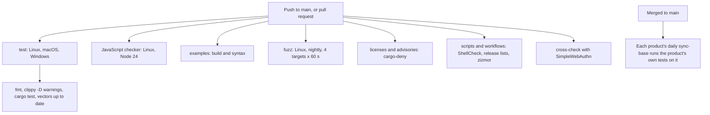

# Testing

This page lists every layer of tests in the Phygital Key base (this repository), with real counts and the command to run each one, and points to the tests each product runs on top. It is for contributors, reviewers and anyone who wants to check a claim in the [threat model](threat-model.md) for themselves. Counts are for the `main` branch after 0.4.0, taken from the files in this repository.

**On this page**

- [At a glance](#at-a-glance)
- [Shared test vectors](#shared-test-vectors)
- [Wycheproof](#wycheproof)
- [Cross-check with SimpleWebAuthn](#cross-check-with-simplewebauthn)
- [Rust unit and integration tests](#rust-unit-and-integration-tests)
- [Property tests](#property-tests)
- [Fuzzing](#fuzzing)
- [Mutation testing](#mutation-testing)
- [JavaScript checker tests](#javascript-checker-tests)
- [Installer release-list check](#installer-release-list-check)
- [Scripts and workflows](#scripts-and-workflows)
- [Examples](#examples)
- [Supply chain](#supply-chain)
- [Base CI](#base-ci)
- [Tests in each product](#tests-in-each-product)
- [The owner's hand test](#the-owners-hand-test)

## At a glance

| Layer | Count | Where | In CI |
|---|---|---|---|
| Shared test vectors | 141 (73 approvals, 25 key histories, 43 standing approvals) | `test-vectors/` | Yes, in Rust and in JavaScript |
| Wycheproof (Google's known-hard cases) | 746 ECDSA P-256 (DER and raw), in both verifiers; 210 ML-DSA-65 | `test-vectors/wycheproof/` | Yes |
| Cross-check with SimpleWebAuthn | 11 valid and 10 passkey-refusal vectors, 2 stricter cases listed | `crosscheck/` | Yes, Linux |
| Rust `#[test]` functions | 66 in 13 files (60 plain, 6 property) | `crates/` | Yes, Linux, macOS, Windows |
| Property tests | 6 functions × 2000 cases = 12,000 random cases per run | `crates/phygital-key-verify/tests/props.rs` | Yes |
| Fuzz targets | 5, 60 s each on every push, 30 min each every week | `fuzz/fuzz_targets/` | Yes, Linux |
| Mutation testing | cargo-mutants on the verifier: 341 mutants, every real gap caught | by hand | No |
| JavaScript checker | 12 tests (3 run every shared vector, 2 run Wycheproof, 1 signs an agent proof) | `verifier-js/test/` | Yes, Linux |
| Installer release-list check | 22 checks on lists signed with a test key | `crates/phygital-key-gate/tests/release-lists.sh` | Yes, Linux |
| Update job and port check | 22 checks with stand-ins: the standing-approval wait, the port takeover, which listeners are the gate's own | `crates/phygital-key-gate/tests/update-job.sh` | Yes, Linux |
| Scripts and workflows | ShellCheck on the installers, zizmor on the workflows | `.github/workflows/ci.yml` (lint job) | Yes, Linux |
| Examples | build and syntax of 3 examples | `examples/` | Yes, Linux |
| Supply chain | cargo-deny: advisories, licences, bans, sources | `deny.toml` | Yes |
| Static analysis | CodeQL on Rust, JavaScript and the workflows | `.github/workflows/codeql.yml` | Yes |
| End to end, browsers, abuse, secure install, container | 124, 16, 16, 36 (Linux) and 5 checks in Phygital Key MCP | in each product's repository | Yes, there ([below](#tests-in-each-product)) |

## Shared test vectors

The vectors are part of the [spec](spec.md): every implementation must pass every one. Both verifiers, the Rust library and the [JavaScript checker](verifier-js.md), share no code, only the spec and these files. When the two agree on every vector, unclear spec text has nowhere to hide.

| File | Cases | Accepted | Refused | Codes covered |
|---|---|---|---|---|
| `vectors.json` (approvals) | 73 | 14 | 59 | `APPROVAL_REQUIRED`, `MALFORMED`, `WRONG_AUDIENCE`, `EXPIRED`, `REQUEST_MISMATCH`, `ASSURANCE_TOO_LOW`, `UNTRUSTED_KEY`, `BAD_SIGNATURE`, `REPLAYED`, `PROOF_REQUIRED`, `BAD_PROOF` |
| `keyrings.json` (key histories) | 25 | 5 | 20 | `UNSIGNED`, `WRONG_ROOT`, `BAD_ENTRY`, `KEYS_DO_NOT_MATCH`, `WRONG_ORIGIN`, `NOT_AN_UPDATE` |
| `standing.json` (standing approvals) | 43 | 9 | 34 | `NOT_ALLOWED`, `USED_UP`, `REVOKED`, `REPLAYED`, `REQUEST_MISMATCH`, `BAD_SIGNATURE`, `WRONG_AUDIENCE`, `EXPIRED`, `ASSURANCE_TOO_LOW`, `MALFORMED`, `APPROVAL_REQUIRED` |
| **Total** | **141** | **28** | **113** | |

The vectors cover exact edges: 8192 and 8193 byte requests, 4096 and 4097 byte client data, 16384 and 16386 character approvals, exactly at `exp`, 30 s and 31 s clock drift, 300 s and 301 s life, NFD text, a KELVIN SIGN payee, a Cyrillic look-alike, floats, duplicate keys, deep nesting, lone surrogates, a flipped signature bit, wrong origin, wrong RP ID, a cross-origin frame, replays, rollbacks and forks of the key history, and every standing-approval limit. Each case has a `description`; see [test vectors](../test-vectors/README.md).

The file is made by `crates/phygital-key-testgen` with fixed test keys and deterministic signatures. CI makes it again and fails if anything changed:

```bash
cargo run -p phygital-key-testgen -- test-vectors && git diff --exit-code test-vectors
```

The private keys in `test-vectors/keys/test-keys.json` are public test keys. Never trust them anywhere.

## Wycheproof

[Wycheproof](https://github.com/C2SP/wycheproof) is Google's collection of known-hard cases for crypto libraries: bad encodings, out-of-range numbers, edge-case keys and hashes. Three files are copied unchanged into `test-vectors/wycheproof/` (commit `7a32593`, Apache-2.0), with a README saying where they come from:

| File | Cases | Run by | Result |
|---|---|---|---|
| `ecdsa_secp256r1_sha256_test.json` (DER signatures, as in WebAuthn) | 484 | Rust `tests/wycheproof.rs`, JavaScript `test/wycheproof.test.js` | All pass in both |
| `ecdsa_secp256r1_sha256_p1363_test.json` (raw r‖s, as in receipts and use tokens) | 262 | the same | All pass in both |
| `mldsa_65_verify_test.json` (ML-DSA-65, release lists) | 210 | `update.rs` test `wycheproof_mldsa_65` | All pass |

Each case goes through the same calls the verifiers use for real approvals, not a separate path. Both tests were checked to fail when the signature check is forced to accept everything. One more Rust test checks that high-S signatures verify, because authenticators do not normalise S.

## Cross-check with SimpleWebAuthn

`crosscheck/simplewebauthn.test.mjs` hands the WebAuthn assertion in every approval vector to [SimpleWebAuthn](https://simplewebauthn.dev) (`@simplewebauthn/server` 14.0.3), a widely used relying-party library that shares no code with ours. It checks signature, challenge, origin, RP ID, user presence and, for `high`, user verification on its own.

- Where our verifiers accept (11 vectors), it accepts.
- Where they refuse for a passkey reason (`BAD_SIGNATURE`, `ASSURANCE_TOO_LOW`), it refuses too, with two cases where we are stricter on purpose, listed in the test so a change is noticed: `cross_origin_frame` (we refuse `crossOrigin: true` even without `topOrigin`) and `client_data_4097_bytes` (our size limit).
- Refusals above WebAuthn (format, expiry, request, audience, replay) are not compared.

```bash
cd crosscheck && npm ci && npm test
```

## Rust unit and integration tests

Counted with `grep -c '#\[test\]'` in each file:

| File | Tests | What they check |
|---|---|---|
| `crates/phygital-key-verify/tests/vectors.rs` | 5 | Every approval, key-history and standing vector passes; every refusal code is covered; a valid approval works once |
| `crates/phygital-key-verify/tests/units.rs` | 17 | Known-answer `request_hash` and receipt reference, huge integers, level and error-code names, keyring parsing, key cards, request shapes, ids, depth counting, root fingerprint, standing rules, use tokens and use receipts |
| `crates/phygital-key-verify/tests/props.rs` | 6 | Property tests (next section) |
| `crates/phygital-key-verify/tests/wycheproof.rs` | 3 | Every Wycheproof P-256 case, DER and raw, through the verifier's own signature calls; high-S signatures verify ([Wycheproof](#wycheproof)) |
| `crates/phygital-key-verify/tests/edges.rs` | 7 | Edges mutation testing found loose: 36-byte authenticator data refused even when signed; `set_keyring` changes what a live verifier trusts; seen ids and use counts kept until exactly 30 s after expiry; a 4096-character receipt is read; revocation lists read from JSON count and merge; a proof made by `sign_proof` checks out, and one dated at the approval's `exp` does not |
| `crates/phygital-key-verify/src/canonical.rs` | 7 | Key order (RFC 8785 UTF-16 order), string escapes, floats refused, non-NFC refused, NFC singletons refused rather than folded, composition exclusions |
| `crates/phygital-key-verify/src/strict.rs` | 3 | Duplicate keys and junk refused, deep nesting refused, brackets inside strings not counted |
| `crates/phygital-key-verify/src/receipt.rs` | 1 | Receipt round trip and refusals |
| `crates/phygital-key-gate/src/audit.rs` | 1 | The hash chain detects changes |
| `crates/phygital-key-gate/src/seen.rs` | 1 | Used ids remembered until expiry; a damaged file fails closed |
| `crates/phygital-key-gate/src/util.rs` | 1 | Dates |
| `crates/phygital-key-gate/src/update.rs` | 11 | Signed release lists: a signed list is accepted and parsed; a changed list, a wrong key, no key or a junk signature is refused; the strict line format (final LF, no CRLF, lowercase hex, two spaces, no duplicate or foreign file names, no paths); versions compare by number; keys are read from PEM blocks. v2 lists: in date and signed twice is accepted; expired, signed in the future, missing or wrong ML-DSA signature refused; strict `signed` and `expires` lines; ML-DSA keys read from their blocks; the 210 Wycheproof ML-DSA-65 cases; a link planted at the staging path is replaced, never written through (review 7 L2) |
| `crates/phygital-key-gate/src/product.rs` | 3 | The installers get the product block and its release keys, filled once; unsafe product values are refused; environment names are made from the program name |
| **Total** | **66** | |

```bash
cargo test --workspace
```

The base pins no release key: each product pins its own in `release-keys.pem`. A product with no pinned key refuses every install and update ([pinned release keys](architecture.md#pinned-release-keys)); no test in the base fails for that.

## Property tests

`props.rs` has one `proptest!` block with `ProptestConfig::with_cases(2000)` and 6 functions, so each `cargo test` tries 12,000 random cases:

| Function | Property |
|---|---|
| `random_text_never_verifies` | Random text (up to 400 characters) is never a valid approval |
| `random_bytes_never_verify` | Random bytes (up to 2000) are never a valid approval |
| `changing_any_decoded_byte_is_refused` | Flipping any bit of a valid approval is refused |
| `any_other_request_is_refused` | A valid approval never covers another request |
| `canonical_form_is_idempotent` | The canonical form of the canonical form is the same |
| `verify_never_panics_on_random_requests` | Random JSON requests never crash the verifier |

## Fuzzing

Coverage-guided fuzzing with `cargo-fuzz` (libFuzzer). CI runs each target for 60 seconds on every push, and `.github/workflows/fuzz-weekly.yml` runs each for 30 minutes every Sunday, side by side, keeping any crash input as an artifact. A local run of 10 minutes per target (2026-10-18) went through 321,443 (`verify`), 5,702,178 (`keyring_history`) and 35,537 (`standing`) inputs with no crash.

| Target | What it feeds | What must hold |
|---|---|---|
| `verify` | Random bytes as an approval, and a real approval with the bytes XORed into it | Never panics, never verifies |
| `strict_json` | Random bytes to the strict parser and the canonical form | Never panics; accepted input is stable through canonical form and back |
| `keyring_history` | Random keyrings | Never panics, never passes for a random root |
| `standing` | Random standing approvals and use tokens, each paired with a real one | Never panics, never verifies |
| `proof` | Random bytes as the agent's proof for a real agent-bound approval, and the real proof with the bytes XORed in | Never panics, never verifies |

Needs nightly Rust and `cargo install cargo-fuzz`:

```bash
cd fuzz && cargo +nightly fuzz run verify -- -max_total_time=60
```

Replace `verify` with `strict_json`, `keyring_history` or `standing`.

## Mutation testing

[cargo-mutants](https://mutants.rs/) changes the verifier's code on purpose (for example `<` into `<=`, or a check that always returns success) and runs the tests against each change, called a mutant. A mutant the tests still pass shows a check no test covers.

On the verifier, every gap it found was turned into a test or a vector. The exact size-limit vectors (8192-byte request, 4096-byte client data, 16384-character approval) and five more key-history cases came from it (see the 0.2.0 entry in the changelog).

The full run on 2026-10-18 counted 341 mutants: 296 caught, 27 that do not build, 18 missed. Fourteen of the 18 were real gaps and now have tests in `tests/edges.rs`; a second run caught all of them. The other 4 cannot be told apart from the real code:

| Mutant | Why it is the same |
|---|---|
| `read_use`: `> 16384` changed to `>=` or `==` | A use token is three base64url parts; their lengths skip one value in four, and 16384 is one of the skipped values, so no token of exactly that length exists |
| `Revocations::none` returns `Default::default()` | `none()` is defined as the default |
| The strict parser's `expecting` message | Only the text of an error message |

```bash
cargo mutants --package phygital-key-verify
```

It is not part of CI.

## JavaScript checker tests

`verifier-js/test/vectors.test.js` has 9 tests and `verifier-js/test/wycheproof.test.js` has 2 ([Wycheproof](#wycheproof)), run with Node's built-in test runner (`node --test`). The checker has no dependencies.

| Test | What it checks |
|---|---|
| every approval vector | All 55 in `vectors.json` |
| every key-history vector | All 25 in `keyrings.json` |
| every standing-approval vector | All 43 in `standing.json` |
| an approval works once | Replay is refused |
| a level that is a JavaScript built-in name is refused | `toString` and friends (review 5) |
| a byte-order mark before the approval JSON is refused | One approval, one encoding (review 5) |
| junk in a revocation list is ignored, never thrown | Review 5 |
| async stores are awaited: a database-style seen store still stops a replay | An async seen store is awaited; anything but an exact `true` from `insertIfNew` counts as already used (documentation review) |
| async stores are awaited: a database-style use store still counts and stops reuse | An async use store is awaited; a count that is not a safe integer is `MALFORMED` (documentation review) |
| wycheproof: DER signatures | All 484 Wycheproof P-256 DER cases through `derToRaw` and WebCrypto |
| wycheproof: raw r\|\|s signatures | All 262 raw cases through the use-token scalar check and WebCrypto |

```bash
cd verifier-js && npm test
```

## Installer release-list check

`crates/phygital-key-gate/tests/release-lists.sh` takes `verify_release`, the function the secure installer runs as root on every release list, out of `assets/install-service.sh` and runs it against lists signed with a throwaway test key. No root, no network; it runs under the old bash 3.2 that macOS ships and under bash 5. 22 checks:

- a v2 list in date is accepted and prints its version, signed and expires times; an old v1 list asked for by version is still read;
- refused: expired, signed more than a day in the future, good for more than 400 days, expires before signed, a leading zero, changed after signing, signed by another key, a v1 header on a v2 list, no files, a file for another version;
- with an installed program (a stand-in): it is asked to check `release2.txt`, with the ML-DSA signature when there is one; when it refuses, the list is refused; an older program that cannot read v2 lists leaves the P-256 check in place;
- the rollback memory keeps the newest signed time, never an older one, and reads a damaged file as empty.

It found three bugs in the new code before they shipped: an empty array that stops bash 3.2, a missing memory file that stopped the script, and a `grep -q` in a pipe that could make a refused ML-DSA check look like an older program.

## Update job and port check

`crates/phygital-key-gate/tests/update-job.sh` takes three functions out of `assets/install-service.sh` and runs them with stand-ins for curl, kill, ps, systemd and `/proc`. No root, no network. 22 checks:

- `standing_hold`: the daily job waits while standing approvals are active, says why and how to install now, remembers when it first waited for the installed version, waits at 6 days, goes on after 7, ignores an old record for another version, does not wait with `--now` or when the gate does not answer;
- `gate_up`: a program that takes the port during an unattended update is stopped with `kill -9` once per grab and named in the result line; after 5 tries the gate is stopped (fail closed); an install by hand refuses instead;
- `ours` (Linux): systemd (pid 1), root (systemd's helper) and the gate user inside its system unit are the gate's own; a user's own unit named like the gate, another user's process and the gate user outside its units are not; on macOS nothing is skipped.

## Scripts and workflows

The CI job "scripts and workflows" runs ShellCheck (`-S warning`) on the installer templates and the test scripts, the release-list check above, and [zizmor](https://docs.zizmor.sh) (offline) on the workflows. The products run zizmor on theirs. Both were clean after the fixes listed in the changelog.

## Examples

The CI job "examples (build and syntax)" checks that the [examples](../examples/README.md) still build: `node --check examples/node-service/server.mjs`, `cargo build --manifest-path examples/rust-service/Cargo.toml`, and a YAML parse of `examples/ci-approval/example-deploy.yml`. It does not run them against a gate.

## Supply chain

CI runs [cargo-deny](https://embarkstudios.github.io/cargo-deny/) through `EmbarkStudios/cargo-deny-action` on every push, with the rules in `deny.toml`:

| Check | Rule |
|---|---|
| Advisories | RustSec advisory database; yanked crates are refused |
| Licences | Only Apache-2.0, MIT, BSD-2-Clause, BSD-3-Clause, ISC, Unicode-3.0, Zlib, CDLA-Permissive-2.0 (confidence threshold 0.9) |
| Bans | Wildcard versions refused (local path dependencies allowed) |
| Sources | Unknown registries and unknown git sources refused |

```bash
cargo deny check
```

`cargo audit` checks the same RustSec database and can be run locally; it is not a separate CI job. In the workflows, every GitHub Action is pinned to a full commit SHA, the default permission is `contents: read`, checkouts use `persist-credentials: false`, and every workspace build uses `--locked`.

## Base CI

`.github/workflows/ci.yml` runs on every push to `main` and on every pull request. The seven jobs run side by side; in the job that runs on several operating systems, a failure on one does not cancel the others (`fail-fast: false`). The base builds no program and makes no release, so there is no release workflow here.



| Job | Runs on | Steps |
|---|---|---|
| test | `ubuntu-latest`, `macos-latest`, `windows-latest` | `cargo fmt --all --check`; `cargo clippy --workspace --all-targets --locked -- -D warnings`; `cargo test --workspace --locked`; `cargo run -q --release -p phygital-key-testgen --locked -- test-vectors` and `git diff --exit-code test-vectors` |
| JavaScript checker | `ubuntu-latest`, Node 24 | `npm test` in `verifier-js` |
| examples | `ubuntu-latest`, Node 24 | `node --check examples/node-service/server.mjs`; `cargo build` of `examples/rust-service`; YAML check of `examples/ci-approval/example-deploy.yml` |
| fuzz | `ubuntu-latest`, nightly Rust | `cargo install --locked cargo-fuzz`, then each of the 5 targets for 60 s |
| licenses and advisories | `ubuntu-latest` | cargo-deny |
| scripts and workflows | `ubuntu-latest` | `shellcheck -S warning` on `crates/phygital-key-gate/assets/*.sh` and `crates/phygital-key-gate/tests/*.sh`; `crates/phygital-key-gate/tests/release-lists.sh`; `crates/phygital-key-gate/tests/update-job.sh`; `pipx run zizmor==1.31.1 --offline .` |
| cross-check with SimpleWebAuthn | `ubuntu-latest`, Node 24 | `npm ci` and `npm test` in `crosscheck` |

`.github/workflows/codeql.yml` runs GitHub CodeQL (static analysis) on the Rust code, the JavaScript (approval page and checker) and the workflows, on every push, every pull request and once a week.

`.github/workflows/scorecard.yml` runs the [OpenSSF Scorecard](https://scorecard.dev) on every push to `main` and once a week: an outside tool that scores the repository's security practices (pinned actions, token permissions, branch protection and more). It publishes the result to scorecard.dev, where the README badge reads it, and uploads the details to GitHub code scanning.

`.github/workflows/fuzz-weekly.yml` runs each fuzz target for 30 minutes every Sunday ([fuzzing](#fuzzing)).

`.github/dependabot.yml` checks the Rust crates, the `crosscheck` npm packages and the pinned GitHub Actions every week. A new version waits 7 days before Dependabot suggests it (security fixes skip the wait); each update arrives as a pull request and must pass the full CI.

## Tests in each product

The base has no program, so the tests that need one run in each product's repository: on every push and pull request there, and in its daily `sync-base` job against the newest base commit, which keeps a base update only if they pass. For Phygital Key MCP:

| Test | Checks | Where |
|---|---|---|
| End-to-end and red team: the release build, a real Chromium with a virtual passkey, the official MCP SDK as the client, and the demo service, including agent attacks, web hardening, key changes, standing approvals and revocation, stdio mode and the flood limit, and what the AI reads (instructions, tool names, descriptions and schemas are short, plain printable ASCII, with no hidden characters and no outside links), agent-bound approvals (a copy without the agent's proof, a proof by another key and a stale proof are refused), the waiting limit, and audit-check and trust-service from the command line | 124 | [`tests/e2e/run.mjs`](https://github.com/Phygital-Key/phygital-key-mcp/blob/main/tests/e2e/run.mjs) |
| The approval page in Firefox and WebKit (Safari's engine), each with its own gate: enroll, confirm, approve once (the replay is refused), deny, and no page or console error. Playwright's virtual passkey stands in for `navigator.credentials`, so this checks the page and the gate in those engines, not each browser's own WebAuthn code | 16 | [`tests/e2e/browsers.mjs`](https://github.com/Phygital-Key/phygital-key-mcp/blob/main/tests/e2e/browsers.mjs) |
| Abuse against a live gate: 10 MB bodies, 50,000-deep JSON, 1 MB and 2000-line headers, random bytes, 200 idle or half-sent connections (it answers meanwhile and closes them after 10 s), a 2000-request burst, odd paths, memory under 200 MB | 16 | [`tests/e2e/abuse.mjs`](https://github.com/Phygital-Key/phygital-key-mcp/blob/main/tests/e2e/abuse.mjs) |
| Secure install, for real on macOS and Linux, then attacked as the user, with the update job checks, the job started from systemd and launchd, the open-file limit and (Linux) the systemd sandbox score and a program trying to take the port through two restarts (the list is on [secure install](secure-install.md#how-it-is-tested)) | 36 on Linux, 32 on macOS | [`tests/secure-install.sh`](https://github.com/Phygital-Key/phygital-key-mcp/blob/main/tests/secure-install.sh), written from the base template `crates/phygital-key-gate/assets/secure-install-test.sh` |
| Container image: builds, the program runs, the gate starts and answers, runs as `65532:65532`, enrollment works inside it | 5 | the `container` job of the product's `ci.yml` |
| Files made from the base are up to date: `product-files --out .`, then `git diff --exit-code` | 1 | the `product-files` job of the product's `ci.yml` |
| Tests of the MCP side (`cargo test --locked`) on Linux, macOS and Windows | | the `test` job of the product's `ci.yml` |
| The product's workflows, with zizmor | | the `workflows` job of the product's `ci.yml` |

Phygital Key A2A runs the same secure install, container and zizmor checks, its own 172 end-to-end checks (the official A2A client, and the agent card is plain printable ASCII with no outside links) and the A2A conformance kit: see [its testing page](https://github.com/Phygital-Key/phygital-key-a2a/blob/main/docs/testing.md).

The release workflow (`release.yml`) is in each product too: on a `v*` tag it runs the tests, builds 5 targets, signs `release.txt` and `release2.txt` (P-256, and ML-DSA-65 once that key is pinned, checked by the program it just built) and publishes the release and the container image ([signed in the release run](architecture.md#signed-in-the-release-run)).

## The owner's hand test

Automated tests use a virtual passkey. On 2026-10-17 the owner also tested version 0.3.0 by hand with Touch ID on macOS: a deploy was approved once, then reusing the approval and changing the version were both refused.

## Next

- [Threat model](threat-model.md): which test proves which defence
- [Security reviews](security-reviews.md): what the reviews found
- [Contributing](../CONTRIBUTING.md): run every check before a pull request
- [Test vectors](../test-vectors/README.md): the shared cases
