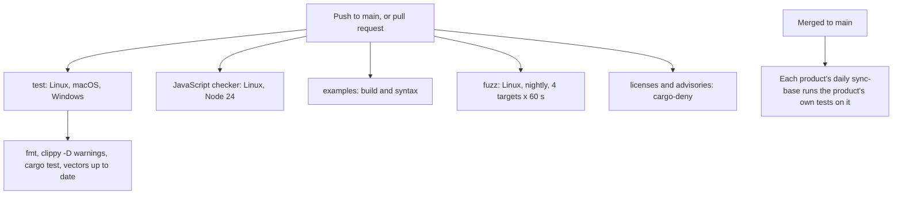

# Testing

This page lists every layer of tests in the Phygital Key base (this repository), with real counts and the command to run each one, and points to the tests each product runs on top. It is for contributors, reviewers and anyone who wants to check a claim in the [threat model](threat-model.md) for themselves. Counts are for version 0.4.0, taken from the files in this repository.

**On this page**

- [At a glance](#at-a-glance)
- [Shared test vectors](#shared-test-vectors)
- [Rust unit and integration tests](#rust-unit-and-integration-tests)
- [Property tests](#property-tests)
- [Fuzzing](#fuzzing)
- [Mutation testing](#mutation-testing)
- [JavaScript checker tests](#javascript-checker-tests)
- [Examples](#examples)
- [Supply chain](#supply-chain)
- [Base CI](#base-ci)
- [Tests in each product](#tests-in-each-product)
- [The owner's hand test](#the-owners-hand-test)

## At a glance

| Layer | Count | Where | In CI |
|---|---|---|---|
| Shared test vectors | 123 (55 approvals, 25 key histories, 43 standing approvals) | `test-vectors/` | Yes, in Rust and in JavaScript |
| Rust `#[test]` functions | 49 in 11 files (43 plain, 6 property) | `crates/` | Yes, Linux, macOS, Windows |
| Property tests | 6 functions × 2000 cases = 12,000 random cases per run | `crates/phygital-key-verify/tests/props.rs` | Yes |
| Fuzz targets | 4, 60 s each | `fuzz/fuzz_targets/` | Yes, Linux |
| Mutation testing | cargo-mutants on the verifier | by hand | No |
| JavaScript checker | 9 tests (3 of them run every vector) | `verifier-js/test/` | Yes, Linux |
| Examples | build and syntax of 3 examples | `examples/` | Yes, Linux |
| Supply chain | cargo-deny: advisories, licences, bans, sources | `deny.toml` | Yes |
| Static analysis | CodeQL on Rust, JavaScript and the workflows | `.github/workflows/codeql.yml` | Yes |
| End to end, secure install, container | 108, 30 and 5 checks in Phygital Key MCP | in each product's repository | Yes, there ([below](#tests-in-each-product)) |

## Shared test vectors

The vectors are part of the [spec](spec.md): every implementation must pass every one. Both verifiers, the Rust library and the [JavaScript checker](verifier-js.md), share no code, only the spec and these files. When the two agree on every vector, unclear spec text has nowhere to hide.

| File | Cases | Accepted | Refused | Codes covered |
|---|---|---|---|---|
| `vectors.json` (approvals) | 55 | 11 | 44 | `APPROVAL_REQUIRED`, `MALFORMED`, `WRONG_AUDIENCE`, `EXPIRED`, `REQUEST_MISMATCH`, `ASSURANCE_TOO_LOW`, `UNTRUSTED_KEY`, `BAD_SIGNATURE`, `REPLAYED` |
| `keyrings.json` (key histories) | 25 | 5 | 20 | `UNSIGNED`, `WRONG_ROOT`, `BAD_ENTRY`, `KEYS_DO_NOT_MATCH`, `WRONG_ORIGIN`, `NOT_AN_UPDATE` |
| `standing.json` (standing approvals) | 43 | 9 | 34 | `NOT_ALLOWED`, `USED_UP`, `REVOKED`, `REPLAYED`, `REQUEST_MISMATCH`, `BAD_SIGNATURE`, `WRONG_AUDIENCE`, `EXPIRED`, `ASSURANCE_TOO_LOW`, `MALFORMED`, `APPROVAL_REQUIRED` |
| **Total** | **123** | **25** | **98** | |

The vectors cover exact edges: 8192 and 8193 byte requests, 4096 and 4097 byte client data, 16384 and 16386 character approvals, exactly at `exp`, 30 s and 31 s clock drift, 300 s and 301 s life, NFD text, a KELVIN SIGN payee, a Cyrillic look-alike, floats, duplicate keys, deep nesting, lone surrogates, a flipped signature bit, wrong origin, wrong RP ID, a cross-origin frame, replays, rollbacks and forks of the key history, and every standing-approval limit. Each case has a `description`; see [test vectors](../test-vectors/README.md).

The file is made by `crates/phygital-key-testgen` with fixed test keys and deterministic signatures. CI makes it again and fails if anything changed:

```bash
cargo run -p phygital-key-testgen -- test-vectors && git diff --exit-code test-vectors
```

The private keys in `test-vectors/keys/test-keys.json` are public test keys. Never trust them anywhere.

## Rust unit and integration tests

Counted with `grep -c '#\[test\]'` in each file:

| File | Tests | What they check |
|---|---|---|
| `crates/phygital-key-verify/tests/vectors.rs` | 5 | Every approval, key-history and standing vector passes; every refusal code is covered; a valid approval works once |
| `crates/phygital-key-verify/tests/units.rs` | 17 | Known-answer `request_hash` and receipt reference, huge integers, level and error-code names, keyring parsing, key cards, request shapes, ids, depth counting, root fingerprint, standing rules, use tokens and use receipts |
| `crates/phygital-key-verify/tests/props.rs` | 6 | Property tests (next section) |
| `crates/phygital-key-verify/src/canonical.rs` | 7 | Key order (RFC 8785 UTF-16 order), string escapes, floats refused, non-NFC refused, NFC singletons refused rather than folded, composition exclusions |
| `crates/phygital-key-verify/src/strict.rs` | 3 | Duplicate keys and junk refused, deep nesting refused, brackets inside strings not counted |
| `crates/phygital-key-verify/src/receipt.rs` | 1 | Receipt round trip and refusals |
| `crates/phygital-key-gate/src/audit.rs` | 1 | The hash chain detects changes |
| `crates/phygital-key-gate/src/seen.rs` | 1 | Used ids remembered until expiry; a damaged file fails closed |
| `crates/phygital-key-gate/src/util.rs` | 1 | Dates |
| `crates/phygital-key-gate/src/update.rs` | 5 | Signed release lists: a signed list is accepted and parsed; a changed list, a wrong key, no key or a junk signature is refused; the strict line format (final LF, no CRLF, lowercase hex, two spaces, no duplicate or foreign file names, no paths); versions compare by number; keys are read from PEM blocks |
| `crates/phygital-key-gate/src/product.rs` | 2 | The installers get the product block and its release keys, filled once; environment names are made from the program name |
| **Total** | **49** | |

```bash
cargo test --workspace
```

The base pins no release key: each product pins its own in `release-keys.pem`. A product with no pinned key refuses every install and update ([pinned release keys](architecture.md#pinned-release-keys)); no test in the base fails for that.

## Property tests

`props.rs` has one `proptest!` block with `ProptestConfig::with_cases(2000)` and 6 functions, so each `cargo test` tries 12,000 random cases:

| Function | Property |
|---|---|
| `random_text_never_verifies` | Random text (up to 400 characters) is never a valid approval |
| `random_bytes_never_verify` | Random bytes (up to 2000) are never a valid approval |
| `changing_any_decoded_byte_is_refused` | Flipping any bit of a valid approval is refused |
| `any_other_request_is_refused` | A valid approval never covers another request |
| `canonical_form_is_idempotent` | The canonical form of the canonical form is the same |
| `verify_never_panics_on_random_requests` | Random JSON requests never crash the verifier |

## Fuzzing

Coverage-guided fuzzing with `cargo-fuzz` (libFuzzer). CI runs each target for 60 seconds on every push. Local runs went through millions of inputs with no crash.

| Target | What it feeds | What must hold |
|---|---|---|
| `verify` | Random bytes as an approval, and a real approval with the bytes XORed into it | Never panics, never verifies |
| `strict_json` | Random bytes to the strict parser and the canonical form | Never panics; accepted input is stable through canonical form and back |
| `keyring_history` | Random keyrings | Never panics, never passes for a random root |
| `standing` | Random standing approvals and use tokens, each paired with a real one | Never panics, never verifies |

Needs nightly Rust and `cargo install cargo-fuzz`:

```bash
cd fuzz && cargo +nightly fuzz run verify -- -max_total_time=60
```

Replace `verify` with `strict_json`, `keyring_history` or `standing`.

## Mutation testing

[cargo-mutants](https://mutants.rs/) changes the verifier's code on purpose (for example `<` into `<=`, or a check that always returns success) and runs the tests against each change, called a mutant. A mutant the tests still pass shows a check no test covers.

On the verifier, every gap it found was turned into a test or a vector. The exact size-limit vectors (8192-byte request, 4096-byte client data, 16384-character approval) and five more key-history cases came from it (see the 0.2.0 entry in the changelog). The last targeted run counted 165 mutants, 124 caught; the rest were boundary or equivalent changes, counted before the added tests. There is no newer count, so we do not claim 100%.

```bash
cargo mutants --package phygital-key-verify
```

It is not part of CI.

## JavaScript checker tests

`verifier-js/test/vectors.test.js` has 9 tests, run with Node's built-in test runner (`node --test`). The checker has no dependencies.

| Test | What it checks |
|---|---|
| every approval vector | All 55 in `vectors.json` |
| every key-history vector | All 25 in `keyrings.json` |
| every standing-approval vector | All 43 in `standing.json` |
| an approval works once | Replay is refused |
| a level that is a JavaScript built-in name is refused | `toString` and friends (review 5) |
| a byte-order mark before the approval JSON is refused | One approval, one encoding (review 5) |
| junk in a revocation list is ignored, never thrown | Review 5 |
| async stores are awaited: a database-style seen store still stops a replay | An async seen store is awaited; anything but an exact `true` from `insertIfNew` counts as already used (documentation review) |
| async stores are awaited: a database-style use store still counts and stops reuse | An async use store is awaited; a count that is not a safe integer is `MALFORMED` (documentation review) |

```bash
cd verifier-js && npm test
```

## Examples

The CI job "examples (build and syntax)" checks that the [examples](../examples/README.md) still build: `node --check examples/node-service/server.mjs`, `cargo build --manifest-path examples/rust-service/Cargo.toml`, and a YAML parse of `examples/ci-approval/example-deploy.yml`. It does not run them against a gate.

## Supply chain

CI runs [cargo-deny](https://embarkstudios.github.io/cargo-deny/) through `EmbarkStudios/cargo-deny-action` on every push, with the rules in `deny.toml`:

| Check | Rule |
|---|---|
| Advisories | RustSec advisory database; yanked crates are refused |
| Licences | Only Apache-2.0, MIT, BSD-2-Clause, BSD-3-Clause, ISC, Unicode-3.0, Zlib, CDLA-Permissive-2.0 (confidence threshold 0.9) |
| Bans | Wildcard versions refused (local path dependencies allowed) |
| Sources | Unknown registries and unknown git sources refused |

```bash
cargo deny check
```

`cargo audit` checks the same RustSec database and can be run locally; it is not a separate CI job. In the workflows, every GitHub Action is pinned to a full commit SHA, the default permission is `contents: read`, checkouts use `persist-credentials: false`, and every workspace build uses `--locked`.

## Base CI

`.github/workflows/ci.yml` runs on every push to `main` and on every pull request. The five jobs run side by side; in the job that runs on several operating systems, a failure on one does not cancel the others (`fail-fast: false`). The base builds no program and makes no release, so there is no release workflow here.



| Job | Runs on | Steps |
|---|---|---|
| test | `ubuntu-latest`, `macos-latest`, `windows-latest` | `cargo fmt --all --check`; `cargo clippy --workspace --all-targets --locked -- -D warnings`; `cargo test --workspace --locked`; `cargo run -q --release -p phygital-key-testgen --locked -- test-vectors` and `git diff --exit-code test-vectors` |
| JavaScript checker | `ubuntu-latest`, Node 24 | `npm test` in `verifier-js` |
| examples | `ubuntu-latest`, Node 24 | `node --check examples/node-service/server.mjs`; `cargo build` of `examples/rust-service`; YAML check of `examples/ci-approval/example-deploy.yml` |
| fuzz | `ubuntu-latest`, nightly Rust | `cargo install --locked cargo-fuzz`, then each of the 4 targets for 60 s |
| licenses and advisories | `ubuntu-latest` | cargo-deny |

`.github/workflows/codeql.yml` runs GitHub CodeQL (static analysis) on the Rust code, the JavaScript (approval page and checker) and the workflows, on every push, every pull request and once a week.

`.github/workflows/scorecard.yml` runs the [OpenSSF Scorecard](https://scorecard.dev) on every push to `main` and once a week: an outside tool that scores the repository's security practices (pinned actions, token permissions, branch protection and more). It publishes the result to scorecard.dev, where the README badge reads it, and uploads the details to GitHub code scanning.

`.github/dependabot.yml` checks the Rust crates and the pinned GitHub Actions every week; each update arrives as a pull request and must pass the full CI. (Its npm entry still names `tests/e2e`, which moved to the products.)

## Tests in each product

The base has no program, so the tests that need one run in each product's repository: on every push and pull request there, and in its daily `sync-base` job against the newest base commit, which keeps a base update only if they pass. For Phygital Key MCP:

| Test | Checks | Where |
|---|---|---|
| End-to-end and red team: the release build, a real Chromium with a virtual passkey, the official MCP SDK as the client, and the demo service, including agent attacks, web hardening, key changes, standing approvals and revocation, stdio mode and the flood limit | 108 | [`tests/e2e/run.mjs`](https://github.com/Phygital-Key/phygital-key-mcp/blob/main/tests/e2e/run.mjs) |
| Secure install, for real on macOS and Linux, then attacked as the user, with the update job checks (the list is on [secure install](secure-install.md#how-it-is-tested)) | 30 | [`tests/secure-install.sh`](https://github.com/Phygital-Key/phygital-key-mcp/blob/main/tests/secure-install.sh), written from the base template `crates/phygital-key-gate/assets/secure-install-test.sh` |
| Container image: builds, the program runs, the gate starts and answers, runs as `65532:65532`, enrollment works inside it | 5 | the `container` job of the product's `ci.yml` |
| Files made from the base are up to date: `product-files --out .`, then `git diff --exit-code` | 1 | the `product-files` job of the product's `ci.yml` |
| Tests of the MCP side (`cargo test --locked`) on Linux, macOS and Windows | | the `test` job of the product's `ci.yml` |

Phygital Key A2A is new; its tests live in [its repository](https://github.com/Phygital-Key/phygital-key-a2a).

The release workflow (`release.yml`) is in each product too: on a `v*` tag it runs the tests, builds 5 targets, signs `release.txt` and publishes the release and the container image ([signed in the release run](architecture.md#signed-in-the-release-run)).

## The owner's hand test

Automated tests use a virtual passkey. On 2026-10-17 the owner also tested version 0.3.0 by hand with Touch ID on macOS: a deploy was approved once, then reusing the approval and changing the version were both refused.

## Next

- [Threat model](threat-model.md): which test proves which defence
- [Security reviews](security-reviews.md): what the reviews found
- [Contributing](../CONTRIBUTING.md): run every check before a pull request
- [Test vectors](../test-vectors/README.md): the shared cases
