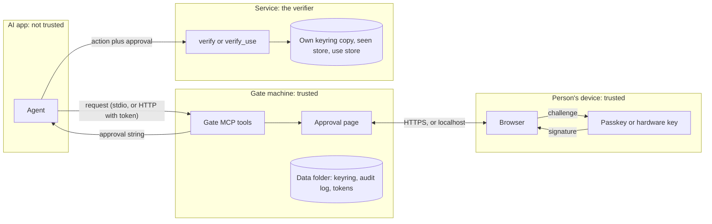
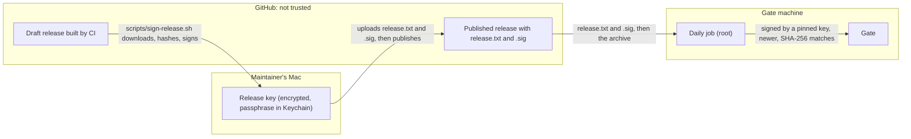

# Threat model

This page says what Phygital Key protects, from whom, how, and which test proves each defence. It is for anyone deciding whether to trust Phygital Key with a real action, and for security researchers. It describes version 0.3.0, which is pre-audit (no paid outside audit; see [security reviews](security-reviews.md)).

In one sentence: Phygital Key makes sure **a real person said yes to this exact request**, and that the yes cannot be faked, changed, stretched or reused. It does not make a bad request safe, and it cannot protect a service that does not check the [approval](glossary.md).

**On this page**

- [The headline guarantee](#the-headline-guarantee)
- [What we protect](#what-we-protect)
- [Trust boundaries](#trust-boundaries)
- [The update channel](#the-update-channel)
- [Attackers, defences and the tests that prove them](#attackers-defences-and-the-tests-that-prove-them)
- [What we trust](#what-we-trust)
- [Where to run it](#where-to-run-it)
- [Known limits](#known-limits)
- [Out of scope](#out-of-scope)

## The headline guarantee

With the [secure install](secure-install.md) on macOS or Linux: **the AI, even acting as you, can't change the gate's program, read its data or write its keys. Only the administrator password can.**

How the secure install makes that true:

| What | How | Checked by (`tests/secure-install.sh`, every push, macOS and Linux) |
|---|---|---|
| The gate runs as its own user | `_phygitalkey` on macOS (hidden, uid 400 to 499), `phygitalkey` on Linux (system user) | "only the gate user listens (IPv4 and IPv6)" |
| The program cannot be changed by you | Owned by root, in a root-only folder (`/Library/PhygitalKey` or `/usr/lib/phygital-key`) | "program owned by root", "this user cannot change the program" |
| The data cannot be read or written by you | `/Library/Application Support/PhygitalKey` or `/var/lib/phygital-key`, mode 0700, owned by the gate user | "this user cannot read the data folder", "this user cannot write the keyring" |
| The installed program is the official one | The install downloads the release list (`release.txt`), checks its signature against the pinned release keys, then checks the archive against the SHA-256 in that signed list; a `--binary` must be an absolute path, owned by root, with no group or other write and no symlinks, in every folder above it | "refuses a relative --binary", "refuses a binary the user could have changed", "refuses a release list signed by an unknown key" |
| Updates come only from signed, newer releases | A root-owned daily job (on by default) installs a release only if its list is signed by a pinned key and its version is higher; a new gate that does not start is replaced by the previous program | "daily update job installed, owned by root", "update job leaves the gate running unless a newer signed release exists", "a failed update switches back to the previous program" |
| No look-alike page on the same address | The gate holds both `127.0.0.1` and `[::1]` and refuses to start if either is taken; the install refuses while another program listens on the port | "refuses while another program holds the address" |
| Admin tasks need your password | `phygital-key-admin enroll`, `token`, `keys`, `audit-check`, `status`, `logs`, `update` run through `sudo` | "admin helper makes an enrollment link", "admin status confirms the listener" |
| No secrets in logs | The enrollment link and MCP token are never written to the gate log | "no enrollment link or token in the gate log" |

On Linux the systemd unit adds sandboxing: `NoNewPrivileges`, `ProtectSystem=strict`, `ProtectHome`, `ProtectProc=invisible`, `PrivateTmp`, `PrivateDevices`, `ProtectClock`, `ProtectKernel*`, `RestrictAddressFamilies`, `RestrictNamespaces`, `RestrictRealtime`, `RestrictSUIDSGID`, `LockPersonality`, `MemoryDenyWriteExecute`, `SystemCallArchitectures=native`, `SystemCallFilter=@system-service`, an empty `CapabilityBoundingSet`, `IPAddressDeny=any` with `IPAddressAllow=localhost`, and `ReadWritePaths` set to the data folder only.

> [!IMPORTANT]
> The guarantee needs two things from you. Install from a terminal you trust (an agent that already controls your shell could change what you type). And keep `sudo` behind your password: if your account has password-less sudo, an agent acting as you has the administrator's power too.

## What we protect

| Asset | What "protected" means | Where it lives |
|---|---|---|
| The yes (the approval) | Only the person's key can make it. It covers one exact request, one [audience](glossary.md) (`aud`), one level, for at most 300 seconds (60 by default), once. | Carried by the agent; checked by the service |
| The person's private keys | Never leave the passkey or hardware key. The gate only sees public keys. | The person's authenticator |
| The [keyring](glossary.md) | Only a key that is already trusted can add or remove a key; the history is signed back to one pinned [fingerprint](glossary.md). | Gate data folder; each verifier's own copy |
| The [standing approval](glossary.md) limits | A use outside the fixed values, ranges, use count or end date is refused. | Signed by the person; checked by the service |
| The record | Every request, approval, denial, key change, receipt and revocation is in a hash-chained audit log. | `audit.log` in the gate data folder |
| The secrets of the gate | MCP access token, one-time enrollment token, the per-standing-approval use key | Data folder (0600 or 0700); use keys only in memory |
| The update channel | The secure install, `install.sh` and `phygital-key update` install only a release whose file list is signed by a pinned release key, and the daily job only a newer one. Homebrew, Scoop and cargo installs rely on their own channel instead. See [the update channel](#the-update-channel). | Release files on GitHub; public keys pinned in `crates/phygital-key/assets/install-service.sh` and `install.sh` |
| The release keys | Two ECDSA P-256 keys: a signing key and an offline backup key. Never in GitHub. | Signing key on the maintainer's Mac, encrypted (AES-256), passphrase in the macOS Keychain; backup key off that Mac |

Cryptography, exactly: ES256 (ECDSA over P-256 with SHA-256) for every signature, SHA-256 for every hash, RFC 8785 (JCS) for the [canonical form](glossary.md). The person's device signs this [challenge](glossary.md):

$$\text{challenge} = \mathrm{SHA256}(\texttt{"phygital-key/approval/v1"} \,\|\, \texttt{0x00} \,\|\, \mathrm{JCS}(\text{claims}))$$

Approvals are **signed and verified, not secret**: anyone holding one can read the request. Libraries: RustCrypto `p256`, `ecdsa`, `sha2`, `serde_jcs`, `unicode-normalization`, `subtle` (constant-time compares). The JavaScript checker uses only WebCrypto. There are no home-made primitives. See [canonical form](canonical-form.md) and [WebAuthn](webauthn.md).

## Trust boundaries

Each arrow that crosses a box is a trust boundary:

1. **Agent to gate.** The agent can only ask. Six MCP tools exist, and none of them approves. Over HTTP the agent needs the MCP access token; over stdio only the app that started the gate can talk to it.
2. **Gate to person.** The approval page shows the canonical request built by the gate, never text written by the agent. The page computes the challenge itself and refuses to sign if the claims differ from what it shows.
3. **Person's device.** The key signs inside the authenticator. WebAuthn binds it to the approval page's domain (the RP ID).
4. **Agent to service.** The service trusts nothing the agent says. It decides the audience, the exact request it is about to run, and the level, then checks the approval against its own keyring copy and records the id so it works once. See [how it works](how-it-works.md) and [architecture](architecture.md).
5. **Release channel to gate machine.** GitHub, its download servers and anything in between are not trusted. Only a signature by a release key pinned in the program already installed lets new code in. The next section covers it.

## The update channel

The secure install updates itself once a day (on by default, decision 36 in [decisions](decisions.md)). That runs new code as root on every machine that has it, so a SHA-256 published next to the file is not enough: whoever controls the GitHub account could replace both. Each release therefore carries `release.txt`, a list of its archives and their SHA-256, and `release.txt.sig`, an ECDSA P-256 / SHA-256 signature over that list (DER encoded).

What the daily job does, in order (from `crates/phygital-key/assets/install-service.sh`):

1. Downloads `release.txt` and `release.txt.sig` from the latest release over HTTPS.
2. Checks the signature with `openssl` against the public keys pinned in the installed, root-owned program (or with that program's own `release-check` if `openssl` is missing). The keys come from what is already installed, never from the download.
3. Reads the version on line 2. If it is not strictly higher than the installed version, it stops and records `up to date`.
4. Downloads the archive for this machine and compares its SHA-256 with the one in the signed list.
5. Keeps the old program, swaps in the new one and restarts the gate. If the new gate does not answer within about 30 seconds, it puts the old program back and restarts that. If another program holds the gate's port, it stops the gate instead and records why.
6. Writes one result line to `<prefix>/update-status`, which `phygital-key-admin status` prints.

`release.txt` is strict: line 1 `phygital-key release manifest v1`, line 2 `version vX.Y.Z`, then one `<64 lowercase hex>  phygital-key-vX.Y.Z-<target>.tar.gz` (or `.zip`) line per archive, LF line ends and a final LF. Anything else is refused (Rust test `strict_format` in `crates/phygital-key/src/update.rs`).

| Attacker | What they can do | What they cannot do | Proved by |
|---|---|---|---|
| Someone who takes over the GitHub account, a download mirror or the connection | Replace archives, `.sha256` files and `release.txt` | Make a list that verifies: they have no release key. The update is refused and recorded as `update refused`. | Secure install "refuses a release list signed by an unknown key"; Rust test `refused_when_changed_wrong_key_or_unsigned` |
| Someone who steals the maintainer's key file | Copy `signing-key.pem` | Use it: the file is encrypted with AES-256 under a random passphrase kept in the maintainer's macOS Keychain | `scripts/release-key.sh` (how the keys are made); not testable |
| The maintainer loses the signing key (an accident, not an attack) | No more releases can be signed with that key | Stop updates: the backup key is pinned too, so a release signed with it installs | Rust test `both_installers_pin_the_same_keys` (both installers carry the same key block); the backup path itself has not been run |
| Someone who holds back updates (a freeze) | Serve an older release as "latest", or nothing at all, so machines stay on an old version | Install an older or an unsigned release. An older signed list ends in `up to date`, an unsigned one in `update refused`. | Rust test `versions_compare_by_number`; secure install "update job leaves the gate running unless a newer signed release exists", "update job records its result" |
| A bad release that was signed (a bug, or a maintainer mistake) | Reach every secure install with updates on | Stay installed if the new gate does not start: the previous program comes back. A signed release that starts and answers is trusted and stays. | Secure install "a failed update switches back to the previous program" |

> [!CAUTION]
> Automatic updates move trust to the release key. A release signed with a pinned key that starts and answers is installed as root on every secure install with updates on, within about a day (macOS: at a random time chosen at install; Linux: daily, with up to 6 hours of random delay). If you would rather review each version first, install with `--no-auto-update` and update by hand with `phygital-key-admin update` or `install-service --release vX.Y.Z`.

Limits of the update channel, plainly:

- **A freeze cannot be seen from the machine.** The signed list has no expiry date. `phygital-key-admin status` shows the latest signed release it found; compare it with the [Releases](https://github.com/s17sh70x2jfl031ag/phygital-key-mcp/releases) page.
- **The first install trusts what it downloads.** The pinned keys arrive inside the install script. Someone who controls the GitHub account could serve a changed script to new installs. Machines already installed keep the keys they have.
- **Someone in full control of the maintainer's logged-in Mac** could use both the key file and the Keychain passphrase.
- **If both release keys are lost**, no update can install. Machines would need a fresh install with new pinned keys.
- **`--release` can go back.** With the administrator password, `install-service --release vX.Y.Z` installs any signed release, also an older one. The daily job never does.
- **Not yet run for real.** The release keys are made once by the maintainer (`scripts/release-key.sh`); until then no key is pinned and every update is refused. CI tests the signature check, the refusal and the switch back with a local build, but the full download-and-update path runs for real only once signed releases exist (the first real test is the release after v0.3.0).
- **An update restarts the gate.** Requests still waiting are lost (they live in memory), and so are standing approvals. Approvals already signed are not affected.
- **The secure install contacts github.com once a day** for `release.txt` (and the archive when updating). The gate itself makes no network calls. `install.sh` and `phygital-key update` contact GitHub only when you run them. See [privacy](privacy.md).

## Attackers, defences and the tests that prove them

Names in the last column are real: vectors from `test-vectors/` (shared by both verifiers), checks from `tests/e2e/run.mjs` (in quotes), checks from `tests/secure-install.sh`, and Rust or JavaScript test functions. See [testing](testing.md) for how to run them.

| Attacker | Attack | Defence | Proved by |
|---|---|---|---|
| A misled or hostile agent | Prompt injection makes it want to deploy, pay or delete; it writes "approved=true" into the request | It can only ask. No tool approves. Text inside a request is data, shown as data. | Vector `prompt_injection_is_data`; e2e "MCP lists exactly 6 tools, none can approve", "prompt injection in params changes nothing: still pending", "page shows the injected text as plain data" |
| An agent that changes the request after approval | Approved 2.4.1, sends 2.4.2; adds `force: true`; swaps the action type | The verifier hashes the request it is about to run and compares (`REQUEST_MISMATCH`). | Vectors `request_one_char_changed`, `request_hash_inconsistent`, `unicode_homoglyph`; property test `any_other_request_is_refused`; e2e "approved 2.4.1, tried 2.4.2: refused", "deploy approval used for a payment: refused", "extra field added after approval: refused" |
| An agent that reuses or stretches a yes | Replays it, uses it later, uses it at another service | Single-use `id` (`REPLAYED`), short life (`EXPIRED`), audience (`WRONG_AUDIENCE`). | Vectors `replayed_id`, `expired_exactly_at_exp`, `expired_later`, `iat_31s_ahead`, `lifetime_301s`, `exp_equals_iat`, `wrong_audience`; Rust test `a_valid_approval_works_once`; e2e "replay is refused", "approval for another audience: refused", "CLI verify remembers used approvals (second use refused)" |
| An agent that asks for too little | Requests `medium` (touch) for a production deploy | The verifier sets the level per action (`ASSURANCE_TOO_LOW`). `high` needs the user-verified flag. | Vectors `medium_when_high_required`, `missing_user_verification_on_high`, `missing_user_presence`; e2e "medium approval for a high action: refused" |
| An agent that forges | Sends a made-up or edited signature to the gate or the service | Signatures are checked against trusted public keys (`BAD_SIGNATURE`, `UNTRUSTED_KEY`). The gate runs every check except replay before it keeps an approval. | Vectors `flipped_signature_bit`, `signature_from_other_claims`, `wrong_challenge`, `untrusted_key`; property tests `random_text_never_verifies`, `random_bytes_never_verify`, `changing_any_decoded_byte_is_refused`; fuzz target `verify`; e2e "forged signature sent to the gate: refused", "after a forged signature it is still not approved", "one changed character in the approval: refused" |
| An agent that adds its own key | Calls the enrollment API with a software key, or approves its own new key | Enrollment needs a one-time token from `phygital-key enroll` in your own terminal, in the link's `#fragment`, used up at the first step, valid 10 minutes. `mcp` mode never prints it. The first key signs itself; every later key needs a `high` approval from a key already trusted. | e2e "enrollment without the CLI token is refused", "enrollment link works only once", "token is removed from the address bar", "first key is not trusted until it signs itself", "second key is NOT trusted before approval", "stdio mode does not print an enrollment link"; vectors `added_by_untrusted_key`, `first_not_self_signed` |
| A phishing page | A copy of the approval page on another domain, or inside a frame | WebAuthn binds the key to the real RP ID. Wrong origin, wrong RP ID or a cross-origin frame is `BAD_SIGNATURE`. | Vectors `wrong_origin`, `wrong_rp_id`, `cross_origin_frame`, `wrong_type` |
| A web page in the person's browser | CSRF, DNS rebinding, framing, reading local key names, calling `/mcp` | Host allowlist (421 for unknown hosts); Origin check on every page POST; `/mcp` refuses any browser `Origin`; CSP `default-src 'none'` with `frame-ancestors 'none'`; `X-Frame-Options: DENY`; no CORS on localhost; COOP and CORP `same-origin`; `no-store`, `nosniff`, `no-referrer`; 64 KB body limit. | e2e "wrong Host header (DNS rebinding) is refused", "POST from another origin is refused", "MCP endpoint refuses calls from web pages", "local key list is not readable by other websites (no CORS on localhost)", "strict CSP header", "no-store and nosniff headers", "no page loads anything from another site" |
| Another program on the same machine | Opens `[::1]` on the gate's port and serves a look-alike page with the same passkey origin | The gate holds both loopback addresses and refuses to start if either is taken; if one listener stops, all stop. The secure install refuses while another program listens. | Secure install "refuses while another program holds the address", "only the gate user listens (IPv4 and IPv6)" |
| Another program on the same machine | Calls the page API with a fake `Origin`, restarts the signing step to swap claims | It can deny or cancel a waiting request (the answer becomes no). It cannot approve without the person's key. Claims stay fixed while valid. | e2e "claims cannot be swapped while the person signs", "a denied request cannot be approved later" |
| Another program on the same machine | Uses the gate's HTTP MCP endpoint to flood the person | `/mcp` needs the 32-byte access token (constant-time compare). Request limits: 30 new per minute, 50 waiting, 5000 held. | e2e "MCP endpoint refuses a client without the access token", "MCP endpoint refuses a wrong access token", "the 31st request in a minute is refused (flood limit)", "the gate still answers after the flood limit"; secure install "MCP refuses calls without the token". The 50-waiting and 5000-held limits have no automated test yet. |
| Look-alike text | `аpi` with a Cyrillic a, KELVIN SIGN instead of K, invisible characters | Exact bytes are signed and compared, never rewritten. Text that is not Unicode NFC is refused. Audiences are visible ASCII only. The page quotes odd keys and highlights invisible, direction-changing and mixed-script characters (a help, not a guarantee). | Vectors `kelvin_sign_payee_refused`, `nfd_request_refused`, `non_nfc_claims_refused`, `unicode_homoglyph`; Rust tests `text_that_is_not_nfc_is_refused`, `nfc_singletons_are_refused_not_folded`; e2e "look-alike KELVIN SIGN payee refused at the gate (not NFC)", "audience with invisible characters refused" |
| Parser tricks | Duplicate keys, floats, huge or deeply nested JSON, lone surrogates, base64 padding, a byte-order mark | Strict parsing refuses all of these (`MALFORMED`) before any signature work. A too-deep request is refused when it is created, so it never reaches the person. | Vectors `duplicate_json_key`, `float_amount`, `too_deep`, `unpaired_surrogate`, `base64_padding`, `oversize`, `request_8193_bytes`, `approval_16386_chars`; Rust tests `refuses_duplicates_and_junk`, `refuses_deep_nesting`; JS test "a byte-order mark before the approval JSON is refused"; fuzz target `strict_json`; e2e "floats are refused at the gate", "too deeply nested request refused before the person sees it" |
| A checker tricked by its language | A level named `toString` (a JavaScript built-in) | Own-property checks in the JavaScript checker. | JS test "a level that is a JavaScript built-in name is refused" |
| Approval fatigue | Hundreds of requests so the person clicks yes | 30 new requests per minute, 50 waiting at most, every field always shown, fingerprint, face or PIN for `high`. | e2e "the 31st request in a minute is refused (flood limit)"; the limits are in `crates/phygital-key/src/state.rs`; the 50-waiting limit has no automated test yet |
| A tampered key list | A website or file lists an extra key, relabels one, serves an old copy, or a removed key signs a new branch | Every key change is an approval signed by a key trusted at that point, back to one pinned fingerprint and a pinned origin; cards must match what was signed; a refetch must extend the copy accepted before (`verify_history_update`, `--previous`). | Vectors `extra_unsigned_key`, `relabeled_card`, `swapped_key`, `tampered_entry`, `wrong_origin`, `rollback`, `fork_by_removed_key`, `remove_last_key`; fuzz target `keyring_history`; e2e "a key slipped into the file without a signature is caught", "an older copy of the key list (rollback) is caught", "a key list signed on another gate is refused", "the last key cannot be removed" |
| An agent stretching a standing approval | More uses, bigger amounts, another payee, extra fields, after the end | Exact `fixed` values, `vary` limits (both `min` and `max` for integers), nothing extra, a use cap counted by the service, 60-second use tokens never past the end, use key only in the gate's memory. Standing approvals are always level `high`. | Vectors `over_max`, `under_min`, `negative_amount`, `fixed_field_changed`, `extra_field`, `used_up`, `replayed_use`, `use_outlives_standing`, `standing_ended`, `standing_medium_never_enough`, `range_without_min`; fuzz target `standing`; e2e "a use token for 450 cannot pay 999", "gate refuses a use over the limit", "gate refuses another payee", "third use refused (max 2)", "the same use token twice is refused" |
| Type confusion | A standing approval used as a one-time approval, or the reverse; a `revoke` request run as an action | `standing` and `revoke` types are reserved; `verify` refuses them. | Vectors `standing_as_one_time`, `standing_as_action`, `one_time_approval_as_standing`, `no_use_token`; e2e "standing approval alone is not a one-time approval", "a standing request disguised as a normal one is refused" |
| A revoked standing approval still used | Uses collected before the revoke | The gate throws the use key away at once. The person then signs a [revocation](glossary.md), published at `/.well-known/phygital-key-revoked.json`; services refuse with `REVOKED`. Revocations bypass the request limits and can be retried. Junk in the list is ignored. | Vectors `revoked`, `revoked_among_others`, `revocation_by_untrusted_key`, `revocation_for_other_service`; JS test "junk in a revocation list is ignored, never thrown"; e2e "revoked: no new uses, even before the revocation is signed", "after the person signs the revocation, the service refuses the standing approval" |
| A made-up receipt | The agent reports "done" with a fake [receipt](glossary.md) | The gate records a receipt only if it is signed by the service's pinned receipt key and names the same approval, request and service. | Rust tests `round_trip_and_refusals`, `use_receipts_are_bound_to_the_use`; e2e "a receipt the agent made up is refused (signature checked)", "receipt for another approval is refused", "a receipt is recorded only once" |
| Someone editing the record | Changes a line of the audit log | Each line holds the SHA-256 of the line before it; `phygital-key audit-check` finds the break. | Rust test `chain_detects_changes`; e2e "audit log chain is intact" |
| Someone who controls GitHub or a mirror | Replaces a release so the secure install runs their program as root | Only a release list signed by a pinned release key, for a newer version, with a matching SHA-256, is installed. Details in [the update channel](#the-update-channel). | Secure install "refuses a release list signed by an unknown key"; Rust tests `refused_when_changed_wrong_key_or_unsigned`, `strict_format`, `versions_compare_by_number` |
| A crash or damage to the used-ids file | The command-line verifier forgets an id and accepts it twice | Lock file, temp file and rename, directory fsync; any damaged line refuses everything; ids kept 30 s past expiry. | Rust test `remembers_until_expiry_and_fails_closed` |

## What we trust

| We trust | Why it matters | What happens if it fails |
|---|---|---|
| The person's device and authenticator | The key signs there | A fully compromised phone or laptop can trigger signatures |
| The machine that runs the gate | The gate serves the approval page | Whoever controls it controls what the page shows, and could show one request while asking the key to sign another. Authenticators do not display what they sign. This is the role AP2 calls the Trusted Surface. |
| The verifier's keyring copy | It decides which keys count | Whoever can write it decides who can approve |
| The verifier's seen store and use store | They make each approval and each use count once | A store that forgets, or is not shared between instances, allows a second use |
| The person's judgement | They read the request and decide | A person who approves a harmful request gets a valid approval for it |
| The release keys and the maintainer's Mac | A signature by a pinned release key is what lets an update install | Whoever can sign with a release key can ship a program that the daily job installs as root on every secure install with updates on |

## Where to run it

The guarantees hold only if **the agent cannot change the gate's program, the gate's data folder or the verifier's keyring**.

| Setup | Fit | Why |
|---|---|---|
| [Secure install](secure-install.md) on macOS or Linux | Real use | Gate as its own system user, program owned by root, data closed to you; see [the headline guarantee](#the-headline-guarantee) |
| Gate on [another machine](own-server.md) that the agent cannot reach as an administrator | Real use | Same separation, by a machine boundary. Remote origins need HTTPS. |
| `phygital-key demo` or `phygital-key mcp` under your own user | Trying it | Shows the flow, but an agent with full shell access as you could edit the files |
| Windows | Trying it | There is no secure install for Windows yet |

> [!WARNING]
> The MCP access token ends up in your AI app's settings, which the agent can read. It keeps other programs out of the gate's HTTP endpoint, not the agent. The agent still can only ask; it cannot approve.

## Known limits

- **Signed, not encrypted.** Whoever holds an approval can read the request. Keep secrets out of requests. Encrypted requests are not built, by decision 33 in [decisions](decisions.md): the page is served by the gate, so encrypting against the gate helps only with a separately served, pinned page.
- **A bearer for its life.** A stolen approval works once, only for that request and audience, until it expires (60 s by default, at most 300 s). Binding it to the requester's key is not built.
- **Revocation lag.** Until a service picks up the signed revocation, use tokens already handed out work for up to 60 s. An agent that collected every remaining use right before the revoke could spend them all in that window.
- **No hardware proof.** Attestation is `none`, so the gate cannot tell a hardware key from a software key (decision 35). The one-time enrollment link protects the first key. A service that wants only hardware keys can trust only those keys in its keyring.
- **First fetch of a keyring.** With no stored copy, a checker cannot tell an old copy from the latest. Rollback protection starts from the first copy you accept.
- **The audit log catches edits, not a full rewrite.** The hash chain has no secret key: someone who can write the file can rebuild every hash, or cut off the end. Keep the last hash somewhere else (a backup, a ticket) to detect that.
- **Used ids on one machine.** The command-line verifier's `seen-ids.jsonl` serves one machine. Several instances need a shared store (use the library).
- **Memory only.** Pending requests and standing approvals live in the gate's memory. A restart ends them all (the answer becomes no), and an automatic update is a restart.
- **Updates trust the release key.** A signed release that starts is installed; there is no second reviewer and no expiry on the signed list. See [the update channel](#the-update-channel).
- **Look-alike highlighting is a help.** The real protection is that exact bytes are signed and compared.
- **Request limits are a nuisance limit, not a fatigue cure.** A person can still be asked many times.
- **Pre-audit.** Six internal reviews by AI security-auditor agents, every finding fixed; no paid third-party audit. See [security reviews](security-reviews.md).

## Out of scope

- An agent that can do the action without going through a verifier (for example one that already holds production credentials). Phygital Key protects services that check approvals.
- A service that does not call `verify` or `verify_use`, or calls it with the agent's idea of the audience, request or level.
- A compromised authenticator, person's device, or gate machine administrator.
- A release key used by someone in full control of the maintainer's Mac (see [the update channel](#the-update-channel)).
- A request the person reads and approves, even if it is harmful.
- Denial of service by a program on the gate machine (it can deny, cancel or fill limits; it cannot approve).
- Not built, by decision: encrypted requests (decision 33), hardware-attestation checks (decision 35), AP2 or SD-JWT export (decision 28, mapping in [AP2](ap2.md)), 2-of-3 approvers (the format is ready), a Windows secure install.

Found a way around a defence on this page? Report it privately: see [SECURITY.md](../SECURITY.md).

## Next

- [Security reviews](security-reviews.md): what each review found and what was fixed
- [Testing](testing.md): every test layer and how to run it
- [Secure install](secure-install.md): set up the headline guarantee
- [Updates](updates.md): how each install updates, and how to check a download
