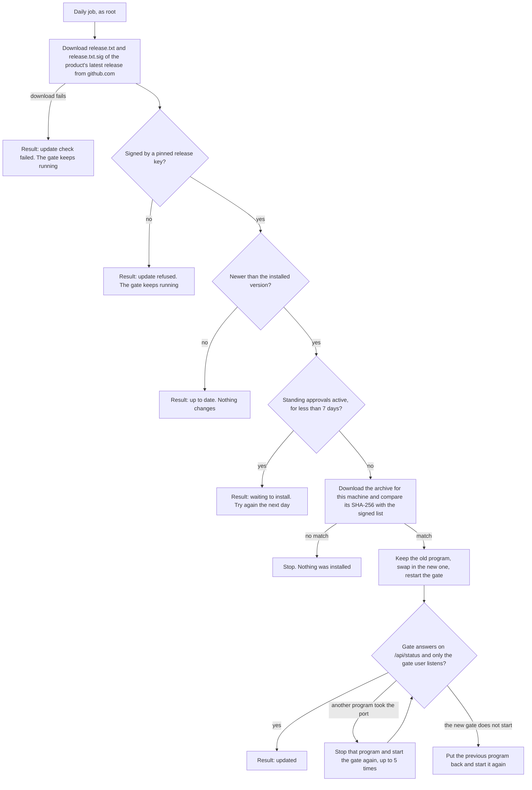
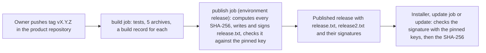

# Updates

How a Phygital Key product gets new versions for each way of installing it: the secure install's automatic daily updates, `update` for installs in your own folders, package managers, and how to check a release yourself. For anyone who runs the gate. Commands are shown for Phygital Key MCP (`phygital-key-mcp`); Phygital Key A2A (`phygital-key-a2a`) takes the same commands and options, with its own names from the [table in reference](reference.md#names-per-product).

**On this page:** [how often](#how-often) · [by install method](#update-by-install-method) · [from 0.3](#from-03-to-the-products) · [automatic updates](#automatic-updates-secure-install) · [update](#update-install-script-and-cargo) · [package managers](#package-managers) · [the signed release list](#the-signed-release-list) · [after updating](#after-updating) · [what carries over](#what-carries-over) · [check a download yourself](#check-a-download-yourself) · [limits](#limits)

## How often

There is no fixed release schedule. Each product releases on its own, on its Releases page ([Phygital Key MCP](https://github.com/Phygital-Key/phygital-key-mcp/releases), [Phygital Key A2A](https://github.com/Phygital-Key/phygital-key-a2a/releases)). The base (this repository) makes no releases: a base change reaches a product's `main` through its daily `sync-base` job, and you with that product's next release. What changed in the base is in [CHANGELOG.md](../CHANGELOG.md). While the project is at 0.x, only the latest release gets fixes ([SECURITY.md](../SECURITY.md)).

See what you have:

```bash
phygital-key-mcp --version
```

```text
phygital-key-mcp 0.4.0
```

## Update, by install method

| You installed with | How it updates | Update now |
|---|---|---|
| The [secure install](secure-install.md) | By itself, once a day, signed releases only ([below](#automatic-updates-secure-install)) | `phygital-key-mcp-admin update` |
| The install script (`install.sh`) | When you run the command | `phygital-key-mcp update` (or `phygital-key-mcp update --check` to only look) |
| cargo | When you run the command | `phygital-key-mcp update`, or build again: `cargo install --locked --force --git https://github.com/Phygital-Key/phygital-key-mcp phygital-key-mcp` |
| Homebrew | With Homebrew | `brew update` then `brew upgrade phygital-key-mcp` |
| Scoop (Windows) | With Scoop | `scoop update` then `scoop update phygital-key-mcp` |
| Container (`ghcr.io/phygital-key/phygital-key-mcp`) | When you pull a new image | `docker pull ghcr.io/phygital-key/phygital-key-mcp:latest`, then start a new container on the same volume ([how](own-server.md#run-it-in-a-container)) |
| By hand | When you download it | Download the new archive, [check it](#check-a-download-yourself), replace the program file |

Each install is updated on its own. Updating your own `phygital-key-mcp` (Homebrew, the script, cargo) does not update the secure install, which runs its own locked copy, and the other way round. Each product updates only from its own repository and with its own keys.

## From 0.3 to the products

Versions up to 0.3.0 were one program, `phygital-key`, released from this repository. Since 0.4.0 the program is a product: `phygital-key-mcp` (the same MCP gate) or `phygital-key-a2a`. Nothing moves you there by itself: a 0.3 updater (`phygital-key update` or the 0.3 daily job) refuses a product's release, because its release list names files that start with the product's program name, which the 0.3 check does not accept.

| 0.3 | Phygital Key MCP |
|---|---|
| `phygital-key mcp` | `phygital-key-mcp stdio` |
| `phygital-key mcp-token` | `phygital-key-mcp token` |
| `--open-mcp` | `--no-token` |
| `~/.phygital-key` | `~/.phygital-key-mcp` |
| `<home>/mcp-token` | `<home>/access-token` |
| `PHYGITAL_KEY_HOME`, `_PORT`, `_BIND`, `_ORIGIN` | `PHYGITAL_KEY_MCP_HOME`, `_PORT`, `_BIND`, `_ORIGIN` |
| `phygital-key-admin` | `phygital-key-mcp-admin` |
| `ghcr.io/phygital-key/phygital-key` | `ghcr.io/phygital-key/phygital-key-mcp` |
| `brew install phygital-key/tap/phygital-key` | `brew install phygital-key/tap/phygital-key-mcp` |

To move:

1. **Secure install:** remove the 0.3 service first, then install the product ([from a 0.3 secure install](secure-install.md#from-a-03-secure-install)), and enroll your key again.
2. **Your own folders:** install the product ([getting started](getting-started.md)). The new program reads `~/.phygital-key-mcp`, not `~/.phygital-key`, so enroll your key again, or move the old folder to the new name before the first start. Either way the old `mcp-token` file is not read: the first `serve`, `demo` or `token` makes a new `access-token`, so paste the new line into your AI app.
3. **AI app settings:** change the command to `phygital-key-mcp` with the argument `stdio` ([connect your AI app](https://github.com/Phygital-Key/phygital-key-mcp/blob/main/docs/connect-your-ai.md)).
4. **Services:** keep checking approvals as before. The approval format (`pka.1`) did not change. If a service reads a keyring from your gate, give it the keyring of the new gate once you have enrolled there.

## Automatic updates (secure install)

The secure install sets up a daily job, owned by root, that installs a newer release of the same product only when its file list is signed by a pinned release key. It is on by default.

| | macOS | Linux |
|---|---|---|
| Job | launchd LaunchDaemon `io.phygitalkey.<id>.update` (`/Library/LaunchDaemons/io.phygitalkey.<id>.update.plist`), runs as root | systemd `<program>-update.timer` and `<program>-update.service` (`/etc/systemd/system/`), a oneshot run as root with `PrivateTmp` and `ProtectHome` |
| When | Once a day at a time of day picked at random when you install (printed at the end of the install). If the Mac was asleep at that time, launchd runs it when the Mac wakes | `OnCalendar=daily` with `RandomizedDelaySec=6h`: once a day, between midnight and 06:00. `Persistent=true` runs a missed check after the machine was off |
| Output | `/Library/Logs/PhygitalKey/<id>-update/update.log` (folder 0700, root only) | The journal: `journalctl -u <program>-update` |
| Last result | `/Library/PhygitalKey/<id>/update-status` | `/usr/lib/<program>/update-status` |

| Product | `<id>` | `<program>` | Job (macOS) | Job (Linux) |
|---|---|---|---|---|
| Phygital Key MCP | `mcp` | `phygital-key-mcp` | `io.phygitalkey.mcp.update` | `phygital-key-mcp-update.timer` |
| Phygital Key A2A | `a2a` | `phygital-key-a2a` | `io.phygitalkey.a2a.update` | `phygital-key-a2a-update.timer` |

Both jobs run `<prefix>/bin/<program> --port <port> install-service --auto-update-run` (a hidden option). Each run does this:



In words:

1. It downloads `release.txt` and `release.txt.sig` from `https://github.com/<product repo>/releases/latest/download/` (for Phygital Key MCP, `Phygital-Key/phygital-key-mcp`) over https (TLS 1.2 or newer). Every `curl` starts with `-q`, so it never reads a `.curlrc` file.
2. It checks the signature against the release keys pinned in the installed program's own installer script ([the signed release list](#the-signed-release-list)). Any doubt is a refusal.
3. It compares the signed version with the installed one, number by number (`v0.10.0` is newer than `v0.9.9`). Only a strictly newer version goes on. An automatic update never installs an older version.
4. If any standing approval is active, it waits ([waiting while you are busy](#waiting-while-you-are-busy)).
5. It downloads the archive for this machine and compares its SHA-256 with the value in the signed list. The `.sha256` file next to the archive is not used.
6. It keeps a copy of the current program, swaps the new one in with one rename, and restarts the gate.
7. It runs the same start checks as a fresh install: the gate must answer within about 30 seconds, and no program other than the gate user may listen on the port. If a program running as another user takes the port while the gate restarts, the job stops that program (`kill -9`) and starts the gate again, up to 5 times, and names it in the result line. If the port is still taken after that, the gate is stopped and the result says so. If the new gate does not start, the job puts the previous program back and starts that one.

Steps 1 to 5 do not touch the running gate. Only an update that passes them restarts it.

**Root starts from a clean environment.** On macOS, `sudo` keeps your `HOME` (and your `PATH` when no `secure_path` is set). So `install-service`, which the daily job and the admin helper's `update` both run, starts bash with an empty environment: only `PATH=/usr/bin:/bin:/usr/sbin:/sbin`, root's own `HOME` (`/var/root` on macOS, `/root` on Linux), `LANG=C` and the installer's `PKA_*` values. The script itself sets that `PATH` and `HOME` again as its first step and clears variables such as `CURL_HOME`, `SSL_CERT_FILE`, `OPENSSL_CONF`, `BASH_ENV`, `LD_PRELOAD` and `DYLD_INSERT_LIBRARIES`, which also covers `curl ... | sudo bash`. The admin helper sets `PATH` to system folders before it calls `sudo`. A `~/.curlrc` or a fake `curl`, `awk` or `openssl` early in your `PATH` therefore never runs as root (secure-install checks "root ignores the user's ~/.curlrc" and "root ignores programs early in the user's PATH").

### See the last result

```bash
phygital-key-mcp-admin status
```

```text
program:      phygital-key-mcp 0.4.0
auto-update:  on  (last: 2026-10-18T03:12:00Z up to date (v0.4.0; latest signed release v0.4.0))
ok: only the gate (_phygitalkeymcp) listens on port 7468
{"history_ok":true,"keys":[...],"origin":"http://localhost:7468","root_fingerprint":"...","rp_id":"localhost","standing_active":0,"waiting":0}
```

Before the first daily run, `last:` says `not run yet`. The result line is one of these (time in UTC first; the versions are examples):

| Result | Meaning |
|---|---|
| `up to date (v0.4.0; latest signed release v0.4.0)` | Nothing newer is signed. Nothing changed |
| `updated from v0.4.0 to v0.5.0 (signed release, SHA-256 checked)` | The new version runs and passed the start checks |
| `updated from v0.4.0 to v0.5.0 (signed release, SHA-256 checked); stopped programs that took the port of the gate during the restart: [uid 501, pid 1234]` | Updated, but while the gate restarted a program running as another user took its port, posing as the gate. The job stopped it and started the gate again. Find out what that program was |
| `update check failed: could not download the latest signed release list from GitHub (still on v0.4.0)` | `release.txt` or its signature could not be downloaded |
| `waiting to install v0.5.0: 1 standing approval(s) active. It installs once they end, after 7 days at the latest, or now with: phygital-key-mcp-admin update --now` | A newer signed release exists, but installing it now would end active standing approvals. See [waiting while you are busy](#waiting-while-you-are-busy) |
| `update refused: the latest release list is not signed by a pinned release key (still on v0.4.0)` | The list is missing a valid signature. Nothing was installed |
| `update to v0.5.0 failed: the new gate did not start, so v0.4.0 is back` | The new version failed its start checks. The previous program runs again |
| `update stopped: ...` | The run stopped before installing (for example `update stopped: the download does not match its signed SHA-256. Nothing was installed.`), or, with `the gate is stopped:` in it, the gate is stopped and needs you. See [troubleshooting](troubleshooting.md#automatic-updates) |

Every stopped run also leaves its message in the update log or the journal.

### Update now

```bash
phygital-key-mcp-admin update
```

This runs the daily job at once (it asks for your administrator password): it installs the latest signed release if it is newer, and otherwise records `up to date`. Like the daily job, it waits while standing approvals are active. `phygital-key-mcp-admin update --now` installs anyway (and so ends them).

### Waiting while you are busy

Installing restarts the gate, and a restart ends every standing approval (their use keys live only in memory). So before it installs, the daily job asks the gate how many standing approvals are active (`standing_active` in `/api/status`). If one or more are, it records the `waiting to install` line and tries again the next day.

Requests still waiting for you do not hold an update back. An agent can make a request at any time, so counting them would let an agent keep updates away for good. `/api/status` still reports them as `waiting`; they are lost on the restart, and the agent asks again.

The 7 days are counted per installed version. The first wait on the version you run writes `<unix time> <installed version>` to `<prefix>/update-postponed`, and a newer release that appears meanwhile does not restart the clock. After 7 days the job installs anyway, so a security fix arrives within a week. An agent cannot start this wait on its own, because a standing approval needs your passkey. Your own active standing approval can still hold a security update back for up to 7 days.

To install one chosen version, newer or older, use the locked program with `--release`:

```bash
sudo /Library/PhygitalKey/mcp/bin/phygital-key-mcp install-service --release v0.4.0      # macOS
sudo /usr/lib/phygital-key-mcp/bin/phygital-key-mcp install-service --release v0.4.0     # Linux
```

(`v0.4.0` is an example: use a version from the product's [Releases](https://github.com/Phygital-Key/phygital-key-mcp/releases) page.) The same signed-list check applies. With automatic updates on, the next daily run moves an older version up to the latest signed release again.

### Turn automatic updates off or on

```bash
sudo /Library/PhygitalKey/mcp/bin/phygital-key-mcp install-service --no-auto-update   # off (macOS)
sudo /Library/PhygitalKey/mcp/bin/phygital-key-mcp install-service --auto-update      # on again
```

(On Linux: `/usr/lib/phygital-key-mcp/bin/phygital-key-mcp`.) To install with updates off from the start:

```bash
curl -q -fsSL https://raw.githubusercontent.com/Phygital-Key/phygital-key-mcp/v0.5.0/install-service.sh | sudo bash -s -- --no-auto-update
```

The choice is saved as `on` or `off` in `<prefix>/auto-update` and kept on later installs until you pass the other option. `--no-auto-update` removes the job; `phygital-key-mcp-admin update` still works when you want it. Both options run the whole install again for the installed version, so the gate restarts.

### What automatic updates need

- **openssl**, to check the signature. macOS has an `openssl` command; most Linux systems do too. If it is missing, the job uses the installed program's own hidden `release-check` command instead, which checks the same pinned keys (only when that program is root-owned in root-only folders). A fresh install without openssl stops with `needs openssl to check the release signature. Install openssl, then run this again.`
- **curl** and https access to `github.com`.
- **A gate restart.** An update restarts the gate: requests still waiting for a decision are lost, and every [standing approval](standing-approvals.md) ends, because both live only in memory. Approvals you already signed and the AI already fetched keep working at the service until they expire. Days without a newer release cause no restart.

## `update` (install script and cargo)

For a program in your own folders, such as `~/.local/bin` from the install script, or `~/.cargo/bin` from cargo:

```bash
phygital-key-mcp update --check    # only say whether a newer signed release exists
phygital-key-mcp update            # install it
```

The answers look like this (the versions are examples):

```text
phygital-key-mcp v0.4.0 is up to date (latest signed release: v0.4.0).
```

```text
phygital-key-mcp v0.5.0 is available (you have v0.4.0). Run: phygital-key-mcp update
```

```text
Updated /Users/you/.local/bin/phygital-key-mcp from v0.4.0 to v0.5.0 (signed release, SHA-256 checked).
Restart your AI app, or any running phygital-key-mcp serve, to use it.
```

It downloads the product's latest `release.txt` and its signature from GitHub with `curl`, checks the signature itself (ECDSA P-256 with SHA-256, against the same pinned release keys as the installers, so it needs no openssl), refuses anything that is not strictly newer, downloads the archive for this machine, compares its SHA-256 with the signed list, and renames the new program over the old one. The folder that holds the program must be writable by you. A cargo install is replaced by the official release build.

It refuses where another updater is in charge:

| Install | It answers |
|---|---|
| Secure install | `phygital-key-mcp: this is the secure install: it updates itself every day. To update now: phygital-key-mcp-admin update` |
| Homebrew | `phygital-key-mcp: installed with Homebrew: run  brew upgrade phygital-key-mcp` |
| Windows | `phygital-key-mcp: on Windows, update with Scoop (scoop update phygital-key-mcp), or download the new .zip from the Releases page` |

The install script itself also checks the signed release list (it needs `openssl` for that) and ends with `Update later with: phygital-key-mcp update`. To pin a version with the script, put `PHYGITAL_KEY_VERSION=v0.4.0` before `sh` (the name is the same for every product).

## Package managers

Each product has its own package names. For Phygital Key MCP:

- **Homebrew:** `brew update`, then `brew upgrade phygital-key-mcp`. Homebrew checks the archive against the SHA-256 in the formula of the tap `Phygital-Key/homebrew-tap`.
- **Scoop:** `scoop update`, then `scoop update phygital-key-mcp`. Scoop installs the version and SHA-256 listed in the bucket file of the product's repository (`bucket/phygital-key-mcp.json`), which is updated separately from each release.
- **winget:** the product's `scripts/package-manifests.sh` writes winget manifests, but they are not submitted to Microsoft, so `winget upgrade` does not find Phygital Key yet.

Package managers do not read the signed release list. They rely on their own checksums. The product's `scripts/package-manifests.sh` writes the Homebrew formula, the Scoop manifest and the winget manifests from the `.sha256` files of a published release.

## The signed release list

Every product release carries two extra files:

- `release.txt`: the version and the SHA-256 of each archive, exactly in this form (LF line ends, final LF). For Phygital Key MCP:

  ```text
  phygital-key release manifest v1
  version v0.4.0
  <64 lowercase hex>  phygital-key-mcp-v0.4.0-aarch64-apple-darwin.tar.gz
  <64 lowercase hex>  phygital-key-mcp-v0.4.0-x86_64-pc-windows-msvc.zip
  ```

- `release.txt.sig`: an ECDSA P-256 signature over SHA-256 of `release.txt` (DER):

  $$\text{release.txt.sig} = \mathrm{ECDSA\text{-}P256}_{\text{release key}}\big(\mathrm{SHA256}(\texttt{release.txt})\big)$$

Newer releases also carry `release2.txt`, the same list with two more lines, and two signatures:

```text
phygital-key release manifest v2
version v0.5.0
signed 1792300000
expires 1807852000
<64 lowercase hex>  phygital-key-mcp-v0.5.0-aarch64-apple-darwin.tar.gz
```

- `signed` and `expires` are Unix seconds. A release run sets `expires` 180 days after `signed`; a list good for more than 400 days, or signed more than a day ahead of the machine's clock, is refused.
- `release2.txt.sig` is the same P-256 signature as above. `release2.txt.mldsa` is a second signature with ML-DSA-65 (FIPS 204), with the context string `phygital-key release list v2`. ML-DSA is believed to stay safe if large quantum computers arrive.

What v2 adds:

| | `release.txt` | `release2.txt` |
|---|---|---|
| Who reads it | Installs from before the change | New installs, the daily job, `update` |
| An old list served again (a freeze) | Reads as `up to date`, for good | Ends in "the latest signed release list expired" after at most 180 days |
| A list older than one seen before (a rollback) | Not noticed | Refused: the secure install remembers the newest `signed` time it accepted (`<prefix>/release-seen`) |
| Signatures | P-256 | P-256, plus ML-DSA-65 once the product pins an ML-DSA key |

The installed, root-owned program (`release-check`) checks the ML-DSA signature on every update. A first install has no trusted program yet, so it checks the P-256 signature with `openssl`, as before. Until a product pins an ML-DSA key, the P-256 signature is enough. A release has to come out at least every 180 days, or installs report that the list expired (the gate keeps running).

Each product has its own release key: a secret of the GitHub environment `release` in that product's repository (named `RELEASE_SIGNING_KEY`). GitHub hands that secret only to a release run started by a `v*` tag, and a repository ruleset lets only repository admins create, update or delete `v*` tags. For now the environment has no required reviewer: the run signs and publishes by itself as soon as the owner pushes the tag (decision 36 in [decisions](decisions.md)). No copy is kept anywhere else: the product's `scripts/release-key.sh` makes the key in a temporary folder, stores it in GitHub and deletes the local copy. The ML-DSA key is a second secret, `RELEASE_MLDSA_KEY`, made by `scripts/release-key.sh --pq`: the program makes it and hands the private part straight to GitHub without writing it to disk. The public key is pinned in the product's `release-keys.pem`, compiled into the program, and in the `# BEGIN RELEASE KEYS` block of its `install-service.sh` and `install.sh`. `product-files` writes those blocks from the same keys, and the product's CI fails if they differ.



1. A pushed tag `vX.Y.Z` starts the product's `.github/workflows/release.yml`. Its build job runs the tests and builds the archives (and their `.sha256` files) for the 5 targets, and publishes a build provenance attestation for each archive (`actions/attest-build-provenance`: a record signed through Sigstore of which workflow built which file from which commit).
2. The `publish` job uses the environment `release`, so it gets the key only in a run from a `v*` tag. It does not wait for an approval click while the required reviewer is off. It computes the SHA-256 of every archive itself, writes `release.txt` and `release2.txt`, signs both, checks the signatures against the keys pinned in that commit (it stops if none matches), signs `release2.txt` with ML-DSA using the Linux program it just built (when an ML-DSA key is pinned), has that program check the whole v2 list, and publishes the release with every file and every list and signature.
3. Every installer and updater checks the signature first and takes the SHA-256 only from the signed list.

The parser in `crates/phygital-key-gate/src/update.rs` refuses anything that is not exactly this form (for v2 also a bad `signed` or `expires` line): another header, a version line without `v` or with leading zeros, uppercase hex, one space instead of two, CRLF line ends, a file name for another version or another product, a path, a duplicate file, or a list with no files.

What this protects: someone who swaps a release file on GitHub, runs a download mirror or sits between you and GitHub cannot make an update that installs, because they cannot sign. A stolen workflow token or a pull request cannot read the key either: GitHub gives the environment secret only to runs from `v*` tags, and only repository admins can push those tags. One product's release cannot install as another: its file names start with its own program name, and it is signed with its own key.

Also in place: the build record that shows which workflow built each file from which commit, the version check (no older version installs), and your choice to turn automatic updates off. Your first install also trusts the installer script you download (pinned to a release tag over https), and the keys in it are the root of trust from then on. See [the update channel](threat-model.md#the-update-channel).

## After updating

- **stdio (`phygital-key-mcp stdio`)**: the AI app keeps running the old program until it starts the gate again. Restart the app.
- **`serve` or `demo`**: stop it and start it again.
- **Secure install**: the update restarts the service for you.

> [!WARNING]
> A restart drops requests that are still waiting and ends every standing approval (their signing keys live only in memory). The daily job waits while standing approvals are active, but for 7 days at most: after that it installs anyway, and you ask for standing approvals again. Turn automatic updates off if even that would hurt you.

## What carries over

Updates of a product never touch its data folder. Your keyring, audit log, access token, revocations and pinned service keys stay, so AI apps keep working with the same token and services keep trusting the same keys. Moving from 0.3 is not an update: see [from 0.3 to the products](#from-03-to-the-products).

Keyrings made by v0.1.0, before the signed key history existed, keep working and stay unsigned; the home page then says the history does not check out. Start a new keyring if you want a signed one ([keys and devices](keys-and-devices.md#if-you-lose-a-device) lists the steps).

Services that check approvals use their own copy of the verifier (the Rust crate, the JavaScript checker or a product's `verify`). Update those separately. The approval format is versioned (`pka.1`): the [spec](spec.md) and its test vectors say what every verifier must accept and refuse.

## Check a download yourself

For Phygital Key MCP (Phygital Key A2A archives start with `phygital-key-a2a-` instead):

| Machine | Archive |
|---|---|
| macOS, Apple silicon | `phygital-key-mcp-vX.Y.Z-aarch64-apple-darwin.tar.gz` |
| macOS, Intel | `phygital-key-mcp-vX.Y.Z-x86_64-apple-darwin.tar.gz` |
| Linux, x86_64 | `phygital-key-mcp-vX.Y.Z-x86_64-unknown-linux-gnu.tar.gz` |
| Linux, arm64 | `phygital-key-mcp-vX.Y.Z-aarch64-unknown-linux-gnu.tar.gz` |
| Windows, x86_64 | `phygital-key-mcp-vX.Y.Z-x86_64-pc-windows-msvc.zip` |

Each archive holds one folder with the program, `README.md`, `LICENSE` and `NOTICE`.

**Check the signed list (who published it).** Download `release.txt` and `release.txt.sig` from the release, take the pinned public keys from the product's `release-keys.pem` at the same tag, and check the signature:

```bash
curl -fsSL https://raw.githubusercontent.com/Phygital-Key/phygital-key-mcp/v0.4.0/release-keys.pem \
  | awk '/-----BEGIN PUBLIC KEY-----/{n++; f="release-key-" n ".pem"} f{print > f} /-----END PUBLIC KEY-----/{close(f); f=""}'
openssl dgst -sha256 -verify release-key-1.pem -signature release.txt.sig release.txt
```

It prints `Verified OK` for a key that signed the list (try `release-key-2.pem` if there are two keys). For a newer release, check `release2.txt` with `release2.txt.sig` the same way.

**Check the pinned key itself.** The fingerprints of every product's release keys are also published off GitHub, on Codeberg: [Phygital-Key/phygital-key-release-keys](https://codeberg.org/Phygital-Key/phygital-key-release-keys). Compare before a first install:

```bash
curl -fsSL https://raw.githubusercontent.com/Phygital-Key/phygital-key-mcp/main/release-keys.pem \
  | awk '/BEGIN PUBLIC KEY/,/END PUBLIC KEY/' | openssl pkey -pubin -outform DER | shasum -a 256
```

Then compare the archive with the signed list:

```bash
tail -n +3 release.txt | shasum -a 256 -c --ignore-missing     # macOS
tail -n +3 release.txt | sha256sum -c --ignore-missing         # Linux
```

Both print the archive's name and `OK` when it matches.

**Check only the checksum file.** Every archive also has `<file>.sha256` next to it:

```bash
shasum -a 256 -c phygital-key-mcp-v0.4.0-aarch64-apple-darwin.tar.gz.sha256      # macOS
sha256sum -c phygital-key-mcp-v0.4.0-x86_64-unknown-linux-gnu.tar.gz.sha256      # Linux
```

On Windows (PowerShell), compare the hash it prints with the first word of the `.sha256` file:

```powershell
(Get-FileHash .\phygital-key-mcp-v0.4.0-x86_64-pc-windows-msvc.zip -Algorithm SHA256).Hash.ToLower()
```

A matching `.sha256` shows only that the file is the one published next to it on GitHub. The signed `release.txt` also shows that a release run from a `v*` tag in the product's repository signed it.

**Check the build record (who built it).** With the GitHub CLI (`gh`), check that the product's release workflow built the archive, and from which commit:

```bash
gh attestation verify phygital-key-mcp-v0.4.0-aarch64-apple-darwin.tar.gz --repo Phygital-Key/phygital-key-mcp
```

## Limits

- **Not tested against GitHub yet.** No product release has been installed by the daily job or `update` against a newer signed release on GitHub, and up to MCP 0.4.0 and A2A 0.1.0 the daily job did not start from launchd or systemd at all (no `HOME`; run `<program>-admin update` once after the next release). Each product's CI tests the parts on their own, on macOS and Linux, on every push to `main` and every pull request (`tests/secure-install.sh`): the update job is installed and root-owned, it is on by default, a release list signed by an unknown key is refused, the job leaves the gate running unless a newer signed release exists and records its result, a new program that does not start is switched back to the previous one, `--no-auto-update` removes the job, the off choice is kept on later installs, `--auto-update` turns it back on, uninstall removes the job, the job runs when its service manager starts it, and root ignores a planted `~/.curlrc` and a fake `curl` early in the user's `PATH`. The unit tests in `update.rs` (in the base) cover the signature checks (P-256 and ML-DSA), the strict v1 and v2 formats, expiry, version order and reading the pinned keys, and `tests/release-lists.sh` runs the installer's own list check. The ML-DSA path in a real release run has been tried only locally with test keys.
- **One trust root per product.** Everything rests on the product's pinned release keys and the first installer you ran.
- **A moment with a free port.** During an update restart the gate's port is free for a moment. A program that takes it is stopped and the gate started again, but a fast program could win that moment again (and is stopped again). Handing the open port from launchd or systemd to the gate, so it is never free, is not built: the gate forbids unsafe code.
- **A freeze shows only when the list expires.** Someone who controls a download mirror could keep serving an old, validly signed `release2.txt`. Until it expires (at most 180 days after it was signed) the job reports `up to date`; after that, it reports that the list expired. Installs from before `release2.txt` read `release.txt`, which has no expiry, until they update once.
- **A release at least every 180 days.** Otherwise the latest list expires and every install reports it (the gate keeps running, and nothing is installed).
- **First install: P-256 only.** A first install checks the P-256 signature. The ML-DSA signature is checked by the installed program, from the next update on.
- **Daily network use.** With automatic updates on, the secure install contacts `github.com` once a day ([privacy](privacy.md#what-leaves-your-machine)). The gate itself still makes no network calls.
- **Restarts.** An installed update restarts the gate at the job's time, with the effects [above](#what-automatic-updates-need).

## Next

- [Secure install](secure-install.md#update)
- [Troubleshooting](troubleshooting.md#automatic-updates)
- [Privacy](privacy.md)
- [Changelog](../CHANGELOG.md)
