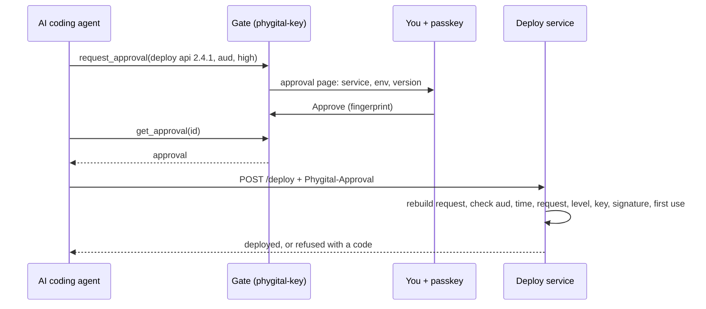
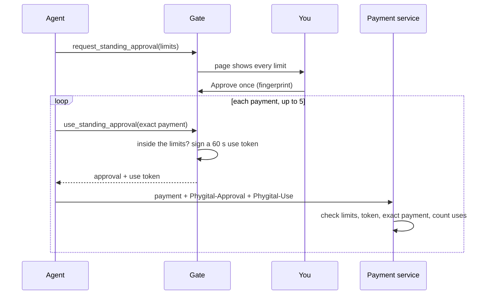
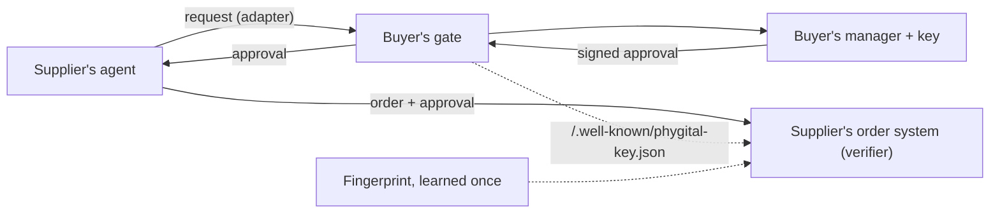

# Use cases

Ten concrete situations where a person's signed yes changes what can go wrong, each with the exact request, the audience, the level and what the service checks. It is for people deciding whether Phygital Key fits their job, and for developers planning a [verifier](glossary.md). Every scenario says what is built today (version 0.3.0) and what it would still need.

The examples use made-up names on reserved domains (`example.com`, `203.0.113.0/24`). None of them describes a real customer.

**On this page**

- [How to read each scenario](#how-to-read-each-scenario)
- [1. Production deploys from an AI coding agent](#1-production-deploys-from-an-ai-coding-agent)
- [2. Database deletes](#2-database-deletes)
- [3. Payments: one large payment, or many small ones within limits](#3-payments-one-large-payment-or-many-small-ones-within-limits)
- [4. Sending email or messages on your behalf](#4-sending-email-or-messages-on-your-behalf)
- [5. Changing infrastructure settings (DNS, firewall)](#5-changing-infrastructure-settings-dns-firewall)
- [6. Release signing in CI](#6-release-signing-in-ci)
- [7. Company to company: a supplier's AI asks a buyer to approve an order](#7-company-to-company-a-suppliers-ai-asks-a-buyer-to-approve-an-order)
- [8. Person to person: a written agreement approved by both sides](#8-person-to-person-a-written-agreement-approved-by-both-sides)
- [9. Person to system: unlocking a door or a device](#9-person-to-system-unlocking-a-door-or-a-device)
- [10. Admin actions on a home server](#10-admin-actions-on-a-home-server)
- [Built today and still needed, in one table](#built-today-and-still-needed-in-one-table)

## How to read each scenario

| Field | Meaning |
|---|---|
| **Request** | The exact `{"type", "params"}` the person approves. The service rebuilds it from its own data and compares it to the last character. |
| **Audience** (`aud`) | Who will act on the yes. The approval works there and nowhere else. |
| **Level** | `medium` is a touch on the key. `high` is fingerprint, face or PIN. The service decides the level for each action, never the agent. |
| **Kind** | One-time (one exact request, 60 seconds by default, once) or standing (one kind of action, fixed limits, a few uses, up to 30 days). See [standing approvals](standing-approvals.md). |
| **Status** | Built: works with 0.3.0 as shipped. Needs: what the scenario still requires. |

In every scenario the service runs the same checks, in this order, and stops at the first failure: well formed, audience, time, exact request, level, trusted key, signature, user presence (and verification for `high`), first use. The codes are in [error codes](error-codes.md).

## 1. Production deploys from an AI coding agent

**Situation.** An AI coding agent works in your repository. It can run tests on its own, but a deploy to production should happen only for the version you looked at. Without a check, a wrong instruction in a file the agent read (a prompt injection) or a plain mistake could ship the wrong build.

```json
{"type": "deploy", "params": {"service": "api", "env": "production", "version": "2.4.1"}}
```

| Audience | Level | Kind | Status |
|---|---|---|---|
| `https://deploy.example.com` | `high` | One-time | Built. Runnable version: [`examples/node-service/`](../examples/node-service/) |

**What you see.** The approval page lists `service`, `env` and `version` exactly as the gate built them, the audience, the level and the time left. You press Approve and use your fingerprint, face or PIN.

**What the service checks.** It builds `{"type": "deploy", "params": {...}}` from the deploy it is about to run, requires `high`, and refuses anything else. Approved `2.4.1` and asked to run `2.4.2`: `REQUEST_MISMATCH`. The same approval a second time: `REPLAYED`. An approval made for another service: `WRONG_AUDIENCE`.

**Without it.** The service sees a deploy call from a token the agent holds. It cannot tell whether a person agreed, or to which version.



## 2. Database deletes

**Situation.** An agent tidies a database. Reading is fine; deleting rows is not something you want to happen from a misread instruction.

```json
{"type": "delete_rows", "params": {"database": "shop", "table": "sessions", "older_than": "2026-01-01"}}
```

| Audience | Level | Kind | Status |
|---|---|---|---|
| `worker:db-maintenance` | `high` | One-time | Built. Runnable version: [`examples/rust-service/`](../examples/rust-service/) |

**What you see.** The database, the table and the cut-off date. Common invisible, direction-changing and mixed-script characters are highlighted, so a look-alike table name stands out.

**What the service checks.** The worker sets the level by job type (`delete_rows` needs `high`) and runs the job only if the approval covers this exact job. Approved `sessions`, asked to delete from `orders`: `REQUEST_MISMATCH`.

**Without it.** An agent that confuses two tables, or is told to by text it read, deletes data with no record of who agreed.

Keep the request to what the worker needs. The request is shown, logged by the gate's audit log as a hash, and readable by anyone holding the approval, so it must never carry a password or a connection string.

## 3. Payments: one large payment, or many small ones within limits

**Situation A, one large payment.** The agent prepared a supplier payment of 1,250.00 EUR. You want to approve this one payment, to this payee, for this amount.

```json
{"type": "payment", "params": {"to": "ACME Ltd", "iban_last4": "4821", "amount_cents": 125000, "currency": "EUR", "reference": "Invoice 118"}}
```

| Audience | Level | Kind | Status |
|---|---|---|---|
| `https://pay.example.com` | `high` | One-time | Built (the demo service has a fake `POST /payment`) |

Amounts are integers in minor units (`125000` cents) or strings. Floats are refused at the gate and by every verifier, because number formatting is where canonical forms break.

**Situation B, many small payments.** The agent reorders small parts from one supplier a few times a week. Approving each order would teach you to approve without reading. A standing approval lets you approve the limits once.

The agent calls `request_standing_approval` with:

```json
{"for_type": "payment", "fixed": {"to": "ACME Ltd", "currency": "EUR"}, "vary": {"amount_cents": {"min": 1, "max": 2000}}, "max_uses": 5, "days": 7, "aud": "https://pay.example.com"}
```

| Audience | Level | Kind | Status |
|---|---|---|---|
| `https://pay.example.com` | always `high` | Standing: 5 uses, 7 days | Built |

**What you see.** The page spells out the permission: payee and currency fixed, amount from 1 to 2000 cents, up to 5 times, until the end date. Later the page shows how many uses are spent. A short list of allowed strings also works as a limit, for example `"memo": {"one_of": ["bolts", "nuts"]}`.


**What the service checks.** Each payment arrives with two headers: `Phygital-Approval` (your standing approval) and `Phygital-Use` (a use token the gate signs for this one payment, valid at most 60 seconds). The service checks your signature on the limits, the use token, that the payment it is about to make is exactly the one in the token, that `to` and `currency` are the fixed values and `amount_cents` is inside its range, and counts uses itself. Over the limit or another payee: `NOT_ALLOWED`. A sixth payment: `USED_UP`. After you revoke and sign the revocation: `REVOKED`.



> [!WARNING]
> Revoking has two steps. The gate stops new uses at once. The service refuses the standing approval only after you sign the revocation and the service fetches the list from `/.well-known/phygital-key-revoked.json`. Until then, use tokens already handed out still work for up to 60 seconds. See [revocations](revocations.md).

**Without it.** A card or API key with a spending limit says nothing about who agreed to which payment. A prompt-injected agent pays within the limit, to anyone.

Real payments also need what a payment network asks for (AP2 `mandate.payment.1` fields, for example). Phygital Key proves the person's yes; it does not settle payments. See [AP2](ap2.md).

## 4. Sending email or messages on your behalf

**Situation.** An agent drafts replies. You want each message to go out only after you saw its exact recipient and text.

```json
{"type": "send_message", "params": {"to": "sam@example.com", "subject": "Thursday", "text": "Yes, 10:00 works. See you then."}}
```

| Audience | Level | Kind | Status |
|---|---|---|---|
| `https://mail.example.com` | `medium` | One-time | Built (the demo service has a fake `POST /send_message` at `medium`) |

**What you see.** Recipient, subject and the full text. Nothing is cut short. A touch on your key is enough at `medium`.

**What the service checks.** The mail service builds the request from the message it is about to send. A changed recipient or one changed word in the text: `REQUEST_MISMATCH`.

**Without it.** The agent sends whatever it ends up writing, to whoever it ends up choosing, and the mail service cannot tell.

The message text is in the approval in plain form. It is signed, not encrypted: the gate, the service and anyone holding the approval can read it. That is the same text the mail service is about to send, so nothing new is exposed, but keep secrets out.

For regular messages to one person, a standing approval with a fixed `to` and a `one_of` list of short texts works too. Free text cannot be a standing limit: `vary` accepts integer ranges and short string lists only.

## 5. Changing infrastructure settings (DNS, firewall)

**Situation.** An agent manages a few servers. A DNS record pointing at the wrong address, or a firewall rule opening SSH to the world, is quick to make and hard to notice.

```json
{"type": "dns_change", "params": {"zone": "example.com", "name": "www", "record": "A", "value": "203.0.113.10", "ttl": 300}}
```

```json
{"type": "firewall_rule", "params": {"host": "web-1", "action": "allow", "port": 22, "from": "198.51.100.0/24"}}
```

| Audience | Level | Kind | Status |
|---|---|---|---|
| `https://infra.example.com` | `high` | One-time | Built, if your DNS or firewall tool checks the approval. Needs: a small wrapper in front of the provider's API |

**What you see.** Every field, so `from: 0.0.0.0/0` stands out as plainly as `198.51.100.0/24`.

**What the service checks.** A wrapper you run (a few lines with the [Rust](verifier-rust.md) or [JavaScript](verifier-js.md) checker, or a call to `phygital-key verify`) holds the provider's API key, checks the approval, then makes the call. The agent never holds the provider's key.

**Without it.** The agent holds the provider's API key and can make any change the key allows.

## 6. Release signing in CI

**Situation.** A CI job publishes a release. You want it to publish only the commit and version a person approved, even if someone can start the workflow.

```json
{"type": "deploy", "params": {"repo": "example/repo", "commit": "3f2c9a1e8b7d6c5f4a3b2c1d0e9f8a7b6c5d4e3f", "env": "production", "version": "2.4.1"}}
```

| Audience | Level | Kind | Status |
|---|---|---|---|
| `https://github.com/example/repo/deploy/production` | `high` | One-time | Built: the job checks an approval passed in as an input. Needs: a ready-made step that waits for the approval |

**What you see.** The repository, the full commit SHA, the environment and the version.

**What the service checks.** The CI job is the verifier. It builds the request from its own inputs, checks the keyring's signed history against the pinned fingerprint, then runs `phygital-key verify` with `--level high`. A non-zero exit stops the job before the publish step. The runnable workflow is in [`examples/ci-approval/`](../examples/ci-approval/).

**Without it.** Anyone who can start the workflow can publish any commit.

Today the approval reaches the job as an input: the person (or their agent) gets it from the gate, then starts the workflow. A job that waits by itself would call `request_approval` and `get_approval` on a gate it can reach (`phygital-key serve` behind HTTPS, with the MCP token as a CI secret). The MCP tools allow that now, but no ready-made CI step exists. A fresh CI runner also starts with an empty used-approvals file, so the README explains how to stop a replay across runs.

## 7. Company to company: a supplier's AI asks a buyer to approve an order

**Situation.** A supplier's ordering agent proposes a restock order. The buyer's purchasing manager approves it with their own key. The supplier's order system acts only on a yes it can check against the buyer's published keys.

```json
{"type": "purchase_order", "params": {"buyer": "Buyer Co", "supplier": "Supplier Ltd", "po": "PO-2026-0412", "items": [{"sku": "BOLT-M8", "qty": 2000}, {"sku": "NUT-M8", "qty": 2000}], "total_cents": 48000, "currency": "EUR", "deliver_by": "2026-11-02"}}
```

| Audience | Level | Kind | Status |
|---|---|---|---|
| `https://orders.supplier.example` | `high` | One-time | Built: the format, the checker and key sharing. Needs: an adapter other than MCP, so an outside party can send a request without an MCP token |

**How the keys travel.** The buyer's gate publishes its keyring with the signed history at `<gate origin>/.well-known/phygital-key.json`. The supplier learns the buyer's first-key [fingerprint](glossary.md) once, outside the web (on a call, in the contract). The supplier's system fetches the keyring, checks it, and keeps the copy it accepted. Each later fetch must extend that copy, so an old copy or a key the buyer removed cannot come back:

```bash
phygital-key keys --check <fingerprint> --file new.json --signed-on https://approve.buyer.example --previous accepted.json
```



**What the supplier checks.** Audience is its own order system, the order it is about to book matches the approval exactly, level `high`, and the key that signed is in the buyer's checked keyring. A key the buyer's website lists without a signature from a key trusted at that point fails the history check, so whoever controls the website cannot add a key.

**Without it.** The supplier has an email or a portal click from someone at the buyer. Neither proves which person agreed to which lines.

Today the gate takes requests only through MCP: the supplier's agent would need the buyer's MCP token, or the buyer's own agent would relay the request. An HTTP or email adapter is on the [roadmap](roadmap.md), not built.

## 8. Person to person: a written agreement approved by both sides

**Situation.** Two people agree on a flat rental. Each wants proof that the other approved the same document.

Both approve the same request, one after the other, each with their own gate and key:

```json
{"type": "sign_document", "params": {"title": "Lease, Flat 3, 12 Example Street", "sha256": "<base64url SHA-256 of the agreed PDF>", "parties": ["Ana Example", "Ben Example"]}}
```

| Audience | Level | Kind | Status |
|---|---|---|---|
| Each side's own id for the other, e.g. `person:ben` on Ana's approval | `high` | Two one-time approvals | Built: two separate approvals. Not built: one approval carrying 2 of 2 or 2 of 3 signatures |

The `sha256` is the hash of the agreed PDF, so the request stays small and the document itself is not in the approval. Each side checks the other's approval with the other's keyring.

**Check it at once.** An approval lives 60 seconds by default (300 at most), and `verify` refuses it after that (`EXPIRED`). The other side should check it right away and keep it. To check a kept approval again later, the Rust library's `check` function (JavaScript: `checkKind`, with its last argument `standing` set to `false`) runs every check except the replay check and takes `now` as a parameter: pass the approval's own `iat` to check it as of the moment it was signed. That is how key histories are checked too. The `phygital-key verify` command always uses the current time.

**Not built: several signatures in one approval.** The format already has a `signatures` list, but version 0.3.0 requires exactly one signature. "2 of 3 approvers" needs no format change, and it is listed under [maybe later](roadmap.md).

**Without it.** A typed name or a ticked box in an email, which neither side can check against a key.

## 9. Person to system: unlocking a door or a device

**Situation.** A door controller, a safe or a lab instrument should open only when a known person approves, and must keep working without the internet.

```json
{"type": "unlock", "params": {"device": "door-lab-2", "for_seconds": 10}}
```

| Audience | Level | Kind | Status |
|---|---|---|---|
| `device:door-lab-2` | `high` | One-time | Built: the device as an offline verifier with a keyring file. Needs: a way for the device to send the request and receive the approval (for example a QR code), and a clock within 30 seconds |

**How it works.** The device is the verifier. It holds a keyring file (public keys only) and runs the Rust or JavaScript checker, which needs no network: no call home, no account. It keeps used approval ids so each one opens the door once.

**What the device checks.** Its own audience (`device:door-lab-2`), the exact request, `high`, a trusted key, the signature, and first use. Its clock must be right: an approval issued more than 30 seconds in the future, or past its end, is `EXPIRED`.

**Still needed.** The request has to reach the person's gate and the approval has to reach the device. Today that means the device (or a small helper next to it) is an MCP client of a gate it can reach on the local network. A QR code shown on the device, scanned by the person's phone, is an adapter that is not built.

**Without it.** A shared PIN code or a card that anyone holding it can use.

## 10. Admin actions on a home server

**Situation.** You run a home server (files, photos, a media library) and let an AI agent help maintain it. You want routine reads to happen freely, and actions like adding a user, opening a port or wiping a disk to wait for your fingerprint.

```json
{"type": "admin", "params": {"host": "nas", "action": "add_user", "user": "guest", "groups": ["media"]}}
```

| Audience | Level | Kind | Status |
|---|---|---|---|
| `admin:nas` | `high` | One-time | Built: the gate with the [secure install](secure-install.md), and `phygital-key verify`. Needs: the wrapper script and the rule that lets the agent run it |

**How it works.** The gate runs on the server with the secure install, as its own system user: the agent, even acting as you, cannot change the gate's program, read its data or write its keys. A small root-owned wrapper script runs each admin action only after `phygital-key verify` exits with 0 for the exact request it is about to run. It reads a root-owned copy of the keyring (from `phygital-key-admin keys`). The agent may run that one wrapper with raised rights (for example through one `sudoers` line for that script), never `sudo` in general, and cannot edit it.

**What the wrapper checks.** Audience `admin:nas`, the exact action, `high`, and first use (the command line remembers used approvals in `seen-ids.jsonl`).

**Without it.** The agent runs with your account's rights, and a password-less `sudo` gives it the administrator's power too.

> [!IMPORTANT]
> The secure install protects the gate only if your account needs a password for `sudo` and you install from a terminal you trust. See [secure install](secure-install.md).

## Built today and still needed, in one table

| Scenario | Built in 0.3.0 | Still needed |
|---|---|---|
| 1. Production deploy | Everything; runnable example | Nothing |
| 2. Database delete | Everything; runnable example | Nothing |
| 3. Payments | One-time and standing approvals, revocations, receipts | Payment network fields (AP2 export is not built, [decision 28](decisions.md)) |
| 4. Email and messages | Everything | Nothing |
| 5. DNS and firewall | Checker and CLI | A wrapper in front of the provider's API |
| 6. CI release | Workflow example with `phygital-key verify` | A ready-made step that waits for approval |
| 7. Company to company | Format, checker, published keyring with signed history | An adapter other than MCP |
| 8. Person to person | Two one-time approvals | Several signatures in one approval (2 of 3) |
| 9. Door or device | Offline checker with a keyring file | A request and approval path to the device (QR adapter) |
| 10. Home server | Secure install, `phygital-key verify` | The wrapper script and its `sudoers` rule |

## Next

- [Things to ask your AI](examples.md)
- [Check approvals in your service](integrate.md)
- [Runnable examples](../examples/README.md)
- [Roadmap](roadmap.md)
