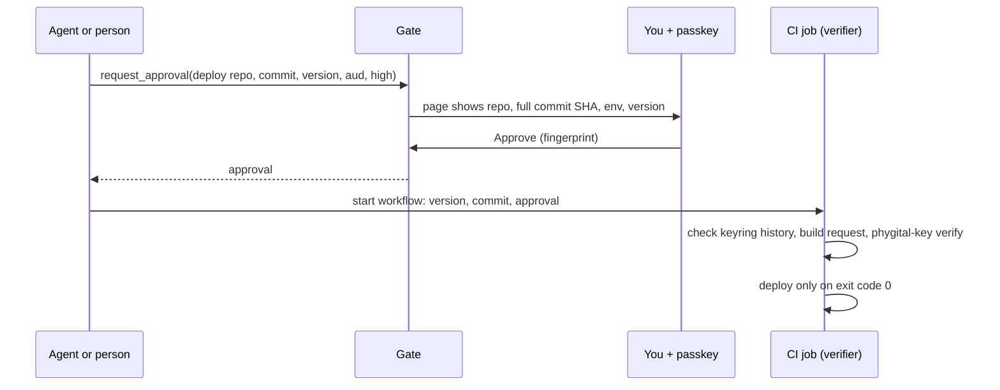

# CI example: deploy only with a person's approval

A GitHub Actions workflow, [`example-deploy.yml`](example-deploy.yml), whose deploy job is the [verifier](../../docs/glossary.md). It installs `phygital-key` with the install script (which checks the signed release list and the SHA-256), builds the deploy request from its own inputs, checks the keyring, checks the approval with `phygital-key verify`, and stops before deploying if anything is off. The file lives here, not in `.github/workflows`, so it never runs in this repository.

## The flow



The request the person approves, and the job rebuilds:

```json
{"type": "deploy", "params": {"repo": "example/repo", "commit": "<full 40-character SHA>", "env": "production", "version": "2.4.1"}}
```

with audience `https://github.com/<owner>/<repo>/deploy/production` and level `high`. Start the workflow within the approval's life (60 seconds by default), for example with `gh workflow run deploy.yml -f version=2.4.1 -f commit=<sha> -f approval=<approval>`.

## Set it up

1. Copy `example-deploy.yml` to `.github/workflows/deploy.yml` in your repository.
2. Set `GATE_ORIGIN` (your approval page origin, HTTPS) and `ROOT_FINGERPRINT` (your first key's fingerprint, shown on your gate's home page).
3. Commit your keyring as `.phygital-key/keyring.json` (`phygital-key keys > .phygital-key/keyring.json`; the fingerprint line goes to stderr, so the file is plain JSON). It holds public keys and the signed key history only.
4. Replace the last step's `echo` with your deploy.
5. Keep `PHYGITAL_KEY_VERSION` at `v0.3.0` or later: the install script refuses a release that has no signed release list.

## Where the keyring comes from

| Option | How | What stops a forged key |
|---|---|---|
| A file in the repository (this example) | `.phygital-key/keyring.json`, changed through reviewed pull requests | `phygital-key keys --check "$ROOT_FINGERPRINT" --file ... --signed-on "$GATE_ORIGIN"`: every key must trace back to the pinned first key through signed changes |
| Fetched from the gate | `curl -fsSL "$GATE_ORIGIN/.well-known/phygital-key.json" -o new.json`, then `phygital-key keys --check "$ROOT_FINGERPRINT" --file new.json --signed-on "$GATE_ORIGIN" --previous .phygital-key/keyring.json` | The same signed history, and `--previous`: the new copy must extend the one you accepted, so an old copy or a removed key cannot come back. Commit the new copy when it changes |

The keyring check runs from the workflow's own branch, before the job checks out the commit to deploy, so the deployed commit cannot bring its own keyring. Whoever can edit the workflow file can remove the checks: protect that file like the rest of your deploy setup.

> [!WARNING]
> A fresh runner starts with an empty used-approvals file, so `phygital-key verify` cannot see that an approval was used in an earlier run. Within the approval's life (60 seconds by default), starting the workflow twice with the same approval deploys the same commit and version twice. The `concurrency` group runs them one after the other. If a second deploy of the same build matters, record each approval id where you deploy and refuse a repeat, or keep the `--seen-file` on a machine every run shares.

Inputs reach the shell only through `env`, never pasted into the script, so an input cannot inject shell commands. The commit must be a full 40-character lowercase SHA.

## Try the check on your computer

The same commands the job runs, against a local `phygital-key demo` on port 7468 (no CI needed). Get an approval for the request above with audience `https://github.com/example/repo/deploy/production` and level `high`, then within 60 seconds:

```bash
export GATE_ORIGIN=http://localhost:7468 AUD=https://github.com/example/repo/deploy/production
export REPO=example/repo VERSION=2.4.1 COMMIT=<the sha you approved> APPROVAL='<approval>'
phygital-key keys --check <fingerprint> --file ~/.phygital-key/keyring.json --signed-on "$GATE_ORIGIN"
request="$(jq -cn --arg repo "$REPO" --arg commit "$COMMIT" --arg version "$VERSION" \
  '{type: "deploy", params: {repo: $repo, commit: $commit, env: "production", version: $version}}')"
phygital-key --home /tmp/ci-runner --origin "$GATE_ORIGIN" verify --approval "$APPROVAL" \
  --request "$request" --aud "$AUD" --level high --keyring ~/.phygital-key/keyring.json
```

A real run of the job's check step (gate on port 18600 with `--lifetime 300`, step script taken from the workflow file):

| Run | Output | Exit |
|---|---|---|
| Keyring check | `keyring ok: 1 keys, every change signed, starting from XS6i25TA3rSUzYZ6MpIvqpyb75rJsnHZiL4tg7egK0s` | 0 |
| `VERSION=2.4.2` (approved 2.4.1) | `{"error":"REQUEST_MISMATCH","ok":false}` | 1 |
| The approved deploy | `{"approved_by":"Test laptop","exp":1792275437,"id":"liL2H5FGCKh9tVDVMBwLPQ","level":"high","ok":true}` | 0 |
| Same approval, same runner | `{"error":"REPLAYED","ok":false}` | 1 |
| `COMMIT=3f2c9a1e` (short SHA) | `commit must be a full SHA` | 1 |
| Same approval, fresh runner (empty `--home`) | `{"approved_by":"Test laptop",...,"ok":true}` | 0, see the warning above |

## Next

- [Use case: release signing in CI](../../docs/use-cases.md#6-release-signing-in-ci)
- [Command line reference](../../docs/cli.md)
- [All examples](../README.md)
